# ClinicOS — Feature Specification & Development Roadmap

**Product**: ClinicOS (General OPD Clinic Management & Decision Support System)  
**Target Roles**: Receptionist, Doctor (General Physician), Cashier  
**Architecture**: React (Vite) Frontend + Modular State Management + Deterministic Clinical Rules Engine + MySQL 8.0 Relational Data Contract  
**Document Status**: Active Implementation Baseline (One Feature at a Time)

---

## 1. Product Vision & Development Strategy

ClinicOS is a streamlined, resilient Outpatient Department (OPD) clinic operating system designed to optimize patient throughput, eliminate transcription fatigue through speech recognition, ensure patient safety via deterministic clinical decision support (CDSS), and facilitate rapid cashless/out-of-pocket billing.

### Incremental Development Principle
Development proceeds **one feature at a time**. Each feature is self-contained with:
- UI Component & Interaction Specs
- Data Model & Schema Bindings (aligned with MySQL schema `mysql_schema.sql`)
- Business Logic & Validation Rules
- Acceptance Criteria Checklist (`[ ]`) for sign-off before proceeding to the next feature.

---

## 2. Feature Master Matrix & Execution Order

| Feature ID | Feature Name | Primary Role | Complexity | Status |
| :--- | :--- | :--- | :--- | :--- |
| **FEAT-01** | Patient Registration & Triage Vitals Capture | Receptionist | Medium | ⏳ Up Next |
| **FEAT-02** | Voice-Enabled Intake Questionnaire (Web Speech STT) | Receptionist | Medium | 📋 Planned |
| **FEAT-03** | External Diagnostic Reports Archival (DICOM, ECG, PDF) | Receptionist | Medium | 📋 Planned |
| **FEAT-04** | Live OPD Patient Queue & Token Roster Management | Receptionist | Low | 📋 Planned |
| **FEAT-05** | Longitudinal Medical History & Encounter Dossier | Doctor | Medium | 📋 Planned |
| **FEAT-06** | Diagnostic Viewer (Interactive DICOM, ECG Waveform, PDF) | Doctor | High | 📋 Planned |
| **FEAT-07** | Deterministic Clinical Safety & Rules Engine | Doctor | High | 📋 Planned |
| **FEAT-08** | Formulary E-Prescription Writer & Clinical Sign-off | Doctor | High | 📋 Planned |
| **FEAT-09** | Auto-Aggregated Itemized Billing Ledger | Cashier | Medium | 📋 Planned |
| **FEAT-10** | Cashless Insurance & Copay Approval Workflow | Cashier | Medium | 📋 Planned |
| **FEAT-11** | Multi-Mode Payment Settlement (Cash, UPI QR, Card) | Cashier | Medium | 📋 Planned |
| **FEAT-12** | Official Clinic Receipt & Visit Encounter Closure | Cashier | Medium | 📋 Planned |
| **FEAT-13** | Unified Persistent State & Role Switching Simulator | System-wide | Medium | 📋 Planned |

---

## 3. Detailed Feature Specifications

---

### FEAT-01: Patient Registration & Triage Vitals Capture
- **Primary Actor**: Receptionist
- **User Story**: *As a Receptionist, I want to register walk-in or returning patients and record their triage vital signs, so that the patient has an active encounter token and the doctor immediately receives baseline biometrics.*

#### 1. UI / UX Design
- **Trigger**: Click `+ New Patient Registration` button in Navbar or Queue header.
- **Modal Component**: `PatientRegistrationModal.jsx`.
- **Form Layout (Two-Column Tabbed / Sectioned Flow)**:
  1. **Demographic Section**:
     - Full Name (`VARCHAR(100)`), DOB (`DATE`) with auto-age calculation, Gender (`M`, `F`, `O`).
     - Phone Number (`VARCHAR(20)`) with quick duplicate lookup.
     - Address (`VARCHAR(255)`), Emergency Contact Name & Phone (`VARCHAR(50)`).
     - ABHA (Ayushman Bharat Health Account) ID & verification simulation badge.
  2. **Triage Vitals Section**:
     - Weight (`kg`, e.g., 68.5) and Height (`cm`, e.g., 172.0).
     - **Auto-Calculated BMI**: $\text{BMI} = \frac{\text{Weight (kg)}}{(\text{Height (m)})^2}$. Displays real-time category badge:
       - `< 18.5`: Underweight (Sky Blue)
       - `18.5 - 24.9`: Normal Weight (Emerald Green)
       - `25.0 - 29.9`: Overweight (Amber)
       - `≥ 30.0`: Obese (Crimson Red)
     - Blood Pressure (`mmHg`, format `Systolic / Diastolic`, e.g., `120/80` or `145/92`).
     - Pulse Rate (`bpm`, e.g., `78`).
     - Body Temperature (`°F`, e.g., `98.6`).
     - Oxygen Saturation (`SpO2 %`, e.g., `98`).
     - Respiratory Rate (`breaths/min`, e.g., `16`).
  3. **Insurance / Payment Scheme Category**:
     - Type: `Cash Pay` | `Private Insurance` | `Govt Scheme` (Ayushman Bharat / PMJAY / CGHS).
     - Provider, Policy Number, Coverage %, Deductible amount.

#### 2. Data Bindings
- Writes to `patients` table (demographics) & `visits` table (queue token `Q-xxx`, status `TRIAGED`).
- Writes to `vital_signs` table with foreign key `visit_id`.

#### 3. Acceptance Criteria
- [ ] Name, Phone, and Gender are required fields; submission blocked if invalid.
- [ ] BMI dynamically updates as soon as height or weight input changes.
- [ ] Quick preset button ("Fill Normal Vitals") for rapid receptionist triage during peak hours.
- [ ] Voice mic button on textarea fields allows hands-free data capture.
- [ ] On submit: generates unique UHID (`UHID-YYYY-XXXXX`), assigns next queue token (`Q-104`), and launches FEAT-02 (Voice Intake) or returns to queue with toast alert.

---

### FEAT-02: Voice-Enabled Intake Questionnaire (Web Speech STT)
- **Primary Actor**: Receptionist (assisting patient)
- **User Story**: *As a Receptionist, I want to conduct a rapid symptom intake using voice-to-text dictation and structured chips, so that chief complaints and duration are captured without keyboard typing.*

#### 1. UI / UX Design
- **Component**: `QuestionnaireModal.jsx`.
- **Speech-to-Text Integration**:
  - Web Speech API (`webkitSpeechRecognition` / `SpeechRecognition`) with pulsing microphone indicator (`SpeechMicButton.jsx`).
  - Real-time live transcript preview in textarea with interim results.
  - Fallback simulated transcript toggle if browser microphone permission is denied or running headless.
- **Structured Sections (Guided 4-Step Stepper)**:
  1. **Chief Complaint & Onset**:
     - Quick chips: *Acute Fever & Chills*, *Persistent Dry Cough*, *Severe Migraine / Headache*, *Abdominal Cramps*, *Chest Discomfort / Palpitations*, *Joint Pain & Stiffness*.
     - Duration selector: `< 24 Hours`, `2 - 3 Days`, `1 - 2 Weeks`, `1 - 3 Months`, `Chronic (> 6 Months)`.
     - Severity rating: 1 to 10 visual scale with color gradient (Green 1-3, Amber 4-6, Red 7-10).
  2. **Associated Symptoms**: Multi-select pills (Nausea, Shortness of breath, Dizziness, Fatigue, Loss of appetite, Rash).
  3. **Known Drug Allergies**:
     - Checkbox: *No Known Drug Allergies (NKDA)*.
     - Multi-select flags: *Penicillin*, *Sulfa Drugs*, *NSAIDs / Aspirin*, *Cephalosporins*, *Paracetamol*, *Other (free-text)*.
  4. **Onset Notes & Voice Summary**:
     - Full transcript box with voice dictation and auto-extracted complaint chips.

#### 2. Data Bindings
- Writes to `intake_questionnaires` table (`primary_symptom`, `duration_days`, `severity_scale`, `known_allergies`, `transcript_text`, `voice_audio_url`).

#### 3. Acceptance Criteria
- [ ] Microphone button activates browser speech recognition and streams text live into the active field.
- [ ] Selecting *NKDA* unchecks other allergy chips; selecting a specific allergy unchecks *NKDA*.
- [ ] Questionnaire response is linked to the active `visit_id`.
- [ ] Progress indicator clearly displays Step 1 of 4 through Step 4 of 4.
- [ ] Submitting updates patient queue status to `INTAKE_COMPLETED` with an audible confirmation and visual badge.

---

### FEAT-03: External Diagnostic Reports Archival (DICOM, ECG, PDF)
- **Primary Actor**: Receptionist
- **User Story**: *As a Receptionist, I want to upload and archive the patient's existing external test reports (DICOM scans, ECG traces, Bloodwork PDFs), so that the Doctor can inspect them immediately during consultation.*

#### 1. UI / UX Design
- **Component**: `ExternalReportsModal.jsx` (accessible from Registration, Queue actions, or Details Drawer).
- **File Upload Dropzone**:
  - Drag-and-drop or file picker supporting:
    - DICOM medical imaging (`.dcm`, `.zip`)
    - 12-Lead ECG waveform traces (`.pdf`, `.png`, `.jpg`)
    - Laboratory Diagnostic Bloodwork (`.pdf`)
  - File metadata fields:
    - Report Type (`DICOM_IMAGE`, `ECG_TRACE`, `LAB_PATHOLOGY`, `ULTRASOUND`, `XRAY`)
    - Modality description (e.g. *Chest X-Ray PA View*, *12-Lead Resting ECG*, *Complete Blood Count*)
    - Facility / Lab Name (e.g. *Apollo Diagnostics*, *City Scan Centre*)
    - Study Date (`DATE`)
    - Findings summary (optional receptionist notes)
- **Report Attachment List**:
  - Thumbnails for images, PDF badge for documents, DICOM stack icon for scans.
  - File size display (`MB`), delete/remove action, preview trigger.

#### 2. Data Bindings
- Writes to `external_reports` table (`visit_id`, `patient_id`, `report_type`, `modality`, `file_path`, `file_size_mb`, `findings_summary`).

#### 3. Acceptance Criteria
- [ ] Multiple files can be attached per visit encounter.
- [ ] Uploaded reports display a counter badge on the patient's queue card (`📄 2 Reports`).
- [ ] Validation ensures file type is supported and size is within limits (≤ 50MB per file).
- [ ] Reports persist in the patient's visit session and are immediately accessible in the Doctor's diagnostic workspace.

---

### FEAT-04: Live OPD Patient Queue & Token Roster Management
- **Primary Actor**: Receptionist & Doctor
- **User Story**: *As a Receptionist/Doctor, I want to view a real-time queue of today's patient tokens, so that clinical intake and consultation order are systematically managed.*

#### 1. UI / UX Design
- **Component**: `PatientQueue.jsx`.
- **Queue Views & Filters**:
  - Filter Tabs: `All Patients`, `Waiting for Triage`, `Ready for Doctor`, `In Consultation`, `Billing Pending`, `Completed`.
  - Search bar: Real-time search across UHID, Patient Full Name, and Phone Number.
- **Patient Token Card**:
  - Prominent Token Pill: `#Q-101`, `#Q-102` (Gold for Waiting, Cyan for Ready, Purple for In Consultation, Emerald for Done).
  - Patient Name, Age, Gender, Blood Group, Doctor Assigned.
  - Vitals Summary Chips: BP `138/88`, Pulse `82`, Temp `98.4°F`, SpO2 `98%`.
  - Chief Complaint badge and Report indicator.
  - Action Dropdown: *Start Voice Intake*, *Upload Reports*, *Call to Doctor's Cabin*, *View Dossier*.

#### 2. Data Bindings
- Reads and updates `visits.status` (`REG`, `TRIAGED`, `IN_CONSULTATION`, `READY_FOR_BILLING`, `COMPLETED`).

#### 3. Acceptance Criteria
- [ ] Search responds instantly with zero layout shifts.
- [ ] Status updates transition patients across filter tabs seamlessly.
- [ ] Queue count badges update automatically in the stats summary header (`14 Total`, `5 Waiting`, `3 with Doctor`).
- [ ] Clicking a patient card opens their comprehensive details drawer or switches to consultation.

---

### FEAT-05: Longitudinal Medical History & Encounter Dossier
- **Primary Actor**: Doctor
- **User Story**: *As a Doctor, I want to review the patient's past clinic visits, longitudinal vitals trend, and past consultation conclusions, so that I have complete historical context before prescribing.*

#### 1. UI / UX Design
- **Component**: `DoctorPage.jsx` (Tab: `History & Dossier`).
- **Workspace Layout**:
  - **Left Sub-Panel**: Patient Demographics card, Emergency contacts, Blood group, Known Allergies warning banner.
  - **Center Sub-Panel**: Chronological Visit Timeline:
    - Previous Visit Date & Attending Physician.
    - Chief complaint on record.
    - Prior vital signs with delta indicator ($\uparrow$ BP, $\downarrow$ Weight).
    - Previous prescribed medication history (e.g. *Tab Telmisartan 40mg od for 30 days*).
    - Previous signed doctor conclusion notes.
  - **Right Sub-Panel**: Current Encounter Summary:
    - Today's Triage Vitals compared with normal baselines.
    - Voice Intake Transcript and extracted symptoms.

#### 2. Data Bindings
- Queries `patients` joined with historical `visits`, `vital_signs`, `prescriptions`, and `intake_questionnaires`.

#### 3. Acceptance Criteria
- [ ] Allergy warning is highlighted prominently in red/amber if patient has documented drug allergies.
- [ ] Past visits can be expanded or collapsed to inspect previous treatment notes.
- [ ] Vital trends show visual comparisons (e.g., Previous BP 142/90 vs Current BP 130/84).

---

### FEAT-06: Diagnostic Viewer (Interactive DICOM, ECG Waveform, PDF)
- **Primary Actor**: Doctor
- **User Story**: *As a Doctor, I want an in-browser diagnostic viewer to inspect DICOM cross-sections, 12-lead ECG traces, and lab PDFs, so that I do not need third-party viewer software.*

#### 1. UI / UX Design
- **Component**: `DoctorPage.jsx` (Tab: `Diagnostic Viewer`) & `DicomModal.jsx`.
- **Viewer Capabilities**:
  1. **DICOM Series Viewer**:
     - Interactive multi-slice viewport (e.g. 148 CT/MRI slices).
     - Slider & mouse wheel scrolling between slices.
     - Window Level / Width Presets:
       - *Lung* (WW: 1500, WL: -600)
       - *Mediastinum / Soft Tissue* (WW: 350, WL: 40)
       - *Bone* (WW: 2000, WL: 350)
       - *Brain* (WW: 80, WL: 40)
     - Tools: Zoom (50% - 200%), Pan, Invert Contrast, Measure Distance (caliper overlay).
     - Slice metadata overlay: Patient UHID, Slice thickness (2.5mm), KVP/mA, Series date.
  2. **12-Lead ECG Waveform Viewer**:
     - Standard 25mm/s, 10mm/mV grid background (pink/amber graph paper).
     - Multi-lead view (I, II, III, aVR, aVL, aVF, V1-V6).
     - Heart rate and PR/QT interval auto-tagging.
  3. **Pathology PDF Document Viewer**:
     - Clean embedded document canvas with zoom and page controls.

#### 2. Data Bindings
- Reads from `external_reports` attached to current `visit_id`.

#### 3. Acceptance Criteria
- [ ] Smooth slice scrolling with no lag.
- [ ] Preset buttons instantaneously adjust contrast and brightness mapping.
- [ ] Fullscreen inspection modal with Esc key dismissal.
- [ ] Doctor can attach an annotation or conclusion remark directly referencing a diagnostic study.

---

### FEAT-07: Deterministic Clinical Safety & Rules Engine
- **Primary Actor**: Doctor (System Decision Support Service)
- **User Story**: *As a Doctor, I want deterministic rule-based safety alerts based on objective vitals thresholds and allergy contraindications, so that critical clinical risks are never overlooked.*

#### 1. Clinical Rule Specifications (Deterministic Logic)
No black-box or non-deterministic hallucinations; purely verified clinical guidelines:

1. **Hypertension Rules (AHA/ACC 2017 Guidelines)**:
   - If Systolic BP $\ge 180$ OR Diastolic BP $\ge 120$: **CRITICAL ALERT** — *Hypertensive Urgency / Crisis. Immediate stabilization required.*
   - If Systolic BP $140 - 179$ OR Diastolic BP $90 - 119$: **WARNING** — *Stage 2 Hypertension detected. Antihypertensive therapy indicated.*
   - If Systolic BP $130 - 139$ OR Diastolic BP $80 - 89$: **WARNING** — *Stage 1 Hypertension detected. Lifestyle and pharmacotherapy review.*
   - If Systolic BP $120 - 129$ AND Diastolic BP $< 80$: **INFO** — *Elevated Blood Pressure.*

2. **Hypoxemia & Respiratory Rules**:
   - If $\text{SpO}_2 < 90\%$: **CRITICAL ALERT** — *Severe Hypoxemia. Administer supplemental $\text{O}_2$ immediately.*
   - If $\text{SpO}_2$ between $90\% - 94\%$: **WARNING** — *Mild to Moderate Hypoxemia. Monitor closely.*
   - If Respiratory Rate $> 24$ bpm: **WARNING** — *Tachypnea detected.*

3. **Cardiac Tachycardia / Bradycardia**:
   - If Pulse Rate $> 100$ bpm: **WARNING** — *Sinus Tachycardia.*
   - If Pulse Rate $< 50$ bpm: **WARNING** — *Sinus Bradycardia.*

4. **Pyrexia / Fever**:
   - If Temperature $\ge 101.5^\circ\text{F}$: **WARNING** — *High-grade Pyrexia. Antipyretic & infectious workup recommended.*
   - If Temperature between $99.5^\circ\text{F} - 101.4^\circ\text{F}$: **INFO** — *Low-grade Fever.*

5. **Drug Allergy Contraindication Screening**:
   - Cross-references patient `intake_questionnaires.known_allergies` against the active prescription items:
     - Example: Patient allergic to *Penicillin* + Doctor prescribes *Amoxicillin* $\rightarrow$ **CRITICAL SAFETY BLOCK** — *Severe Penicillin Cross-Allergy Detected!*
     - Example: Patient allergic to *Aspirin / NSAIDs* + Doctor prescribes *Ibuprofen* $\rightarrow$ **CRITICAL SAFETY BLOCK** — *NSAID Cross-Reactivity Risk!*

#### 2. UI / UX Design
- **Component**: `DoctorPage.jsx` (Tab: `Clinical Insights & Safety`).
- Visual Insight Cards with Severity Tag (`CRITICAL` in Red, `WARNING` in Amber, `INFO` in Blue).
- Clear Rationale: Shows rule triggered, observed parameter, standard threshold, and recommended clinical action.
- **Review & Override Workflow**:
  - Doctor checkbox: `Reviewed and Verified`.
  - Override Notes textarea: required if dismissing a `CRITICAL` alert.
  - Digital Sign-off: "Sign Clinical Decision" records Doctor User ID and Timestamp.

#### 3. Data Bindings
- Writes to `deterministic_insights` table (`rule_code`, `severity_level`, `title`, `description`, `recommendation`, `is_signed`, `doctor_override_notes`).

#### 4. Acceptance Criteria
- [ ] Evaluation runs automatically whenever patient vitals or prescription items change.
- [ ] Rules fire with 100% deterministic reproducibility.
- [ ] Critical contraindication banners prevent accidental finalizing of conflicting prescriptions without explicit acknowledgment.
- [ ] Signed insights cannot be modified after encounter sign-off.

---

### FEAT-08: Formulary E-Prescription Writer & Clinical Sign-off
- **Primary Actor**: Doctor
- **User Story**: *As a Doctor, I want a fast, search-enabled prescription writer backed by an approved OPD drug formulary, so that I can issue clear, error-free e-prescriptions with conclusion notes.*

#### 1. UI / UX Design
- **Component**: `DoctorPage.jsx` (Tab: `E-Prescription & Conclusion`).
- **Formulary Drug Picker**:
  - Searchable autocomplete from `drug_formulary` master (e.g. *Paracetamol 650mg*, *Amoxicillin 625mg*, *Pantoprazole 40mg*, *Metformin 500mg*, *Amlodipine 5mg*, *Azithromycin 500mg*, *Cetirizine 10mg*).
  - Quick-preset buttons for common clinical scenarios (*URI / Common Cold Regimen*, *Hypertension Initiation*, *Acute Gastritis*).
- **Rx Item Parameters**:
  - Dosage Strength (e.g. `650 mg`, `500 mg`, `5 ml`)
  - Form: `Tablet`, `Capsule`, `Syrup`, `Ointment`, `Inhaler`, `Injection`
  - Frequency shorthand: `1-0-1` (Morning & Night), `1-0-0` (Morning), `0-0-1` (Night), `1-1-1` (Thrice daily), `SOS` (As needed)
  - Duration: `3 Days`, `5 Days`, `7 Days`, `14 Days`, `30 Days`
  - Timing: `After Meals`, `Before Meals`, `With Water`, `At Bedtime`
  - Special Instructions / Warnings: e.g. *Complete full 5-day course*.
- **Clinical Conclusion & Follow-up**:
  - Final Clinical Diagnosis / Conclusion notes (voice-enabled dictation).
  - Follow-up date picker (e.g. *Return in 7 days*).
- **Finalize & Sign Encounter Action**:
  - "Finalize & Sign E-Prescription" button:
    - Locks clinical notes.
    - Transitions visit token status to `READY_FOR_BILLING`.
    - Automatically forwards service items & medicines to the Cashier Desk.

#### 2. Data Bindings
- Writes to `prescriptions` and `prescription_items` tables.
- Updates `visits.conclusion_notes`, `visits.conclusion_signed_at`, and `visits.status = 'READY_FOR_BILLING'`.

#### 3. Acceptance Criteria
- [ ] Formulary search returns brand and generic names with dosage forms.
- [ ] Items can be reordered, edited inline, or deleted prior to signing.
- [ ] Allergy safety checks run live during prescription assembly.
- [ ] Once signed, patient token changes status to `READY_FOR_BILLING` and appears in the Cashier's pending queue.

---

### FEAT-09: Auto-Aggregated Itemized Billing Ledger
- **Primary Actor**: Cashier
- **User Story**: *As a Cashier, I want the system to automatically assemble consultation fees, diagnostic procedures, and prescribed medications into an itemized bill, so that manual data re-entry is eliminated.*

#### 1. UI / UX Design
- **Component**: `CashierPage.jsx` (Left Column & Center Ledger).
- **Pending Bill Queue**:
  - Lists patients with status `READY_FOR_BILLING`.
  - Displays Token #, Patient UHID, Attending Doctor, and Total Items.
- **Itemized Ledger Categories**:
  1. **Doctor Consultation**: Standard OPD Specialist Fee (e.g., ₹500 or ₹1,000).
  2. **Diagnostic Procedures & Scans**: Derived from uploaded external tests / ordered investigations (e.g., *Chest CT Scan: ₹6,800*, *ECG Trace: ₹350*, *Biomarker Lab Panel: ₹2,400*).
  3. **Pharmacy Medications**: Derived directly from the signed E-Prescription (Units $\times$ Formulary Unit Price + Applicable GST).
- **Editable Line Items**:
  - Cashier can adjust quantities or add clinic consumables (e.g. *Dressing Kit*, *Injection administration charge*).
  - Subtotals auto-recalculate: Gross Amount = $\sum \text{Item Total}$.

#### 2. Data Bindings
- Writes to `bills` (`visit_id`, `cashier_id`, `gross_amount`, `discount_amount`, `net_amount`, `payment_status`).
- Writes to `bill_items` (`bill_id`, `service_code`, `description`, `unit_price`, `quantity`, `total_price`).

#### 3. Acceptance Criteria
- [ ] Selecting a patient immediately populates their full itemized ledger from the doctor's visit data.
- [ ] Item totals update dynamically upon quantity modifications.
- [ ] Subtotal, taxes, and gross amount are calculated with two-decimal precision.

---

### FEAT-10: Cashless Insurance & Copay Approval Workflow
- **Primary Actor**: Cashier
- **User Story**: *As a Cashier, I want to verify the patient's insurance policy, apply policy discounts, and calculate the cashless approval vs patient copay balance, so that third-party claims are transparently handled.*

#### 1. UI / UX Design
- **Component**: `CashierPage.jsx` (Insurance Claim Drawer / Section).
- **Insurance Scheme Verifier**:
  - Displays Policy Provider (Star Health, HDFC Ergo, Care Insurance, PMJAY, CGHS).
  - Policy / TPA Card Number, Pre-Authorization reference code.
- **Financial Split Computation**:
  - **Gross Bill Amount**: $G$
  - **Approved Coverage Percentage**: $C\%$ (e.g., 80% or 100%)
  - **Policy Deductible**: $D$ (if applicable)
  - **Insurance Covered Amount**: $\min(G - D, G \times \frac{C}{100})$
  - **Patient Copay Due**: $\text{Gross Amount} - \text{Insurance Covered} - \text{Discount}$
- **Claim Status**: `VERIFIED & APPROVED` badge with simulated claim auth token (`AUTH-TPA-99201`).

#### 2. Data Bindings
- Updates `bills.insurance_covered`, `bills.discount_amount`, and recalculates `bills.net_amount`.

#### 3. Acceptance Criteria
- [ ] "Cash / Self-Pay" selection zeroes out insurance deductions and sets patient liability to 100%.
- [ ] Insurance claim breakdown is clearly displayed to the cashier before tender.
- [ ] Approved claim token is printed on the official receipt.

---

### FEAT-11: Multi-Mode Payment Settlement (Cash, UPI QR, Card)
- **Primary Actor**: Cashier
- **User Story**: *As a Cashier, I want to accept multi-mode payment tenders (UPI with interactive dynamic QR, Card POS, or Cash with change calculation), so that checkout is rapid and reconciled.*

#### 1. UI / UX Design
- **Component**: `CashierPage.jsx` (Payment Tender Panel).
- **Payment Method Selectors**:
  1. **UPI / Instant QR**:
     - Displays dynamic SVG QR code encoded with: `upi://pay?pa=clinicos@icici&pn=ClinicOS&am={amount}&cu=INR`.
     - Displays countdown timer (3:00 mins) and "Simulate Scan & Pay" confirmation button for testing.
  2. **Credit / Debit Card (POS)**:
     - Card terminal reference number, card network icons (Visa, Mastercard, RuPay), Last 4 digits.
  3. **Cash**:
     - Total Due display.
     - Cash Tendered input (e.g. ₹2,000 on a ₹1,750 bill).
     - **Change Due calculation**: Auto-displays exact return change (₹250).
- **Split Payment Option**: Allows partial Cash + partial UPI if requested.

#### 2. Data Bindings
- Writes to `payments` table (`bill_id`, `payment_mode`, `transaction_ref`, `amount_paid`, `payment_status = 'SUCCESS'`, `payment_time`).
- Updates `bills.payment_status = 'PAID'`.

#### 3. Acceptance Criteria
- [ ] Payment cannot be confirmed if amount tendered is less than the net amount due.
- [ ] Successful authorization triggers transaction reference generation (`TXN-UPI-88412`).
- [ ] Sound/visual notification confirms payment capture.

---

### FEAT-12: Official Clinic Receipt & Visit Encounter Closure
- **Primary Actor**: Cashier
- **User Story**: *As a Cashier, I want to print or download a professional official clinic receipt and close the visit encounter, so that the patient receives their discharge slip and the queue is cleared.*

#### 1. UI / UX Design
- **Component**: `CashierPage.jsx` (Receipt Modal & Print Preview).
- **Receipt Template Layout (Standard 80mm Thermal / A4 Print)**:
  - Header: ClinicOS Medical Centre, Address, GSTIN, Contact, Registration #.
  - Encounter Details: Receipt No (`REC-2026-0042`), Date & Timestamp, Patient UHID, Full Name, Age/Gender, Doctor Name, Token #.
  - Itemized Charges Table: Service / Medicine, Qty, Rate, Amount.
  - Total Summary: Gross Total, Insurance Claimed, Net Paid, Payment Mode (`UPI / Ref #`), Cashier Signatory.
  - Barcode / QR Code for digital verification.
  - Footer: "Get well soon! Please retain this receipt for insurance reimbursement."
- **Actions**:
  - `Print Receipt` (invokes browser print stylesheet `@media print` with zero margin page rules).
  - `Download PDF` / `Export Text`.
  - `Complete & Close Visit Encounter`.

#### 2. Data Bindings
- Updates `visits.status = 'COMPLETED'`.
- Removes token from active queues and archives to encounter history.

#### 3. Acceptance Criteria
- [ ] Print preview formats cleanly without navbar or sidebars.
- [ ] Closing the visit archives the token and returns the Cashier to the next waiting bill.
- [ ] Patient records across all dashboards update to `COMPLETED`.

---

### FEAT-13: Unified Persistent State & Role Switching Simulator
- **Primary Actor**: All Roles / Developer / Reviewer
- **User Story**: *As a user or evaluator, I want changes made in the Receptionist view to immediately reflect in the Doctor and Cashier views, and be able to switch roles seamlessly, so that the end-to-end OPD clinic workflow can be operated and verified without manual reloads.*

#### 1. Implementation
- **Component**: `PatientContext.jsx` & Navbar Role Switcher (`Receptionist` $\leftrightarrow$ `Doctor` $\leftrightarrow$ `Cashier`).
- **State Store**:
  - Global reactive store holding:
    - `patients[]`: Master patient records with triage vitals, reports, questionnaires.
    - `activeTokens[]`: Ordered queue of visits with statuses.
    - `selectedPatientId`: Shared active encounter focus.
    - `toasts[]`: Real-time cross-role event alerts (e.g. *"New patient token #Q-104 triaged by Reception"*).
- **Local Storage Persistence**:
  - Syncs state to `localStorage.getItem('clinicos_state')` so page reloads do not wipe current queue or prescriptions.
  - "Reset Demo Data" button in settings/sidebar to restore baseline OPD roster.

#### 2. Acceptance Criteria
- [ ] Registering a patient in Reception immediately adds them to Doctor's queue.
- [ ] Finalizing a prescription in Doctor immediately loads their itemized bill in Cashier.
- [ ] Switching roles via Navbar updates the active perspective instantly.

---

## 4. Implementation Phasing & Step-by-Step Execution Plan

We will proceed with development **one feature at a time**, in strict chronological order:

```mermaid
flowchart LR
    F1["FEAT-01: Vitals & Registration"] --> F2["FEAT-02: Voice Intake STT"]
    F2 --> F3["FEAT-03: External Reports Upload"]
    F3 --> F4["FEAT-04: OPD Queue Roster"]
    F4 --> F5["FEAT-05: Medical History Dossier"]
    F5 --> F6["FEAT-06: Diagnostic Viewer"]
    F6 --> F7["FEAT-07: Clinical Rules Engine"]
    F7 --> F8["FEAT-08: E-Prescription Writer"]
    F8 --> F9["FEAT-09: Itemized Billing"]
    F9 --> F10["FEAT-10: Insurance & Copay"]
    F10 --> F11["FEAT-11: Payment Settlement"]
    F11 --> F12["FEAT-12: Receipt & Visit Closure"]
    F12 --> F13["FEAT-13: Persistence & End-to-End Polish"]
```

### Next Immediate Action:
**Start FEAT-01: Patient Registration & Triage Vitals Capture**.
Ensure the registration modal, comprehensive vitals fields, auto-BMI calculation, and token generation work with high-fidelity validation and polish.
