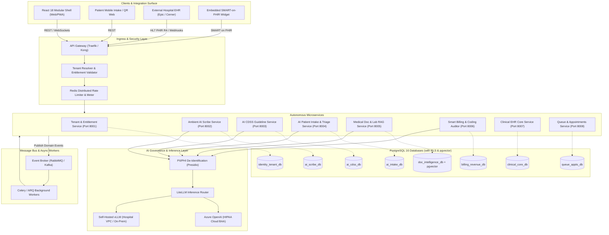

# Technical Architecture: Modular AI SaaS Platform

## 1. System Overview
HealthOS is engineered as an event-driven, cloud-native distributed microservices platform. Each functional capability operates as an independently deployable microservice running on asynchronous Python (FastAPI 0.110+, SQLAlchemy 2.0 Async, Pydantic v2) backed by its own dedicated PostgreSQL 16 database.

The platform provides a **dual-interface contract**:
1. **High-Performance JSON REST APIs**: Consumed natively by the React 18 SPA modular shell and mobile web apps.
2. **HL7 FHIR R4 Interoperability Endpoints**: Ingests and exports canonical healthcare resources (`Patient`, `Encounter`, `Observation`, `Condition`, `DocumentReference`, `Claim`), allowing enterprise hospitals to consume individual rented services (e.g., Ambient AI Scribe or AI CDSS) directly within their existing Hospital Information Systems (Epic, Cerner, etc.).

Multi-tenancy is structured around a **Tiered Multi-Tenancy Architecture**:
- **Small & Medium Outpatient Clinics**: Ingested into shared multi-tenant PostgreSQL databases partitioned strictly by `tenant_id` enforced via PostgreSQL native **Row-Level Security (RLS)** policies and connection session variables.
- **Enterprise Multi-Specialty Hospitals**: Provisioned with dedicated PostgreSQL database instances and isolated compute nodes with VPC peering to satisfy HIPAA, SOC2, and data residency mandates.

---

## 2. Technology Stack

| Layer | Technology | Version | Rationale |
| :--- | :--- | :--- | :--- |
| **Backend Services** | **Python / FastAPI** | 3.11+, 0.110+ | High-throughput asynchronous runtime (`uvloop`), native Pydantic v2 data validation, automated OpenAPI/Swagger generation, and seamless integration with Python AI/ML ecosystems. |
| **Database Engine** | **PostgreSQL** | 16.2 | Enterprise relational integrity, JSONB support for semi-structured clinical schemas, native Row-Level Security (RLS) for multi-tenancy, and high concurrency. |
| **Vector Engine** | **pgvector** | 0.7.0+ | Native in-database vector indexing (`HNSW`, `IVFFlat`) inside PostgreSQL, eliminating the operational overhead and data drift of external vector databases. |
| **ORM / Migration** | **SQLAlchemy + Alembic** | 2.0.28+ | Modern async ORM patterns (`select()`, async sessions), type hints, connection pooling, and automated schema migration management. |
| **Cache & Real-Time** | **Redis** | 7.2 | High-speed in-memory caching, tenant session storage, distributed rate limiting, and real-time audio chunk buffering. |
| **Event Bus / Broker** | **RabbitMQ / Apache Kafka** | 3.13 / 3.7 | Reliable event-driven asynchronous microservice messaging, domain event broadcasting (`PatientCreated`, `EncounterConcluded`), and decoupling compute-heavy AI tasks. |
| **API Gateway** | **Traefik / Kong** | 3.0 / 3.6 | Ingress reverse proxy, TLS termination, tenant resolution (subdomain/header), JWT entitlement validation, and rate limiting. |
| **AI Inference Gateway** | **LiteLLM + Presidio** | Latest | Centralized LLM abstraction layer with built-in PII/PHI de-identification (Microsoft Presidio) routing to Azure OpenAI (HIPAA BAA) and local vLLM medical models. |
| **Speech-to-Text** | **Whisper / Deepgram** | Large-v3 | Sub-second streaming medical transcription with clinical vocabulary fine-tuning and speaker diarization. |
| **Frontend Shell** | **React 18 + Vite** | 18.2, 5.2 | Ultra-fast SPA with Vanilla CSS design tokens, dynamic module loading, and embeddable widget / SMART on FHIR container support. |

---

## 3. High-Level Architecture Diagram



---

## 4. Multi-Tenant Database Schemas & DDL Specifications

Every service controls its own PostgreSQL database. Multi-tenancy for shared databases uses PostgreSQL native **Row-Level Security (RLS)**:
```sql
-- Standard RLS Setup applied to all shared tables
ALTER TABLE <table_name> ENABLE ROW LEVEL SECURITY;
CREATE POLICY tenant_isolation_policy ON <table_name>
    USING (tenant_id = NULLIF(current_setting('app.current_tenant_id', true), '')::UUID);
```
Every database connection checks out a session from the async pool and sets `SET LOCAL app.current_tenant_id = :tenant_id;` automatically through FastAPI middleware.

---

### 4.1. Identity & Entitlement Database (`identity_tenant_db`)

```sql
CREATE EXTENSION IF NOT EXISTS "uuid-ossp";

-- 1. Tenants (Clinics and Hospitals)
CREATE TABLE organizations (
    id UUID PRIMARY KEY DEFAULT uuid_generate_v4(),
    slug VARCHAR(64) NOT NULL UNIQUE,
    name VARCHAR(255) NOT NULL,
    tier ENUM('STARTER_CLINIC', 'PRO_CLINIC', 'HOSPITAL_ENTERPRISE') NOT NULL DEFAULT 'STARTER_CLINIC',
    isolation_mode ENUM('SHARED_RLS', 'DEDICATED_SCHEMA', 'DEDICATED_DB') NOT NULL DEFAULT 'SHARED_RLS',
    contact_email VARCHAR(255) NOT NULL,
    contact_phone VARCHAR(32) NULL,
    is_active BOOLEAN NOT NULL DEFAULT TRUE,
    created_at TIMESTAMPTZ NOT NULL DEFAULT NOW(),
    updated_at TIMESTAMPTZ NOT NULL DEFAULT NOW()
);

-- 2. Service Subscriptions & Licenses (Which modules are rented)
CREATE TABLE module_subscriptions (
    id UUID PRIMARY KEY DEFAULT uuid_generate_v4(),
    organization_id UUID NOT NULL REFERENCES organizations(id) ON DELETE CASCADE,
    module_code VARCHAR(32) NOT NULL, -- 'AI_SCRIBE', 'AI_CDSS', 'AI_INTAKE', 'DOC_INTEL', 'SMART_BILLING', 'CLINICAL_CORE', 'QUEUE'
    status ENUM('ACTIVE', 'TRIAL', 'SUSPENDED', 'CANCELLED') NOT NULL DEFAULT 'ACTIVE',
    billing_model ENUM('FLAT_MONTHLY', 'PER_VISIT', 'PER_TOKEN', 'HYBRID') NOT NULL DEFAULT 'FLAT_MONTHLY',
    allocated_seats INT NOT NULL DEFAULT 5,
    starts_at TIMESTAMPTZ NOT NULL DEFAULT NOW(),
    expires_at TIMESTAMPTZ NULL,
    created_at TIMESTAMPTZ NOT NULL DEFAULT NOW(),
    CONSTRAINT uq_org_module UNIQUE (organization_id, module_code)
);

-- 3. Users Table
CREATE TABLE users (
    id UUID PRIMARY KEY DEFAULT uuid_generate_v4(),
    organization_id UUID NOT NULL REFERENCES organizations(id) ON DELETE CASCADE,
    username VARCHAR(64) NOT NULL,
    email VARCHAR(255) NOT NULL,
    password_hash VARCHAR(255) NOT NULL,
    full_name VARCHAR(128) NOT NULL,
    role VARCHAR(32) NOT NULL, -- 'SUPERADMIN', 'DOCTOR', 'NURSE', 'RECEPTIONIST', 'BILLING_OFFICER', 'AUDITOR'
    specialty VARCHAR(128) NULL,
    medical_license_number VARCHAR(64) NULL,
    is_active BOOLEAN NOT NULL DEFAULT TRUE,
    created_at TIMESTAMPTZ NOT NULL DEFAULT NOW(),
    updated_at TIMESTAMPTZ NOT NULL DEFAULT NOW(),
    CONSTRAINT uq_org_username UNIQUE (organization_id, username),
    CONSTRAINT uq_org_email UNIQUE (organization_id, email)
);

-- 4. API Keys for External Hospital Integrations
CREATE TABLE api_keys (
    id UUID PRIMARY KEY DEFAULT uuid_generate_v4(),
    organization_id UUID NOT NULL REFERENCES organizations(id) ON DELETE CASCADE,
    key_prefix VARCHAR(16) NOT NULL,
    key_hash VARCHAR(255) NOT NULL,
    name VARCHAR(128) NOT NULL,
    allowed_modules JSONB NOT NULL DEFAULT '[]'::jsonb, -- ['AI_SCRIBE', 'AI_CDSS']
    rate_limit_rpm INT NOT NULL DEFAULT 120,
    expires_at TIMESTAMPTZ NULL,
    last_used_at TIMESTAMPTZ NULL,
    created_at TIMESTAMPTZ NOT NULL DEFAULT NOW()
);

-- 5. Usage Metering Log (Flushed asynchronously from Redis buffer)
CREATE TABLE usage_meter_logs (
    id BIGSERIAL PRIMARY KEY,
    organization_id UUID NOT NULL REFERENCES organizations(id) ON DELETE CASCADE,
    module_code VARCHAR(32) NOT NULL,
    metric_name VARCHAR(64) NOT NULL, -- 'AUDIO_MINUTES', 'LLM_TOKENS_INPUT', 'LLM_TOKENS_OUTPUT', 'VISITS_PROCESSED'
    quantity NUMERIC(12, 4) NOT NULL,
    recorded_at TIMESTAMPTZ NOT NULL DEFAULT NOW()
);
CREATE INDEX idx_usage_meter_org_time ON usage_meter_logs (organization_id, recorded_at);
```

---

### 4.2. Ambient AI Clinical Scribe Database (`ai_scribe_db`)

```sql
CREATE EXTENSION IF NOT EXISTS "uuid-ossp";

-- 1. Scribe Consultation Sessions
CREATE TABLE scribe_sessions (
    id UUID PRIMARY KEY DEFAULT uuid_generate_v4(),
    tenant_id UUID NOT NULL,
    external_encounter_id VARCHAR(64) NOT NULL, -- FHIR Encounter ID or internal visit ID
    doctor_id UUID NOT NULL,
    patient_id VARCHAR(64) NOT NULL,
    status ENUM('RECORDING', 'PROCESSING', 'READY_FOR_REVIEW', 'SIGNED', 'REJECTED') NOT NULL DEFAULT 'RECORDING',
    audio_duration_seconds INT NOT NULL DEFAULT 0,
    audio_storage_uri TEXT NULL, -- Optional (can be NULL for zero-retention mode)
    created_at TIMESTAMPTZ NOT NULL DEFAULT NOW(),
    updated_at TIMESTAMPTZ NOT NULL DEFAULT NOW()
);
CREATE INDEX idx_scribe_tenant_encounter ON scribe_sessions (tenant_id, external_encounter_id);

-- 2. Streaming Audio Dialogue Transcripts
CREATE TABLE scribe_dialogue_segments (
    id UUID PRIMARY KEY DEFAULT uuid_generate_v4(),
    tenant_id UUID NOT NULL,
    session_id UUID NOT NULL REFERENCES scribe_sessions(id) ON DELETE CASCADE,
    speaker_tag ENUM('DOCTOR', 'PATIENT', 'ATTENDANT', 'UNKNOWN') NOT NULL DEFAULT 'UNKNOWN',
    start_time_offset_ms INT NOT NULL,
    end_time_offset_ms INT NOT NULL,
    transcript_text TEXT NOT NULL,
    confidence_score NUMERIC(4, 3) NOT NULL DEFAULT 1.000,
    created_at TIMESTAMPTZ NOT NULL DEFAULT NOW()
);
CREATE INDEX idx_dialogue_session ON scribe_dialogue_segments (session_id);

-- 3. Synthesized Structured SOAP Notes
CREATE TABLE scribe_soap_notes (
    id UUID PRIMARY KEY DEFAULT uuid_generate_v4(),
    tenant_id UUID NOT NULL,
    session_id UUID NOT NULL UNIQUE REFERENCES scribe_sessions(id) ON DELETE CASCADE,
    subjective_narrative TEXT NOT NULL,
    objective_findings TEXT NOT NULL,
    assessment_narrative TEXT NOT NULL,
    plan_narrative TEXT NOT NULL,
    structured_chief_complaints JSONB NOT NULL DEFAULT '[]'::jsonb,
    structured_vitals JSONB NOT NULL DEFAULT '{}'::jsonb,
    is_signed BOOLEAN NOT NULL DEFAULT FALSE,
    signed_by UUID NULL,
    signed_at TIMESTAMPTZ NULL,
    fhir_document_reference_id VARCHAR(128) NULL,
    created_at TIMESTAMPTZ NOT NULL DEFAULT NOW(),
    updated_at TIMESTAMPTZ NOT NULL DEFAULT NOW()
);

-- 4. Extracted Clinical Codes & Rx Prescriptions
CREATE TABLE scribe_extracted_entities (
    id UUID PRIMARY KEY DEFAULT uuid_generate_v4(),
    tenant_id UUID NOT NULL,
    soap_note_id UUID NOT NULL REFERENCES scribe_soap_notes(id) ON DELETE CASCADE,
    entity_type ENUM('DIAGNOSIS_ICD10', 'PROCEDURE_CPT', 'MEDICATION_RXNORM', 'LAB_ORDER') NOT NULL,
    code VARCHAR(64) NOT NULL,
    display_name VARCHAR(255) NOT NULL,
    dosage_details JSONB NULL, -- {"dose": "500mg", "frequency": "TID", "days": 5}
    confidence_score NUMERIC(4, 3) NOT NULL DEFAULT 0.95,
    is_accepted_by_physician BOOLEAN NOT NULL DEFAULT TRUE,
    created_at TIMESTAMPTZ NOT NULL DEFAULT NOW()
);
```

---

### 4.3. AI Clinical Decision Support Database (`ai_cdss_db`)

```sql
CREATE EXTENSION IF NOT EXISTS "uuid-ossp";

-- 1. Clinical Rule Definitions (Deterministic)
CREATE TABLE cdss_guideline_rules (
    id UUID PRIMARY KEY DEFAULT uuid_generate_v4(),
    rule_code VARCHAR(64) NOT NULL UNIQUE,
    category ENUM('VITALS', 'DRUG_DRUG', 'DRUG_ALLERGY', 'SEPSIS', 'CHRONIC_CARE') NOT NULL,
    severity ENUM('CRITICAL', 'WARNING', 'INFO') NOT NULL,
    title VARCHAR(255) NOT NULL,
    trigger_expression JSONB NOT NULL, -- AST / JSON Rule logic
    recommendation_template TEXT NOT NULL,
    evidence_citation TEXT NOT NULL,
    is_enabled BOOLEAN NOT NULL DEFAULT TRUE,
    created_at TIMESTAMPTZ NOT NULL DEFAULT NOW()
);

-- 2. CDSS Evaluations Executed for Visits
CREATE TABLE cdss_evaluations (
    id UUID PRIMARY KEY DEFAULT uuid_generate_v4(),
    tenant_id UUID NOT NULL,
    external_encounter_id VARCHAR(64) NOT NULL,
    patient_id VARCHAR(64) NOT NULL,
    doctor_id UUID NOT NULL,
    trigger_context JSONB NOT NULL, -- Snapshot of vitals, symptoms, drugs
    status ENUM('ALERT_GENERATED', 'NORMAL') NOT NULL,
    created_at TIMESTAMPTZ NOT NULL DEFAULT NOW()
);
CREATE INDEX idx_cdss_tenant_encounter ON cdss_evaluations (tenant_id, external_encounter_id);

-- 3. Generated Clinical Alerts & Insights
CREATE TABLE cdss_alerts (
    id UUID PRIMARY KEY DEFAULT uuid_generate_v4(),
    tenant_id UUID NOT NULL,
    evaluation_id UUID NOT NULL REFERENCES cdss_evaluations(id) ON DELETE CASCADE,
    source ENUM('DETERMINISTIC_RULE', 'MEDICAL_LLM') NOT NULL,
    rule_code VARCHAR(64) NULL,
    severity ENUM('CRITICAL', 'WARNING', 'INFO') NOT NULL,
    title VARCHAR(255) NOT NULL,
    summary TEXT NOT NULL,
    recommendation TEXT NOT NULL,
    clinical_evidence TEXT NULL,
    physician_action ENUM('PENDING', 'ACCEPTED', 'OVERRIDDEN', 'DISMISSED') NOT NULL DEFAULT 'PENDING',
    override_reason TEXT NULL,
    acted_at TIMESTAMPTZ NULL,
    created_at TIMESTAMPTZ NOT NULL DEFAULT NOW()
);
```

---

### 4.4. AI Patient Intake & Triage Database (`ai_intake_db`)

```sql
CREATE EXTENSION IF NOT EXISTS "uuid-ossp";

-- 1. Patient Intake Sessions (Kiosk or Mobile QR Link)
CREATE TABLE intake_sessions (
    id UUID PRIMARY KEY DEFAULT uuid_generate_v4(),
    tenant_id UUID NOT NULL,
    session_token VARCHAR(64) NOT NULL UNIQUE,
    patient_identifier VARCHAR(64) NULL,
    patient_language VARCHAR(10) NOT NULL DEFAULT 'en',
    status ENUM('IN_PROGRESS', 'SUBMITTED', 'PROCESSED', 'ABANDONED') NOT NULL DEFAULT 'IN_PROGRESS',
    emergency_flag BOOLEAN NOT NULL DEFAULT FALSE,
    assigned_esi_score INT NULL CHECK (assigned_esi_score BETWEEN 1 AND 5),
    triage_summary TEXT NULL,
    created_at TIMESTAMPTZ NOT NULL DEFAULT NOW(),
    completed_at TIMESTAMPTZ NULL
);
CREATE INDEX idx_intake_tenant ON intake_sessions (tenant_id);

-- 2. Conversational Q&A Logs
CREATE TABLE intake_conversation_logs (
    id UUID PRIMARY KEY DEFAULT uuid_generate_v4(),
    tenant_id UUID NOT NULL,
    session_id UUID NOT NULL REFERENCES intake_sessions(id) ON DELETE CASCADE,
    turn_index INT NOT NULL,
    question_text TEXT NOT NULL,
    patient_raw_answer TEXT NOT NULL,
    translated_english_answer TEXT NULL,
    extracted_symptom_tags JSONB NOT NULL DEFAULT '[]'::jsonb,
    created_at TIMESTAMPTZ NOT NULL DEFAULT NOW()
);
```

---

### 4.5. Medical Document & Lab RAG Database (`doc_intelligence_db`)

```sql
CREATE EXTENSION IF NOT EXISTS "uuid-ossp";
CREATE EXTENSION IF NOT EXISTS "vector"; -- pgvector extension

-- 1. Uploaded Medical Documents
CREATE TABLE medical_documents (
    id UUID PRIMARY KEY DEFAULT uuid_generate_v4(),
    tenant_id UUID NOT NULL,
    patient_id VARCHAR(64) NOT NULL,
    document_type ENUM('LAB_REPORT', 'RADIOLOGY_IMAGING', 'DISCHARGE_SUMMARY', 'PRESCRIPTION_SLIP') NOT NULL,
    file_name VARCHAR(255) NOT NULL,
    storage_uri TEXT NOT NULL,
    mime_type VARCHAR(64) NOT NULL,
    ocr_status ENUM('PENDING', 'PROCESSED', 'FAILED') NOT NULL DEFAULT 'PENDING',
    created_at TIMESTAMPTZ NOT NULL DEFAULT NOW()
);
CREATE INDEX idx_doc_tenant_patient ON medical_documents (tenant_id, patient_id);

-- 2. Document Vector Chunks with pgvector
CREATE TABLE document_vector_chunks (
    id UUID PRIMARY KEY DEFAULT uuid_generate_v4(),
    tenant_id UUID NOT NULL,
    document_id UUID NOT NULL REFERENCES medical_documents(id) ON DELETE CASCADE,
    chunk_index INT NOT NULL,
    content_text TEXT NOT NULL,
    embedding vector(1536) NOT NULL, -- OpenAI text-embedding-3-small or equivalent
    page_number INT NOT NULL DEFAULT 1,
    bounding_box JSONB NULL, -- Bounding box coordinates on PDF
    created_at TIMESTAMPTZ NOT NULL DEFAULT NOW()
);
-- HNSW Cosine Index for ultra-fast RAG vector retrieval
CREATE INDEX idx_chunks_embedding_hnsw ON document_vector_chunks 
    USING hnsw (embedding vector_cosine_ops)
    WITH (m = 16, ef_construction = 64);

-- 3. Structured Biomarkers Extracted (Lab Values)
CREATE TABLE structured_lab_results (
    id UUID PRIMARY KEY DEFAULT uuid_generate_v4(),
    tenant_id UUID NOT NULL,
    document_id UUID NOT NULL REFERENCES medical_documents(id) ON DELETE CASCADE,
    patient_id VARCHAR(64) NOT NULL,
    test_name VARCHAR(128) NOT NULL, -- 'Hemoglobin', 'HbA1c', 'Serum Creatinine'
    numeric_value NUMERIC(10, 3) NULL,
    unit VARCHAR(32) NULL, -- 'g/dL', '%', 'mg/dL'
    reference_low NUMERIC(10, 3) NULL,
    reference_high NUMERIC(10, 3) NULL,
    flag ENUM('NORMAL', 'HIGH', 'LOW', 'CRITICAL') NOT NULL DEFAULT 'NORMAL',
    observed_date DATE NULL,
    created_at TIMESTAMPTZ NOT NULL DEFAULT NOW()
);
CREATE INDEX idx_lab_tenant_patient_test ON structured_lab_results (tenant_id, patient_id, test_name);
```

---

### 4.6. Smart Billing & Revenue Auditor Database (`billing_revenue_db`)

```sql
CREATE EXTENSION IF NOT EXISTS "uuid-ossp";

-- 1. Configurable Tariffs & Service Catalog
CREATE TABLE tariff_services (
    id UUID PRIMARY KEY DEFAULT uuid_generate_v4(),
    tenant_id UUID NOT NULL,
    service_code VARCHAR(32) NOT NULL,
    name VARCHAR(255) NOT NULL,
    category ENUM('CONSULTATION', 'LAB_INVESTIGATION', 'PROCEDURE', 'PHARMACY', 'MISC') NOT NULL,
    default_cpt_code VARCHAR(16) NULL,
    unit_price NUMERIC(10, 2) NOT NULL,
    tax_rate NUMERIC(5, 2) NOT NULL DEFAULT 0.00,
    is_active BOOLEAN NOT NULL DEFAULT TRUE,
    created_at TIMESTAMPTZ NOT NULL DEFAULT NOW(),
    CONSTRAINT uq_tenant_service_code UNIQUE (tenant_id, service_code)
);

-- 2. Patient Invoices
CREATE TABLE invoices (
    id UUID PRIMARY KEY DEFAULT uuid_generate_v4(),
    tenant_id UUID NOT NULL,
    invoice_number VARCHAR(32) NOT NULL,
    external_encounter_id VARCHAR(64) NOT NULL,
    patient_id VARCHAR(64) NOT NULL,
    subtotal_amount NUMERIC(10, 2) NOT NULL,
    discount_amount NUMERIC(10, 2) NOT NULL DEFAULT 0.00,
    tax_amount NUMERIC(10, 2) NOT NULL DEFAULT 0.00,
    total_payable NUMERIC(10, 2) NOT NULL,
    paid_amount NUMERIC(10, 2) NOT NULL DEFAULT 0.00,
    payment_mode ENUM('CASH', 'CREDIT_CARD', 'UPI', 'INSURANCE', 'SPLIT') NOT NULL DEFAULT 'CASH',
    payment_status ENUM('PENDING', 'PARTIAL', 'PAID', 'REFUNDED', 'WRITTEN_OFF') NOT NULL DEFAULT 'PENDING',
    created_at TIMESTAMPTZ NOT NULL DEFAULT NOW(),
    updated_at TIMESTAMPTZ NOT NULL DEFAULT NOW(),
    CONSTRAINT uq_tenant_invoice_num UNIQUE (tenant_id, invoice_number)
);

-- 3. Invoice Line Items
CREATE TABLE invoice_line_items (
    id UUID PRIMARY KEY DEFAULT uuid_generate_v4(),
    tenant_id UUID NOT NULL,
    invoice_id UUID NOT NULL REFERENCES invoices(id) ON DELETE CASCADE,
    service_id UUID NOT NULL REFERENCES tariff_services(id),
    cpt_code VARCHAR(16) NULL,
    quantity INT NOT NULL DEFAULT 1,
    unit_price NUMERIC(10, 2) NOT NULL,
    total_price NUMERIC(10, 2) NOT NULL,
    created_at TIMESTAMPTZ NOT NULL DEFAULT NOW()
);

-- 4. AI Coding & Claim Denial Risk Audits
CREATE TABLE billing_ai_audits (
    id UUID PRIMARY KEY DEFAULT uuid_generate_v4(),
    tenant_id UUID NOT NULL,
    invoice_id UUID NOT NULL REFERENCES invoices(id) ON DELETE CASCADE,
    denial_risk_score INT NOT NULL CHECK (denial_risk_score BETWEEN 0 AND 100),
    risk_level ENUM('LOW', 'MEDIUM', 'HIGH') NOT NULL,
    audit_findings JSONB NOT NULL DEFAULT '[]'::jsonb, -- Missing pre-auth, code mismatch
    unbilled_suggestions JSONB NOT NULL DEFAULT '[]'::jsonb, -- Detected in clinical note but missing from bill
    created_at TIMESTAMPTZ NOT NULL DEFAULT NOW()
);
```

---

### 4.7. Core Clinical EHR Database (`clinical_core_db`)

```sql
CREATE EXTENSION IF NOT EXISTS "uuid-ossp";

-- 1. Patients Registry (MPI)
CREATE TABLE patients (
    id UUID PRIMARY KEY DEFAULT uuid_generate_v4(),
    tenant_id UUID NOT NULL,
    uhid VARCHAR(32) NOT NULL, -- Unique Health Identifier
    first_name VARCHAR(64) NOT NULL,
    last_name VARCHAR(64) NOT NULL,
    dob DATE NOT NULL,
    gender ENUM('MALE', 'FEMALE', 'OTHER') NOT NULL,
    blood_group VARCHAR(8) NOT NULL DEFAULT 'UNKNOWN',
    phone VARCHAR(32) NOT NULL,
    email VARCHAR(255) NULL,
    address TEXT NULL,
    emergency_contact VARCHAR(128) NULL,
    insurance_policy_number VARCHAR(64) NULL,
    created_at TIMESTAMPTZ NOT NULL DEFAULT NOW(),
    updated_at TIMESTAMPTZ NOT NULL DEFAULT NOW(),
    CONSTRAINT uq_tenant_uhid UNIQUE (tenant_id, uhid)
);
CREATE INDEX idx_patients_tenant_phone ON patients (tenant_id, phone);

-- 2. Outpatient Encounters / Visits
CREATE TABLE encounters (
    id UUID PRIMARY KEY DEFAULT uuid_generate_v4(),
    tenant_id UUID NOT NULL,
    patient_id UUID NOT NULL REFERENCES patients(id) ON DELETE RESTRICT,
    doctor_id UUID NOT NULL,
    receptionist_id UUID NOT NULL,
    visit_date TIMESTAMPTZ NOT NULL DEFAULT NOW(),
    queue_token VARCHAR(16) NOT NULL,
    status ENUM('REGISTERED', 'TRIAGED', 'IN_CONSULTATION', 'READY_FOR_BILLING', 'COMPLETED', 'CANCELLED') NOT NULL DEFAULT 'REGISTERED',
    chief_complaint TEXT NULL,
    conclusion_notes TEXT NULL,
    signed_at TIMESTAMPTZ NULL,
    created_at TIMESTAMPTZ NOT NULL DEFAULT NOW(),
    updated_at TIMESTAMPTZ NOT NULL DEFAULT NOW()
);
CREATE INDEX idx_encounters_tenant_status ON encounters (tenant_id, status);

-- 3. Vital Signs Table
CREATE TABLE vital_signs (
    id UUID PRIMARY KEY DEFAULT uuid_generate_v4(),
    tenant_id UUID NOT NULL,
    encounter_id UUID NOT NULL UNIQUE REFERENCES encounters(id) ON DELETE CASCADE,
    systolic_bp INT NULL,
    diastolic_bp INT NULL,
    pulse_rate INT NULL,
    temperature_f NUMERIC(4, 1) NULL,
    resp_rate INT NULL,
    spo2_pct INT NULL,
    weight_kg NUMERIC(5, 2) NULL,
    height_cm NUMERIC(5, 2) NULL,
    bmi NUMERIC(4, 1) NULL,
    measured_at TIMESTAMPTZ NOT NULL DEFAULT NOW()
);

-- 4. Prescriptions Table
CREATE TABLE prescriptions (
    id UUID PRIMARY KEY DEFAULT uuid_generate_v4(),
    tenant_id UUID NOT NULL,
    encounter_id UUID NOT NULL REFERENCES encounters(id) ON DELETE CASCADE,
    drug_name VARCHAR(255) NOT NULL,
    dosage VARCHAR(64) NOT NULL,
    frequency VARCHAR(64) NOT NULL,
    duration_days INT NOT NULL,
    instructions TEXT NULL,
    created_at TIMESTAMPTZ NOT NULL DEFAULT NOW()
);
```

---

## 5. AI Gateway & Inference Orchestration Pipeline

```
Raw Audio / Clinical Text
        |
        v
+-----------------------------------------------------------+
| 1. Healthcare PHI Anonymizer (Microsoft Presidio)          |
|    - Strips patient names, phones, SSN/UHID, addresses     |
|    - Replaces with deterministic pseudonyms [PATIENT_REF]  |
+-----------------------------------------------------------+
        |
        v
+-----------------------------------------------------------+
| 2. LiteLLM Gateway Router & Circuit Breaker               |
|    - Tenant Quota & Cost Attribution Check                |
|    - Prompt Caching (Redis)                               |
+-----------------------------------------------------------+
        |                                   |
        | [Cloud Tenants: HIPAA BAA]         | [Enterprise On-Prem Hospital]
        v                                   v
+-----------------------------+     +-----------------------------+
| Azure OpenAI Service        |     | Self-Hosted vLLM Instance   |
| (GPT-4o / GPT-4o-mini)      |     | (BioMistral / Meditron GPU) |
+-----------------------------+     +-----------------------------+
        |                                   |
        +-----------------+-----------------+
                          v
+-----------------------------------------------------------+
| 3. De-Pseudonymizer & Clinical Safety Guardrails           |
|    - Restores local context identifiers                   |
|    - Validates against deterministic CDSS rules           |
|    - Output schema validation (Pydantic v2 structured)    |
+-----------------------------------------------------------+
```

---

## 6. Enterprise Interoperability: HL7 FHIR R4 Dual-Interface

When enterprise hospitals consume single rented services, they communicate via standard FHIR R4 endpoints:

| Service | FHIR R4 Ingress Endpoint | FHIR R4 Ingested Resources | FHIR R4 Outbound Resources |
| :--- | :--- | :--- | :--- |
| **Ambient AI Scribe** | `POST /fhir/R4/Encounter/{id}/$scribe-stream` | `Encounter`, `Patient` | `DocumentReference` (SOAP Note), `Condition` (ICD-10) |
| **AI CDSS Guideline Engine** | `POST /fhir/R4/$cds-hook-eval` | `Observation` (Vitals), `MedicationRequest` | `DiagnosticReport`, CDS Hook Cards |
| **AI Patient Intake & Triage** | `POST /fhir/R4/QuestionnaireResponse` | `QuestionnaireResponse` | `Observation` (Acuity/ESI Score), `Encounter` |
| **Medical Document RAG** | `POST /fhir/R4/DocumentReference` | `DocumentReference` (PDF/Binary) | Structured `Observation` (Lab Biomarkers) |
| **Smart Billing Auditor** | `POST /fhir/R4/Claim/$scrub` | `Claim`, `Coverage`, `Condition` | `ClaimResponse`, Adjudication Flags |

---

## 7. Security, Compliance & Audit Framework
- **HIPAA §164.312 Technical Safeguards**:
  - AES-256 encryption at rest across all database volumes and object storage buckets.
  - TLS 1.3 encryption in transit for all external APIs and internal microservice mesh calls.
  - Immutable audit logs capturing every PHI query with `user_id`, `tenant_id`, `ip_address`, and `phi_resource_accessed`.
- **Zero-Retention Mode for Audio**: Tenants can configure zero storage of raw audio files. The streaming buffer resides in ephemeral Redis memory and is completely wiped once the physician reviews and signs the generated SOAP note.
- **Tenant Context Injection**: The API Gateway validates JWT signatures and injects the header `X-Tenant-ID`. The FastAPI dependency `get_db_session` automatically issues `SET LOCAL app.current_tenant_id = :tenant_id` before yielding database handles.
