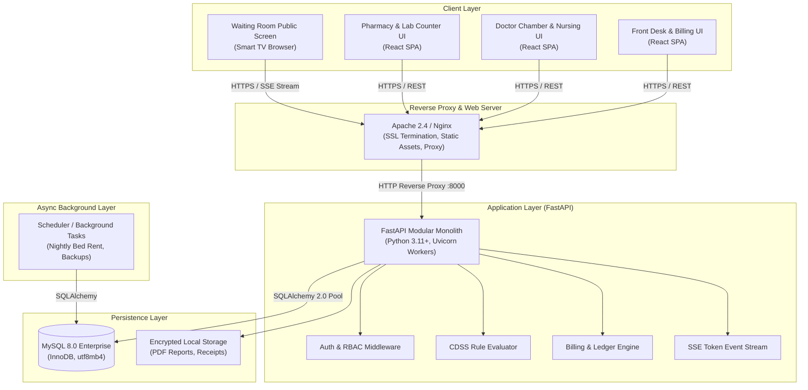
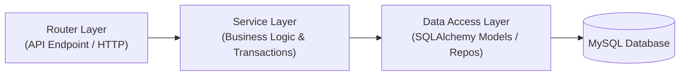
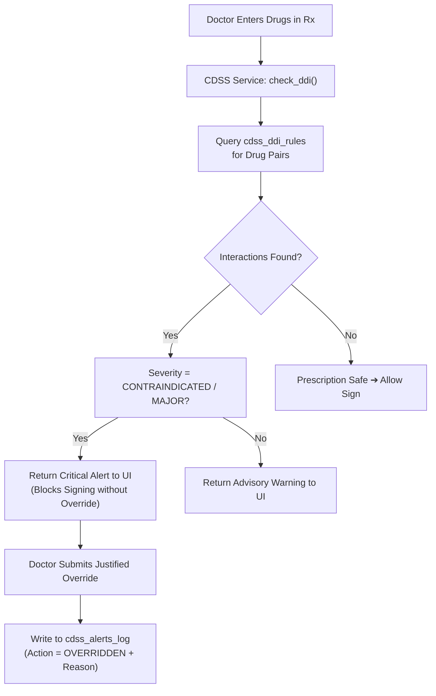
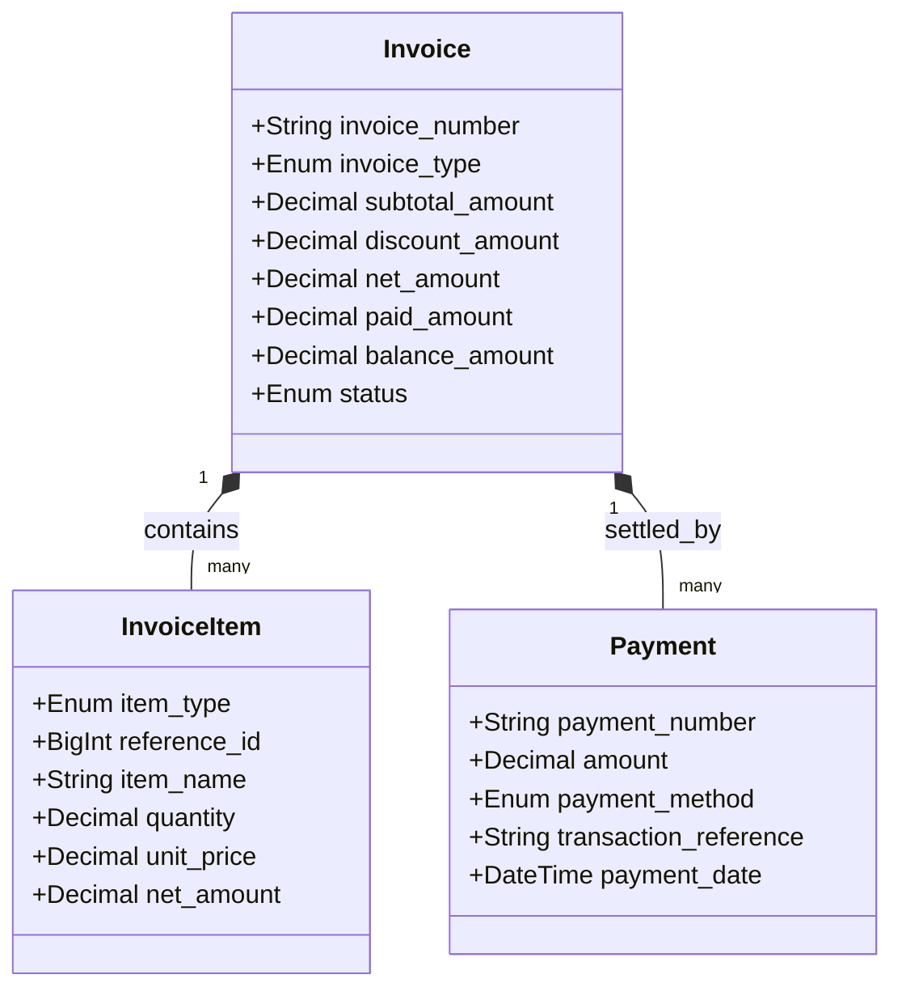

# D3 — Technical Architecture Document (TAD)
## Bright Solutions: Clinical Hospital Operating System

> **Document ID:** D3  
> **Version:** 1.0  
> **Status:** APPROVED ARCHITECTURE SPECIFICATION  
> **Depends On:** [01_PRD.md](file:///home/prem/Desktop/pbt/COS/docs/design/01_PRD.md), [02_feature_spec.md](file:///home/prem/Desktop/pbt/COS/docs/design/02_feature_spec.md), [09_database_schema_ddl.sql](file:///home/prem/Desktop/pbt/COS/docs/design/09_database_schema_ddl.sql), [11_api_endpoint_inventory.md](file:///home/prem/Desktop/pbt/COS/docs/design/11_api_endpoint_inventory.md), [13_rbac_permission_matrix.md](file:///home/prem/Desktop/pbt/COS/docs/design/13_rbac_permission_matrix.md)  
> **Prepared By:** Bright Solutions Backend Engineering Team  
> **Last Updated:** October 2026  

---

## Table of Contents

1. [Executive Summary & Architectural Drivers](#1-executive-summary--architectural-drivers)
2. [High-Level System Topology (C4 Level 2)](#2-high-level-system-topology-c4-level-2)
3. [Deployment Architectures: Staging vs. On-Premise](#3-deployment-architectures-staging-vs-on-premise)
4. [Backend Application Architecture (FastAPI Modular Monolith)](#4-backend-application-architecture-fastapi-modular-monolith)
5. [Database & Persistence Architecture](#5-database--persistence-architecture)
6. [Security, Authentication & Data Protection](#6-security-authentication--data-protection)
7. [Clinical Decision Support (CDSS) Engine](#7-clinical-decision-support-cdss-engine)
8. [Multi-Point Billing & Ledger Engine](#8-multi-point-billing--ledger-engine)
9. [Real-Time Streaming & Waiting Room Display](#9-real-time-streaming--waiting-room-display)
10. [Background Jobs & Scheduled Workers](#10-background-jobs--scheduled-workers)
11. [Observability, Logging & Error Handling](#11-observability-logging--error-handling)

---

## 1. Executive Summary & Architectural Drivers

**Bright Solutions** is an enterprise-grade clinical hospital operating system designed to run both on on-premise hardware inside hospitals and in cloud/staging environments.

### Core Architectural Decisions & Drivers

1. **Modular Monolith over Microservices:** A single, strictly partitioned FastAPI application codebase. Eliminates distributed transaction latency, network serialization overhead, and operational complexity, while maintaining hard domain boundaries.
2. **Production-Grade Relational Core:** MySQL 8.0 (InnoDB) with full ACID guarantees, connection pooling (`QueuePool`), explicit transaction boundaries, and row-level locking (`SELECT ... FOR UPDATE`) for monotonic sequences.
3. **Dual Deployment Topologies:**
   - **Staging Environment:** Contabo LAMP Server hosting `clinicalservices.paperbirdtech.com` with Apache reverse-proxying requests to a systemd/PM2-managed Python daemon.
   - **Hospital On-Premise Environment:** Local server on hospital LAN with edge reliability, automated hourly snapshot backups, and sub-second LAN latency.
4. **Deterministic Clinical Safety:** CDSS rules (Drug-Drug Interactions, Vital Red Flags, Clinical Symptom Trios) execute deterministically within the database transaction path with mandatory override logging for medico-legal and NABH compliance.
5. **Universal Multi-Point Financial Accounting:** Unified invoice and ledger engine capable of servicing reception consultation billing, pharmacy point-of-sale, pathology collection billing, and consolidated 10-head IPD discharge settlement.

---

## 2. High-Level System Topology (C4 Level 2)



---

## 3. Deployment Architectures: Staging vs. On-Premise

### 3.1 Staging Environment: Contabo LAMP Architecture

In the staging environment at `clinicalservices.paperbirdtech.com`, Apache acts as the TLS termination point and reverse proxy for the FastAPI daemon.

- **Domain:** `clinicalservices.paperbirdtech.com`
- **Root Directory:** `~/public_html/clinicalservices.paperbirdtech.com/`
- **FastAPI Daemon:** Running locally on port `8000` via PM2 / systemd.
- **Frontend SPA:** Static production build hosted in `public_html`.
- **API Routing:** All `/api/*` and `/display/queue/stream` requests are proxied via Apache `.htaccess` / `vhost`.

#### Staging Apache `.htaccess` Configuration
```apache
<IfModule mod_rewrite.c>
  RewriteEngine On

  # Disable proxy buffering for real-time Server-Sent Events (SSE)
  SetEnv no-gzip 1
  SetEnv proxy-nokeepalive 1

  # Proxy API and SSE stream to FastAPI Uvicorn daemon
  RewriteCond %{REQUEST_URI} ^/api/ [NC]
  RewriteRule ^api/(.*)$ http://127.0.0.1:8000/api/$1 [P,L]

  # Proxy Swagger / OpenAPI Docs
  RewriteCond %{REQUEST_URI} ^/(docs|redoc|openapi.json) [NC]
  RewriteRule ^(.*)$ http://127.0.0.1:8000/$1 [P,L]

  # Static SPA Fallback
  RewriteCond %{REQUEST_FILENAME} !-f
  RewriteCond %{REQUEST_FILENAME} !-d
  RewriteRule ^ index.html [L]
</IfModule>
```

### 3.2 Production On-Premise Hospital Architecture

For physical hospitals, Bright Solutions runs on a dedicated high-reliability local server:
- **Server Specs:** Intel Xeon / Core i7, 32GB RAM, 1TB NVMe (RAID-1 mirror), Dual Gigabit NICs.
- **Local Network (LAN):** Zero dependency on external internet for day-to-day consultations, dispensing, or billing.
- **Automated Backup Strategy:**
  - Automated hourly local snapshot via `mysqldump` with transactional consistency (`--single-transaction --quick`).
  - Nightly encrypted off-site cloud sync during non-operational hours.

---

## 4. Backend Application Architecture (FastAPI Modular Monolith)

The backend code is organized into strict, decoupled domain packages under `app/modules/`. Cross-module communication occurs strictly via defined service interfaces, never via direct foreign database mutations.

### 4.1 Project Directory Structure

```
backend/
├── app/
│   ├── main.py                     # FastAPI application factory & router mounting
│   ├── core/                       # Cross-cutting foundational services
│   │   ├── config.py               # Pydantic v2 BaseSettings (env validation)
│   │   ├── database.py             # SQLAlchemy 2.0 engine, QueuePool, session factory
│   │   ├── security.py             # JWT generation/decoding, Argon2/bcrypt hashing
│   │   ├── dependencies.py         # Global request dependencies (get_db, current_user)
│   │   ├── exceptions.py           # Custom clinical and domain exceptions
│   │   └── logging.py              # Structured JSON logging & correlation ID middleware
│   ├── models/                     # Shared base model classes
│   │   └── base.py                 # DeclarativeBase, TimestampMixin, PublicIdMixin
│   ├── modules/                    # Domain-driven feature modules
│   │   ├── patient/                # Patient registration & allergies
│   │   ├── opd/                    # Queue management & doctor token assignment
│   │   ├── triage/                 # Vitals capture & screening questionnaire
│   │   ├── consultation/           # SOAP notes, ICD-10 diagnosis, consultations
│   │   ├── pharmacy/               # Formularies, stock batches, dispensations
│   │   ├── ipd/                    # Wards, beds, admissions, daily rounds, discharge
│   │   ├── lab/                    # Lab catalog, test orders, results, reports
│   │   ├── billing/                # Tariffs, invoices, payments, financial ledger
│   │   ├── cdss/                   # DDI evaluator, vital alerts, clinical rules
│   │   ├── auth/                   # Users, credentials, sessions, roles
│   │   ├── admin/                  # Sequence configurations, doctor schedules
│   │   └── display/                # Waiting room public display & SSE stream
│   └── workers/                    # Scheduled jobs and async background tasks
│       ├── bed_rent_worker.py      # Nightly 00:00 bed tariff accrual
│       └── backup_worker.py        # Automated DB backup routine
├── alembic/                        # Database migration scripts
├── scripts/                        # Database seeding & administrative scripts
├── requirements.txt
└── tests/                          # Automated Pytest suite
```

### 4.2 Layered Architecture within Each Module

Every module follows a strict 3-tier separation:



1. **Router Layer (`router.py`):**
   - Pure HTTP handler: deserializes request payloads using Pydantic v2 schemas.
   - Enforces RBAC permissions via `Depends(PermissionChecker(...))`.
   - Delegates execution to the Service Layer and serializes domain responses.
2. **Service Layer (`service.py`):**
   - Encapsulates all business rules, calculations, and clinical validations.
   - Manages atomic transaction boundaries (`db.commit()`, `db.rollback()`).
   - Coordinates cross-module workflows (e.g. calling `CDSSService` before saving a prescription).
3. **Data Access / Repository Layer (`models.py`, `repository.py`):**
   - Defines SQLAlchemy 2.0 table mappings.
   - Executes optimized SQL queries with eager loading (`joinedload` / `selectinload`) to prevent N+1 query performance degradations.

---

## 5. Database & Persistence Architecture

### 5.1 SQLAlchemy 2.0 Connection Pooling

Production stability under concurrent hospital traffic requires strict pool tuning to prevent connection exhaustion or stale MySQL connections (`MySQL server has gone away`).

```python
# app/core/database.py
from sqlalchemy import create_engine
from sqlalchemy.orm import sessionmaker, DeclarativeBase
from sqlalchemy.pool import QueuePool
from app.core.config import settings

DATABASE_URL = (
    f"mysql+pymysql://{settings.DB_USER}:{settings.DB_PASSWORD}@"
    f"{settings.DB_HOST}:{settings.DB_PORT}/{settings.DB_NAME}?"
    "charset=utf8mb4"
)

engine = create_engine(
    DATABASE_URL,
    poolclass=QueuePool,
    pool_size=20,            # High concurrent connections
    max_overflow=10,         # Burst allowance for heavy peak hours
    pool_timeout=30,         # Seconds to wait before raising TimeoutError
    pool_recycle=1800,       # Recycle connections every 30 minutes to prevent MySQL idle drop
    pool_pre_ping=True,      # Actively verifies connection liveness before checking out
    echo=False               # Set False in production to avoid log bloating
)

SessionLocal = sessionmaker(
    bind=engine,
    autocommit=False,
    autoflush=False,
    expire_on_commit=False
)

def get_db():
    """Dependency that yields an isolated DB session per HTTP request."""
    db = SessionLocal()
    try:
        yield db
    finally:
        db.close()
```

### 5.2 Concurrency-Safe Monotonic Sequences

Sequential identifiers (UHID, OPD#, IPD#, Bill#) must be gapless, strictly monotonic, and resilient to concurrent check-ins. Bright Solutions implements row-level locking on the `system_sequences` table:

```python
# Concurrency pattern for sequence generation
def get_next_sequence(db: Session, hospital_id: int, sequence_key: str) -> str:
    # Acquire exclusive row lock (FOR UPDATE)
    seq = db.query(SystemSequence).filter(
        SystemSequence.hospital_id == hospital_id,
        SystemSequence.sequence_key == sequence_key
    ).with_for_update().first()
    
    if not seq:
        raise SequenceNotFoundException(f"Sequence {sequence_key} not configured")
        
    seq.current_value += 1
    generated_number = f"{seq.prefix}-{str(seq.current_value).zfill(seq.padding_length)}"
    return generated_number
```

---

## 6. Security, Authentication & Data Protection

### 6.1 Authentication Lifecycle

- **Access Token:** Short-lived JWT (15-minute expiration) containing `user_id`, `public_id`, `hospital_id`, and `role_code`. Transmitted in `Authorization: Bearer <token>`.
- **Refresh Token:** Cryptographically secure random 256-bit token stored in an HTTP-only, Secure cookie (7-day validity).
- **Password Storage:** Hashed using `Argon2id` (or `bcrypt` with work factor 12). Plaintext passwords are never logged or stored.

### 6.2 PHI Protection & DPDP Act 2023 Compliance

1. **Aadhaar Protection:** Raw 12-digit Aadhaar numbers are never stored in the database. Only an irreversible SHA-256 hash (`aadhaar_hash`) is retained for duplicate patient detection.
2. **Audit Trails:** All access to patient clinical encounters, diagnosis records, and prescriptions generates a synchronous record in `audit_logs` capturing `user_id`, `action`, `entity_name`, `entity_id`, `ip_address`, and timestamp.
3. **Data at Rest:** Transparent Data Encryption (TDE) on MySQL data directories; file uploads (lab PDFs) stored in restricted filesystem directories with non-guessable UUID filenames.

---

## 7. Clinical Decision Support (CDSS) Engine

The CDSS runs as a deterministic, synchronous evaluation pipeline within the consultation and triage flows.



### Deterministic Safety Triggers

1. **Drug-Drug Interactions (DDI):**
   - Evaluates all pairs among prescribed drugs and active home medications.
   - Severity tiers: `CONTRAINDICATED`, `MAJOR`, `MODERATE`, `MINOR`.
   - `CONTRAINDICATED` interactions require mandatory written clinical justification before the consultation can be signed.
2. **Vital Signs Red-Flag Engine:**
   - Evaluates systolic/diastolic blood pressure, oxygen saturation, temperature, and pulse rate against hospital threshold rules.
   - Automatically computes BMI from height and weight.
   - Tags encounter with `is_abnormal = 1` and creates high-priority nursing alerts.
3. **Clinical Syndrome Trios (Intake Questionnaire):**
   - Matches structured complaint responses against known emergency syndromes (e.g. `Chest pain` + `Diaphoresis` + `Radiation to left arm` → Triggers Acute Coronary Syndrome emergency protocol).

---

## 8. Multi-Point Billing & Ledger Engine

Bright Solutions implements a unified invoice ledger supporting four distinct operational payment counters without schema fragmentation:



### The 10 IPD Consolidated Charge Heads

When generating the final IPD discharge invoice (`POST /api/v1/billing/ipd/{uuid}/generate-final`), the billing service queries and aggregates 10 distinct cost centers into line items:

1. **Bed Rent:** Calculated from `ipd_bed_allocations` (Duration in hours/days × Bed room-type tariff).
2. **Doctor Visits:** Calculated from `ipd_daily_notes` (Count of consultant visits × Doctor visit tariff).
3. **Nursing Care:** Daily flat nursing service fee × total admitted days.
4. **Procedures & Surgery:** Aggregate of `ipd_procedures.tariff_amount`.
5. **Pharmacy Medications:** All unpaid dispensations linked to this admission.
6. **Laboratory Tests:** All completed lab orders linked to this admission.
7. **Operation Theatre (OT):** Hourly OT utilization tariff based on procedure duration.
8. **Anaesthesia Charges:** Specialist anaesthetist fee linked to procedure.
9. **Oxygen / Ventilator Support:** Daily/hourly respiratory support equipment tariffs.
10. **Hospital Consumables:** Disposable syringes, IV sets, dressing kits.

---

## 9. Real-Time Streaming & Waiting Room Display

The public waiting room display requires live token status updates without putting load on the core database or leaking patient privacy.

### 9.1 Server-Sent Events (SSE) Architecture

Instead of resource-heavy bidirectional WebSockets, the display system uses **Server-Sent Events (SSE)** via HTTP/1.1:
- **Endpoint:** `GET /api/v1/display/queue/stream`
- **Protocol:** `text/event-stream` with standard HTTP keep-alive.
- **Client Handling:** Native browser `EventSource` on smart TVs.
- **Auto-Reconnect:** Built-in automatic retry supported natively by browsers.

### 9.2 Privacy & Zero-PHI Pipeline

The stream serializer strips all sensitive data. Only room numbers, doctor names, and anonymous queue tokens are broadcast:
```json
{
  "event": "TOKEN_CALLED",
  "data": {
    "doctor_name": "Dr. Ananya Roy",
    "room_number": "Chamber 102",
    "token_number": 14,
    "timestamp": "2026-10-23T11:05:00Z"
  }
}
```

---

## 10. Background Jobs & Scheduled Workers

Scheduled tasks run via an in-process asynchronous scheduler (APScheduler) in single-instance deployments, easily scalable to Celery/Redis for multi-worker environments.

| Worker Task | Frequency | Purpose | Failure Mode |
|:---|:---|:---|:---|
| **Bed Rent Accrual** | Daily at `00:01` | Calculates and records daily bed charges for all active IPD admissions | Retries 3 times; alerts hospital admin if unresolved |
| **Token Reset** | Daily at `00:00` | Archives previous day's queue tokens; resets daily doctor counters | Automatic execution before clinic opens |
| **Database Snapshot** | Hourly | Runs consistent mysqldump snapshot to encrypted local storage | Logs error to syslog; sends webhook alert |
| **Session Cleanup** | Hourly | Purges expired refresh tokens and invalidated JWT sessions | Silent background cleanup |

---

## 11. Observability, Logging & Error Handling

### 11.1 Structured JSON Logging

Logs are formatted in structured JSON for ingestion by standard log analyzers (Loki, ELK, or Datadog):

```json
{
  "timestamp": "2026-10-23T11:00:05.123Z",
  "level": "INFO",
  "correlation_id": "9b1deb4d-3b7d-4bad-9bdd-2b0d7b3dcb6d",
  "user_id": 4,
  "role": "DOCTOR",
  "module": "consultation",
  "action": "SIGN_CONSULTATION",
  "entity_id": 1042,
  "duration_ms": 42.5,
  "status_code": 200
}
```

### 11.2 Standardized Exception Hierarchy

All business rule violations derive from a base `BrightSolutionsException` and map to deterministic HTTP status codes and error payloads:

```python
# app/core/exceptions.py
class BrightSolutionsException(Exception):
    def __init__(self, code: str, message: str, status_code: int = 400, details: list = None):
        self.code = code
        self.message = message
        self.status_code = status_code
        self.details = details or []

class EncounterAlreadySignedException(BrightSolutionsException):
    def __init__(self):
        super().__init__(
            code="ENCOUNTER_ALREADY_SIGNED",
            message="This clinical encounter has already been finalized and signed.",
            status_code=400
        )

class BedNotAvailableException(BrightSolutionsException):
    def __init__(self, bed_number: str):
        super().__init__(
            code="BED_NOT_AVAILABLE",
            message=f"Bed {bed_number} is currently occupied or under maintenance.",
            status_code=409
        )
```
