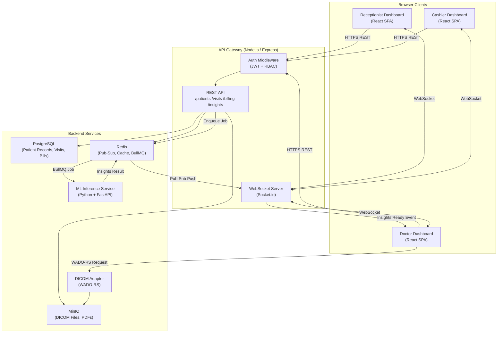

# 03 — Technical Architecture
## CancerCare OS (COS) — Oncology Hospital Information System

---

## System Overview

CancerCare OS is a **web-based, real-time, multi-role HIS** built on a React frontend with a Node.js/Python hybrid backend. Three role-specific SPAs (Doctor, Receptionist, Cashier) are served from a single frontend host and share a unified REST + WebSocket API. A dedicated **ML Inference Service** (Python/FastAPI) handles questionnaire processing asynchronously and pushes results via an internal message broker. DICOM files are served through a WADO-RS-compatible adapter. All patient data is stored in a PostgreSQL relational database with a Redis layer for real-time pub/sub and caching.

---

## Tech Stack

| Layer | Technology | Rationale |
|---|---|---|
| **Frontend** | React 18 + JavaScript (JSX) + Vite | Fast HMR, pure JavaScript ecosystem, flexible component architecture; role-based routing |
| **UI Component Library** | shadcn/ui + Tailwind CSS | Accessible, customisable clinical UI components |
| **DICOM Viewer** | Cornerstone.js 3 (cornerstone-wado-image-loader) | Industry-standard open-source DICOM rendering for web |
| **Rich Text Editor** | TipTap (ProseMirror-based) | Headless, extensible; ideal for the Conclusion Draft |
| **State Management** | Zustand + React Query (TanStack Query) | Lightweight global state; automatic server-state caching & invalidation |
| **Real-Time** | WebSocket (Socket.io) + Server-Sent Events fallback | Bidirectional push for cross-dashboard sync; SSE for one-way insight notifications |
| **Backend API** | Node.js + Express.js (JavaScript / ESM) | Handles auth, CRUD, orchestration; pure JavaScript runtime for fast development |
| **ML Inference Service** | Python 3.11 + FastAPI | Separate microservice for model inference; language-appropriate for ML stack |
| **ML Models** | scikit-learn / PyTorch (ONNX export) + Hugging Face Transformers | Structured data classification (risk flags) + NLP summary generation |
| **Task Queue** | BullMQ (Redis-backed) | Reliable async job queue for questionnaire → inference pipeline |
| **Database** | PostgreSQL 16 | ACID-compliant relational store; well-suited for clinical records |
| **ORM** | Prisma | Type-safe, migration-friendly ORM for Node.js backend |
| **Caching / Pub-Sub** | Redis 7 | Session cache, real-time event bus, BullMQ broker |
| **File Storage** | MinIO (S3-compatible) | On-premise DICOM + document storage; S3-compatible API |
| **Auth** | JWT (access + refresh tokens) + RBAC middleware | Role-based access: Doctor, Receptionist, Cashier, Admin |
| **Hosting** | Docker Compose (on-premise clinic server) → Docker Swarm / k8s for scale | On-premise first for data sovereignty; portable to cloud |
| **CI/CD** | GitHub Actions → Docker build → self-hosted runner | Automated test, lint, build pipeline |
| **Monitoring** | Prometheus + Grafana | System health, API latency, ML inference time |

---

## High-Level Architecture Diagram



---

## Key Data Models

### Patient
```
Patient {
  id          UUID PK
  mrn         VARCHAR UNIQUE           -- Auto-generated Medical Record Number
  full_name   VARCHAR
  dob         DATE
  gender      ENUM(M, F, Other)
  phone       VARCHAR
  address     TEXT
  emergency_contact_name   VARCHAR
  emergency_contact_phone  VARCHAR
  created_at  TIMESTAMP
  created_by  UUID FK → User
}
```

### Visit
```
Visit {
  id            UUID PK
  patient_id    UUID FK → Patient
  visit_date    DATE
  status        ENUM(Registered, Questionnaire_Complete, Insights_Ready, In_Consultation, Concluded, Billed)
  receptionist_id UUID FK → User
  doctor_id       UUID FK → User
  cashier_id      UUID FK → User
  created_at      TIMESTAMP
}
```

### Questionnaire
```
Questionnaire {
  id            UUID PK
  visit_id      UUID FK → Visit
  responses     JSONB                  -- Flexible key-value store for all answers
  submitted_at  TIMESTAMP
  status        ENUM(Draft, Submitted)
}
```

### MLInsight
```
MLInsight {
  id                    UUID PK
  visit_id              UUID FK → Visit
  risk_flags            JSONB            -- [{ label, severity, confidence }]
  symptom_summary       TEXT
  medication_warnings   JSONB            -- [{ drug_name, warning_text }]
  recommended_investigations JSONB      -- [{ name, done }]
  plain_language_summary TEXT
  model_version         VARCHAR
  generated_at          TIMESTAMP
}
```

### Prescription
```
Prescription {
  id          UUID PK
  visit_id    UUID FK → Visit
  doctor_id   UUID FK → User
  drugs       JSONB     -- [{ name, dose, route, frequency, duration, notes }]
  signed_at   TIMESTAMP
}
```

### Bill
```
Bill {
  id              UUID PK
  visit_id        UUID FK → Visit
  payment_mode    ENUM(Insurance, Cash)
  line_items      JSONB   -- [{ description, quantity, unit_price, total }]
  subtotal        DECIMAL
  insurance_covered DECIMAL
  patient_liability DECIMAL
  status          ENUM(Pending, Partial, Paid)
  cashier_id      UUID FK → User
  created_at      TIMESTAMP
}
```

### InsuranceDetail
```
InsuranceDetail {
  id              UUID PK
  visit_id        UUID FK → Visit
  provider_name   VARCHAR
  policy_number   VARCHAR
  group_number    VARCHAR
  coverage_pct    DECIMAL
  deductible_amt  DECIMAL
  pre_auth_number VARCHAR NULLABLE
}
```

---

## API Design

### Authentication
| Method | Endpoint | Description |
|---|---|---|
| POST | `/api/auth/login` | Returns JWT access + refresh tokens |
| POST | `/api/auth/refresh` | Refreshes access token |
| POST | `/api/auth/logout` | Invalidates refresh token |

### Patients
| Method | Endpoint | Description |
|---|---|---|
| POST | `/api/patients` | Create new patient |
| GET | `/api/patients/:id` | Get patient details |
| GET | `/api/patients/search?q=` | Search by name / phone |
| PATCH | `/api/patients/:id` | Update demographics |

### Visits
| Method | Endpoint | Description |
|---|---|---|
| POST | `/api/visits` | Create visit for patient |
| GET | `/api/visits/:id` | Get visit details (full join) |
| GET | `/api/visits/today` | List today's visits for doctor queue |
| PATCH | `/api/visits/:id/status` | Update visit status |

### Questionnaire
| Method | Endpoint | Description |
|---|---|---|
| POST | `/api/visits/:id/questionnaire` | Submit questionnaire (triggers ML) |
| GET | `/api/visits/:id/questionnaire` | Get submitted questionnaire |

### ML Insights
| Method | Endpoint | Description |
|---|---|---|
| GET | `/api/visits/:id/insights` | Get ML insight for visit |
| POST | `/api/visits/:id/insights/regenerate` | Re-run ML pipeline |

### DICOM
| Method | Endpoint | Description |
|---|---|---|
| POST | `/api/visits/:id/dicom` | Upload DICOM series |
| GET | `/api/visits/:id/dicom` | List DICOM series for visit |
| GET | `/api/dicom/wado?studyUID=&seriesUID=&objectUID=` | WADO-RS endpoint for Cornerstone |

### Prescription & Conclusion
| Method | Endpoint | Description |
|---|---|---|
| POST | `/api/visits/:id/prescription` | Create/update prescription |
| GET | `/api/visits/:id/prescription` | Get prescription |
| POST | `/api/visits/:id/conclusion` | Finalise conclusion draft |
| GET | `/api/visits/:id/conclusion` | Get conclusion document |

### Billing
| Method | Endpoint | Description |
|---|---|---|
| POST | `/api/visits/:id/bill` | Generate bill |
| GET | `/api/visits/:id/bill` | Get bill details |
| PATCH | `/api/visits/:id/bill` | Update line items / payment status |
| GET | `/api/visits/:id/bill/pdf` | Download receipt PDF |

### WebSocket Events
| Event | Direction | Payload |
|---|---|---|
| `insights:ready` | Server → Doctor | `{ visit_id, patient_name }` |
| `visit:status_changed` | Server → All | `{ visit_id, new_status }` |
| `conclusion:finalised` | Server → Cashier | `{ visit_id }` |
| `bill:paid` | Server → Receptionist | `{ visit_id }` |

---

## Security Considerations

- **Authentication**: JWT with short-lived access tokens (15 min) and refresh tokens (8 hours, stored HTTP-only cookie)
- **Authorisation**: RBAC middleware enforces per-route role allowlists (e.g., only `Doctor` role can POST to `/prescription`)
- **Data Encryption**: TLS 1.3 for all HTTP traffic; PostgreSQL column-level encryption for PII fields using `pgcrypto`
- **DICOM Security**: DICOM files stored in MinIO with pre-signed URLs (15-minute expiry) for viewer access
- **Audit Logging**: Every write operation logged to an immutable `AuditLog` table (user_id, action, resource, timestamp)
- **Input Validation**: Zod schema validation on all API inputs; parameterised Prisma queries prevent SQL injection
- **Rate Limiting**: API gateway rate-limits per user (100 req/min); ML inference endpoint rate-limited separately

---

## Scalability Considerations

- **Horizontal Scaling**: Stateless Node.js API servers behind a load balancer; Redis handles shared session state
- **ML Inference**: FastAPI ML service runs as an independent container; can be horizontally scaled or replaced with a GPU-backed endpoint
- **Database**: PostgreSQL with read replicas for heavy query loads (doctor queue, audit logs)
- **File Storage**: MinIO clustered mode for DICOM storage growth; DICOM files are large (50MB–2GB per study)
- **WebSocket**: Socket.io with Redis adapter for multi-instance pub/sub; sticky sessions at load balancer
- **Queuing**: BullMQ supports concurrency limits and retry logic; ML jobs are idempotent (retryable)
