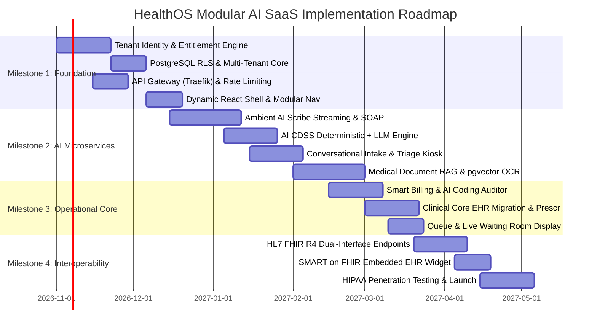

# Implementation Roadmap: Modular AI SaaS Platform

## 1. Milestones Overview

---

## 2. Milestone Breakdown & Deliverables

### Milestone 1: Platform Foundation & Entitlement Engine (Weeks 1–6)
- [ ] Initialize `identity_tenant_db` with organizations, users, module subscriptions, and API keys.
- [ ] Build `svc-tenant-identity` microservice in FastAPI Async with JWT signing, scoping, and Redis-backed session store.
- [ ] Configure API Gateway (Traefik/Kong) reverse proxy with automated subdomain/header tenant resolution (`X-Tenant-ID`).
- [ ] Set up PostgreSQL 16 connection pooling with automatic `SET LOCAL app.current_tenant_id` session variables and Row-Level Security (RLS) enforcement.
- [ ] Upgrade the React 18 frontend shell to dynamically query tenant entitlements on login and mount only subscribed route modules in the navigation sidebar.

### Milestone 2: Standalone AI Microservices (Weeks 7–14)
- [ ] Build `svc-ai-scribe` with WebSocket audio ingestion, Whisper/Deepgram STT, and LLM SOAP note generation pipeline.
- [ ] Implement Zero-Retention Audio Mode toggle and digital physician note sign-off.
- [ ] Build `svc-ai-cdss` with dual deterministic guideline rules (vitals/drug-drug) + LLM differential diagnosis cards.
- [ ] Build `svc-ai-intake` patient-facing mobile QR questionnaire with multilingual translation and ESI acuity scoring.
- [ ] Build `svc-ai-doc-intel` with multimodal OCR and PostgreSQL `pgvector` HNSW index for medical PDF RAG queries.
- [ ] Deploy AI Inference Gateway with Microsoft Presidio PII anonymization and LiteLLM routing (Azure OpenAI + local vLLM).

### Milestone 3: Operational Core & Revenue Automation (Weeks 15–20)
- [ ] Build `svc-ai-billing` with customizable service tariffs, invoice generation, and AI-driven unbilled code detection.
- [ ] Implement insurance Claim Denial Risk scorer and payment gateway integrations (Stripe, UPI).
- [ ] Complete `svc-clinical-core` migration for patient UHID registries, outpatient encounters, and e-prescriptions.
- [ ] Build `svc-queue-appointments` with real-time WebSocket queue token broadcast for waiting room displays.

### Milestone 4: Enterprise Interoperability & Commercial Launch (Weeks 21–26)
- [ ] Implement HL7 FHIR R4 standard controllers across all microservices (`Encounter`, `Observation`, `DocumentReference`, `Claim`).
- [ ] Build SMART on FHIR embeddable widget container for doctors working inside external EHRs (Epic/Cerner).
- [ ] Complete third-party HIPAA security audit, SOC2 Type 1 preparation, and penetration testing.
- [ ] Production deployment on Kubernetes (EKS/GKE) with Helm charts and automated Prometheus/Grafana observability.

---

## 3. Open Questions & Technical Spikes
- [ ] **Spike: Whisper Streaming Latency vs Accuracy**: Benchmark Whisper Large v3 vs Deepgram Nova-2 Medical on specialized Indian/multilingual clinical accents to determine latency vs cost tradeoffs.
- [ ] **Spike: SMART on FHIR Hospital Sandbox Validation**: Test FHIR `DocumentReference` push against Epic App Orchard sandbox to confirm zero-friction EHR ingestion.
- [ ] **Question**: Will enterprise hospital clients require on-premise local GPU nodes (Nvidia A10G/L4) for vLLM, or will Azure OpenAI HIPAA BAA satisfy 100% of their data sovereignty criteria?

---

## 4. Architectural Dependencies
- **Cloud Infrastructure**: Kubernetes cluster (AWS EKS or Azure AKS) with support for auto-scaling worker nodes.
- **Managed Database**: AWS Aurora PostgreSQL 16 or Azure Flexible Server with `pgvector` extension enabled.
- **Inference Accounts**: Azure OpenAI Service with approved HIPAA BAA and zero-data-logging agreements.
- **Speech API**: Deepgram Medical streaming API or dedicated GPU worker pool for self-hosted Whisper.
- **Message Broker**: Managed Amazon MQ (RabbitMQ) or Confluent Kafka cluster.
