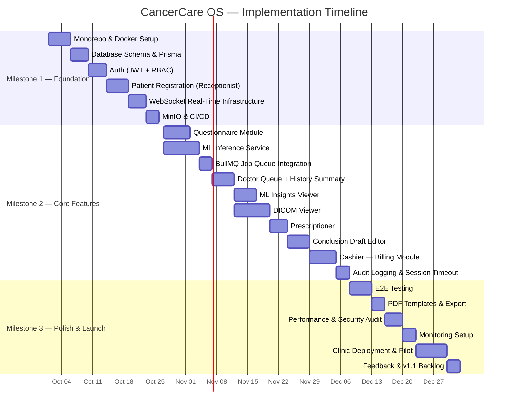

# 05 — Implementation Roadmap
## CancerCare OS (COS) — Oncology Hospital Information System

---

## Milestone 1 — Foundation (Weeks 1–4)

> **Goal**: Working infrastructure, auth, shared data layer, and basic patient registration flow.

### Checklist
- [ ] Initialize monorepo: `apps/frontend`, `apps/api`, `services/ml-inference`
- [ ] Configure Docker Compose: PostgreSQL, Redis, MinIO, Node API, Python FastAPI, React dev server
- [ ] Design and apply Prisma schema (Patient, Visit, Questionnaire, InsuranceDetail, User, AuditLog)
- [ ] Implement JWT auth with RBAC: Doctor, Receptionist, Cashier roles
- [ ] Build login page with role-based redirect
- [ ] Implement Patient Registration form (Receptionist) — demographics + insurance
- [ ] Patient search (name / phone) with duplicate detection
- [ ] Visit creation tied to patient
- [ ] Real-time WebSocket connection established between all three dashboards
- [ ] `visit:status_changed` event propagated to all connected clients
- [ ] MinIO bucket setup for DICOM and PDF storage
- [ ] CI/CD: GitHub Actions pipeline — lint + test + Docker build

---

## Milestone 2 — Core Features (Weeks 5–10)

> **Goal**: Complete the Receptionist → ML → Doctor consultation workflow end-to-end.

### Checklist
- [ ] **Questionnaire module**: Multi-step wizard (6 sections), draft save, final submit
- [ ] **BullMQ job**: Questionnaire submission enqueues ML inference job
- [ ] **ML Inference Service**: FastAPI endpoint accepting questionnaire JSON, returning insight schema
- [ ] **ML Models**: Integrate risk classification model (sklearn/PyTorch ONNX) + NLP summary model
- [ ] **Insight push**: On ML completion, publish `insights:ready` via Redis pub/sub → WebSocket to Doctor
- [ ] **Doctor dashboard — Patient Queue**: Live queue, status badges, real-time updates
- [ ] **Doctor dashboard — History Summary**: Collapsible sections, prior visits timeline
- [ ] **Doctor dashboard — ML Insights Viewer**: Risk flags with severity, plain-language summary, medication warnings, investigation checklist
- [ ] **DICOM Viewer**: Cornerstone.js integration, WADO-RS adapter, file upload to MinIO
- [ ] **DICOM Viewer Tools**: Windowing, zoom, pan, slice navigation, linear measure
- [ ] **Prescriptioner**: Drug autocomplete, multi-drug prescription, PDF export
- [ ] **Conclusion Draft**: TipTap editor, AI pre-fill from insights + prescription, finalise + lock + PDF
- [ ] `conclusion:finalised` WebSocket event triggers Cashier notification
- [ ] **Cashier dashboard — Bill Generation**: Auto-populated itemised bill, insurance vs. cash toggle
- [ ] **Cashier dashboard — Payment**: Mark as Paid, receipt PDF
- [ ] Audit logging for all write operations
- [ ] Session timeout + re-authentication prompt

---

## Milestone 3 — Polish & Launch (Weeks 11–14)

> **Goal**: Production hardening, UX refinement, and clinic go-live preparation.

### Checklist
- [ ] End-to-end testing of full patient visit lifecycle (Receptionist → Doctor → Cashier)
- [ ] DICOM viewer: annotation pinning, full-screen mode, multi-series support
- [ ] Bill: partial payment tracking, billing history across visits
- [ ] Cashier: manual line item add/remove, edge-case billing scenarios
- [ ] Role-specific notification centre (toast + in-app bell)
- [ ] Responsive layout audit (desktop + large tablet)
- [ ] PDF templates: clinic letterhead on receipts, conclusion letters, prescriptions
- [ ] Performance: API response time < 200ms p95; ML inference < 30s
- [ ] Security audit: penetration test on auth flow, API inputs, file uploads
- [ ] Data backup strategy: PostgreSQL daily snapshot, MinIO versioning
- [ ] Monitoring: Prometheus + Grafana dashboards for API health, ML inference latency, DB connections
- [ ] User onboarding: in-app help tooltips for all major flows
- [ ] Staff training documentation
- [ ] Deploy to clinic on-premise server; smoke-test with pilot users (1 doctor, 1 receptionist, 1 cashier)
- [ ] Gather NPS feedback; create v1.1 backlog

---

## Gantt Overview

---

## Open Questions

- [ ] Which ML models are pre-trained and ready for integration? Are they hosted or need to be served locally?
- [ ] Does the clinic already have a PACS server, or will DICOM files be uploaded manually?
- [ ] What is the target on-premise server spec (RAM, CPU, GPU)?
- [ ] Which insurance providers need to be supported at launch? Are their schemas standardised?
- [ ] Is there a preferred language for questionnaire localisation (Hindi, Tamil, etc.)?
- [ ] Will the Clinic Administrator role be needed at go-live, or deferred to v1.1?
- [ ] What print format is required for prescriptions — A4, A5, or prescription slip?
- [ ] Is an online backup / offsite DR strategy required by the clinic?

---

## Dependencies

- ML models must be finalised and containerisable before Milestone 2, Week 5
- DICOM file format and PACS access details needed before DICOM viewer development starts (Milestone 2, Week 6)
- Insurance provider field schemas needed before Receptionist insurance form is built (Milestone 1, Week 3)
- Clinic letterhead assets (logo, address) needed before PDF generation (Milestone 3)
- On-premise server provisioned before Milestone 3 deployment (Milestone 3, Week 11)
