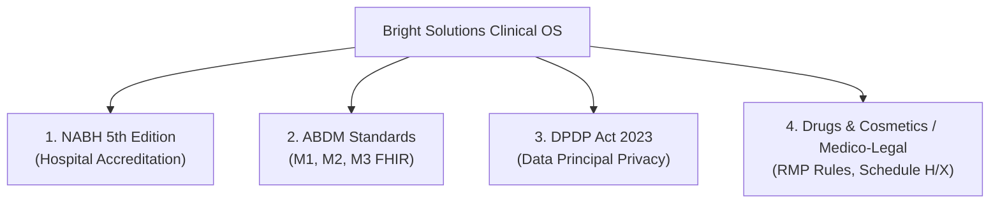
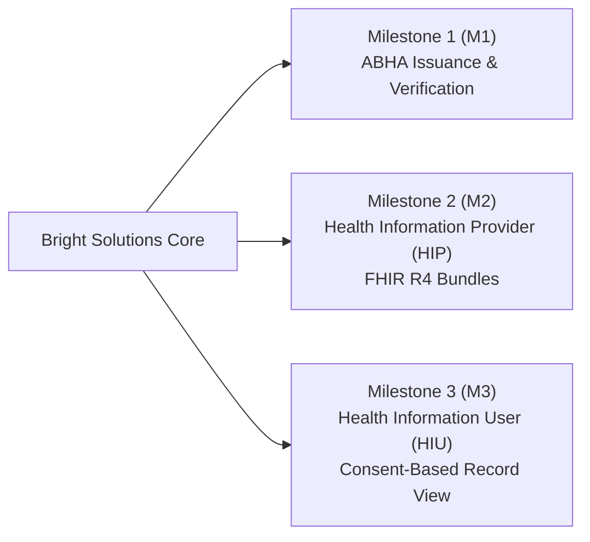
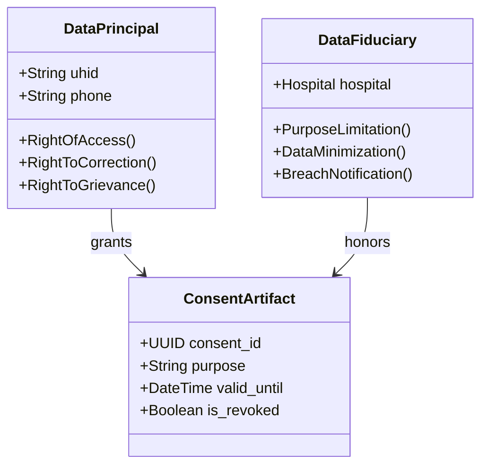
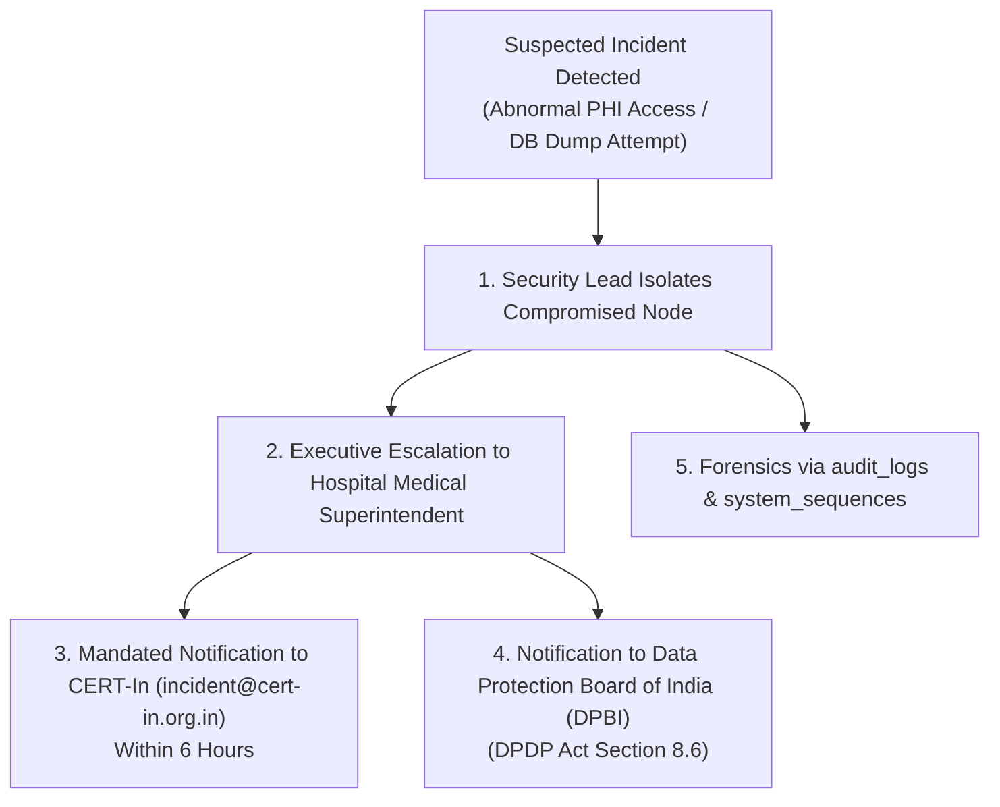

# D6 — Compliance & Regulatory Matrix
## Bright Solutions: Clinical Hospital Operating System

> **Document ID:** D6  
> **Version:** 1.0  
> **Status:** APPROVED ARCHITECTURE SPECIFICATION  
> **Depends On:** [01_PRD.md](file:///home/prem/Desktop/pbt/COS/docs/design/01_PRD.md), [02_feature_spec.md](file:///home/prem/Desktop/pbt/COS/docs/design/02_feature_spec.md), [09_database_schema_ddl.sql](file:///home/prem/Desktop/pbt/COS/docs/design/09_database_schema_ddl.sql), [11_api_endpoint_inventory.md](file:///home/prem/Desktop/pbt/COS/docs/design/11_api_endpoint_inventory.md), [13_rbac_permission_matrix.md](file:///home/prem/Desktop/pbt/COS/docs/design/13_rbac_permission_matrix.md), [03_technical_architecture.md](file:///home/prem/Desktop/pbt/COS/docs/design/03_technical_architecture.md), [08_security_access_control.md](file:///home/prem/Desktop/pbt/COS/docs/design/08_security_access_control.md)  
> **Prepared By:** Bright Solutions Backend Engineering Team  
> **Last Updated:** October 2026  

---

## Table of Contents

1. [Regulatory Scope & Statutory Authorities](#1-regulatory-scope--statutory-authorities)
2. [NABH (5th Edition) Standards Compliance Matrix](#2-nabh-5th-edition-standards-compliance-matrix)
3. [Ayushman Bharat Digital Mission (ABDM) Readiness](#3-ayushman-bharat-digital-mission-abdm-readiness)
4. [Digital Personal Data Protection (DPDP) Act 2023 Compliance](#4-digital-personal-data-protection-dpdp-act-2023-compliance)
5. [EHR Standards for India (MoHFW) & Clinical Terminologies](#5-ehr-standards-for-india-mohfw--clinical-terminologies)
6. [Pharmacy & Drug Regulatory Compliance (Drugs & Cosmetics Act)](#6-pharmacy--drug-regulatory-compliance-drugs--cosmetics-act)
7. [Medico-Legal Record Retention & Statutory Preservation](#7-medico-legal-record-retention--statutory-preservation)
8. [Statutory Data Breach & CERT-In Mandatory Reporting](#8-statutory-data-breach--cert-in-mandatory-reporting)
9. [Accreditation Audit Checklist for Inspection Readiness](#9-accreditation-audit-checklist-for-inspection-readiness)

---

## 1. Regulatory Scope & Statutory Authorities

Bright Solutions is engineered to ensure seamless statutory compliance and inspection readiness across four key Indian healthcare and data governance frameworks:

1. **National Accreditation Board for Hospitals & Healthcare Providers (NABH - 5th Edition):** Quality of care, patient safety, infection control, and Information Management Systems (IMS).
2. **Ayushman Bharat Digital Mission (ABDM - NHA):** National digital health infrastructure integration including ABHA verification, Health Information Provider (HIP), and Health Information User (HIU).
3. **Digital Personal Data Protection (DPDP) Act, 2023:** Lawful processing of sensitive personal data, purpose limitation, patient consent management, and data fiduciary obligations.
4. **MoHFW Electronic Health Record (EHR) Standards & Pharmacy Laws:** Drugs and Cosmetics Rules 1945, Indian Medical Council (Professional Conduct) Regulations, and Information Technology Act 2000.

---

## 2. NABH (5th Edition) Standards Compliance Matrix

The following matrix maps NABH 5th Edition objective elements directly to Bright Solutions database tables, application services, and business rules:

| NABH Standard | Objective Element | Hospital Requirement | Bright Solutions Architectural Implementation | Target DB Table / Service |
|:---|:---|:---|:---|:---|
| **AAC.1** | Unique Patient Identification | Every patient must have a single, unique identification across all visits (OPD, IPD, Emergency). | Auto-generates gapless `UHID` using concurrency-safe `system_sequences`. Phone & Aadhaar hash checks prevent duplicate records. | `patients.uhid`, `PatientService` |
| **AAC.2** | Triage in Emergency / OPD | Initial assessment must capture vital signs and screen for emergency red flags before consultation. | Nursing station triage records vitals, auto-calculates BMI, evaluates red-flag symptom combinations via CDSS. | `vital_signs`, `intake_questionnaires`, `TriageService` |
| **COP.3** | Uniform Care & Clinical Notes | Clinical consultation notes must follow structured documentation (SOAP) and be signed by an RMP. | Structured SOAP note fields; doctor sign-off permanently locks the encounter (`status = 'SIGNED'`). | `consultations`, `ConsultationService` |
| **COP.6** | Pain Assessment | Systematic assessment and recording of patient pain levels during admission and daily care. | Standardized numeric pain scale (0–10) recorded during vitals intake and inpatient nursing rounds. | `vital_signs.pain_scale`, `ipd_nurse_records` |
| **MOM.2** | Medication Safety & Formulary | Prescriptions must use generic names, verify formulary, and screen for drug-drug interactions. | Formulary typeahead enforcing generic names; deterministic CDSS checks DDI pairs; mandatory override for contraindicated drugs. | `pharmacy_items`, `cdss_ddi_rules`, `PharmacyService` |
| **MOM.5** | High-Risk & Narcotic Drugs | Strict inventory audit and verification for Schedule X/H narcotics and controlled substances. | Flagged via `pharmacy_items.is_narcotic`; requires batch allocation and pharmacist verification before dispensing. | `pharmacy_batches`, `pharmacy_dispensations` |
| **PRE.4** | Inpatient Bed Allocation | Accurate tracking of ward, room type, bed transfers, and bed occupancy status. | Normalized `wards` → `rooms` → `beds`. Inter-bed transfers tracked in `ipd_bed_allocations` with historical timestamps. | `ipd_bed_allocations`, `IPDService` |
| **PRE.6** | Discharge Summary | Every inpatient must receive a structured, physician-signed discharge summary covering hospital course and medications. | Discharge summary requires diagnosis, course, medications, warning signs, and doctor signature before bed release is unlocked. | `ipd_discharge_summaries`, `IPDService.finalize_discharge()` |
| **IMS.1** | Information Confidentiality | Protected health data accessible only to authorized personnel based on job role. | Granular Role-Based Access Control (RBAC) enforced via declarative FastAPI dependencies; patient names masked on public TV screens. | `roles`, `permissions`, `DisplayService` |
| **IMS.3** | Audit Trails & Tamper Resistance | All alterations or views of clinical records must be logged with user ID, timestamp, and action. | Synchronous append-only insert into `audit_logs` on all clinical transactions; `UPDATE`/`DELETE` permissions revoked on audit table. | `audit_logs`, `app/core/audit.py` |
| **IMS.4** | Data Backup & Disaster Recovery | Regular verified backups of clinical and financial databases with off-site retention. | Automated hourly snapshots + nightly full compressed dump (`JOB-DB-BACKUP`) with retention pruning (24h hourly, 30d daily). | `scripts/backup_database.sh`, `scheduled_job_executions` |

---

## 3. Ayushman Bharat Digital Mission (ABDM) Readiness

Bright Solutions is architected for full ABDM compliance across Milestones M1, M2, and M3:

### 3.1 Milestone 1 (M1): ABHA Creation & Verification
- **Patient Identity Schema:** The `patients` table includes dedicated fields:
  - `abha_id`: ABHA address (e.g. `patient@abdm`).
  - `abha_number`: 14-digit national health identifier (e.g. `14-1234-5678-9012`).
- **Workflow:** At registration, receptionists can verify an existing ABHA via OTP or link an existing profile to the generated hospital `UHID`.

### 3.2 Milestone 2 (M2): Health Information Provider (HIP)
As an ABDM Health Information Provider, Bright Solutions exports standardized **HL7 FHIR Release 4** resource bundles when patients authorize data sharing:

| Hospital Document | ABDM Record Type | Target FHIR R4 Resource Bundle | Source Database Tables |
|:---|:---|:---|:---|
| **OPD Consultation** | `OPConsultationRecord` | `Bundle` containing `Composition`, `Patient`, `Practitioner`, `Condition`, `MedicationRequest` | `consultations`, `consultation_diagnoses`, `prescriptions` |
| **Diagnostic Lab Report** | `DiagnosticReportRecord`| `Bundle` containing `DiagnosticReport`, `Observation`, `Specimen`, `ServiceRequest` | `lab_orders`, `lab_order_results`, `lab_test_parameters` |
| **Discharge Summary** | `DischargeSummaryRecord` | `Bundle` containing `Composition`, `Encounter`, `Condition`, `CarePlan`, `MedicationStatement` | `ipd_admissions`, `ipd_discharge_summaries`, `ipd_procedures` |
| **Prescription Slip** | `PrescriptionRecord` | `Bundle` containing `MedicationRequest`, `Medication`, `Dosage` | `prescriptions`, `prescription_items`, `pharmacy_items` |

### 3.3 Milestone 3 (M3): Health Information User (HIU)
- Structured consent artifact storage supporting electronic consent validation (Consent ID, valid date range, permitted categories: OPD, Lab, IPD) prior to displaying external health records to consulting doctors.

---

## 4. Digital Personal Data Protection (DPDP) Act 2023 Compliance

Bright Solutions enforces the statutory mandates of the **DPDP Act, 2023** concerning Sensitive Personal Data (Health and Financial Records):

### 4.1 Statutory Principles Implemented

1. **Lawful Purpose & Notice:** At patient check-in, reception captures explicit consent for hospital treatment, billing, and clinical care.
2. **Data Minimization:** APIs return strictly the fields required by each role (e.g. Waiting room display API excludes all patient names and diagnoses; Billing clerk API excludes psychiatric clinical notes).
3. **Aadhaar Vault / De-Identification:** Raw 12-digit Aadhaar numbers are never stored on disk. The system derives an irreversible salted HMAC-SHA-256 (`aadhaar_hash`) solely for duplicate patient detection, complying with UIDAI and DPDP mandates.
4. **Right of Correction:** Patients can request demographic updates (phone number, address) via `/api/v1/patients/{uuid}`, recording an audit log entry of the modification.
5. **Right to Erasure vs. Statutory Clinical Retention:** Under Section 12 of the DPDP Act, the right to erasure does **not** override statutory hospital record retention mandates. Clinical encounter records are preserved for the legally prescribed duration (minimum 3 years for OPD, 5–7 years for IPD).

---

## 5. EHR Standards for India (MoHFW) & Clinical Terminologies

To ensure semantic interoperability across healthcare institutions, Bright Solutions incorporates standard Indian and international clinical coding terminologies:

| Clinical Domain | Standard Coding System | Implementation in Bright Solutions |
|:---|:---|:---|
| **Disease Classification & Diagnoses** | **ICD-10** (WHO / MoHFW) | Master table `icd10_codes` with full-text search; consultation diagnoses require ICD-10 code binding. |
| **Laboratory Investigations** | **LOINC** (Logical Observation Identifiers) | Standard parameter codes in `lab_test_parameters.parameter_code` mapped to LOINC test codes. |
| **Medication Nomenclature** | **Generic Pharmacological Molecule** | Mandatory generic molecule naming in `pharmacy_items.generic_name`; off-formulary items require explicit generic documentation. |
| **Unit of Measurement** | **UCUM** (Unified Code for Units of Measure) | Standard clinical units stored in `lab_test_parameters.unit` (`g/dL`, `mmol/L`, `cells/mcL`) and `vital_signs` (`mmHg`, `bpm`, `°F`). |

---

## 6. Pharmacy & Drug Regulatory Compliance (Drugs & Cosmetics Act)

To meet the requirements of the **Drugs and Cosmetics Act, 1940 and Rules, 1945**:

1. **Registered Medical Practitioner (RMP) Prescription Requirement:**
   - E-prescriptions can only be created by accounts with the `DOCTOR` role possessing a verified `medical_council_reg_no`.
   - Prescription printouts include doctor's name, qualification, state medical council registration number, hospital contact details, date, patient UHID, age, and gender.
2. **Schedule H and Schedule X Narcotics Tracking:**
   - Drugs classified under Schedule H or Schedule X are flagged with `is_narcotic = 1` in `pharmacy_items`.
   - Every dispensation records batch lot number, manufacturer expiry date, quantity, dispensing pharmacist ID, and purchasing patient UHID, creating an automated statutory inspection register.
3. **Expiration Enforcement:**
   - Physical batches with `expiry_date <= CURRENT_DATE` are automatically locked (`is_active = 0`) by `JOB-PHARM-SENTINEL`, rendering them un-selectable in the pharmacist dispensing terminal.

---

## 7. Medico-Legal Record Retention & Statutory Preservation

Under Medical Council of India (MCI / NMC) regulations and statutory precedent, electronic health records must be retained according to the following schedule:

| Document / Record Type | Minimum Retention Period | Storage Tier | Bright Solutions Retention Policy |
|:---|:---|:---|:---|
| **Outpatient (OPD) Consultations** | **3 Years** from date of visit | Active MySQL DB | Online, searchable indefinitely |
| **Inpatient (IPD) Medical Records** | **5 Years** from date of discharge | Active MySQL DB | Online, searchable indefinitely |
| **Medico-Legal Cases (MLC) / Trauma** | **Permanent (until court resolution)** | Active MySQL DB | Strictly preserved; deletion locked |
| **Paediatric Inpatient Records** | **Until child attains 21 years of age** | Active MySQL DB | Online, searchable |
| **Pharmacy Dispensation Register** | **2 Years** from date of supply | Active MySQL DB | Online statutory register |
| **System Security & Audit Logs** | **3 Years** (NABH Section IMS) | Cold Encrypted JSONL | 180 days in MySQL, then compressed archive with SHA-256 seal |

---

## 8. Statutory Data Breach & CERT-In Mandatory Reporting

Under the **Indian Computer Emergency Response Team (CERT-In) Cyber Security Directions (April 2022)** and the **DPDP Act, 2023**:

### 8.1 6-Hour Reporting Mandate
Any cybersecurity incident involving unauthorized access, data breach, ransomware attack, or compromise of health databases must be reported to **CERT-In within 6 hours** of detection.

### 8.2 Hospital Incident Escalation Workflow

---

## 9. Accreditation Audit Checklist for Inspection Readiness

During NABH, state health department, or statutory compliance audits, inspectors can directly verify compliance using these exact system verification points:

| Audit Item | Inspection Checkpoint | Verification Command / Screen | Expected Result |
|:---|:---|:---|:---|
| **Patient ID Uniqueness** | Verify UHIDs are unique and gapless | `SELECT uhid, COUNT(*) FROM patients GROUP BY uhid HAVING COUNT(*) > 1;` | **0 rows returned** (No duplicate UHIDs) |
| **Clinical Immutability** | Attempt to modify signed consultation | `POST /api/v1/consultations/{uuid}/sign` on signed record | Returns `400 Bad Request` (`ENCOUNTER_ALREADY_SIGNED`) |
| **Drug Safety Screening** | Prescribe interacting drugs (e.g. Warfarin + Aspirin) | `POST /api/v1/prescriptions` without override | Returns `400 Bad Request` (`UNJUSTIFIED_CONTRAINDICATION`) |
| **Waiting Room Privacy** | Inspect TV display network payload | View response of `GET /api/v1/display/queue` | Patient names and diagnoses are **100% absent** |
| **Aadhaar Privacy** | Query database for plaintext Aadhaar | `SELECT column_name FROM information_schema.columns WHERE table_name='patients' AND column_name='aadhaar_number';` | **0 rows returned** (Only `aadhaar_hash` exists) |
| **Audit Trail Liveness** | Check recent user activity logging | `SELECT action, entity_name, created_at FROM audit_logs ORDER BY id DESC LIMIT 10;` | Real-time trail with user IDs and timestamps |
| **Discharge Completeness** | Attempt inpatient discharge without summary | `POST /api/v1/ipd/admissions/{uuid}/discharge` | Blocked with `400 CANNOT_DISCHARGE` |
