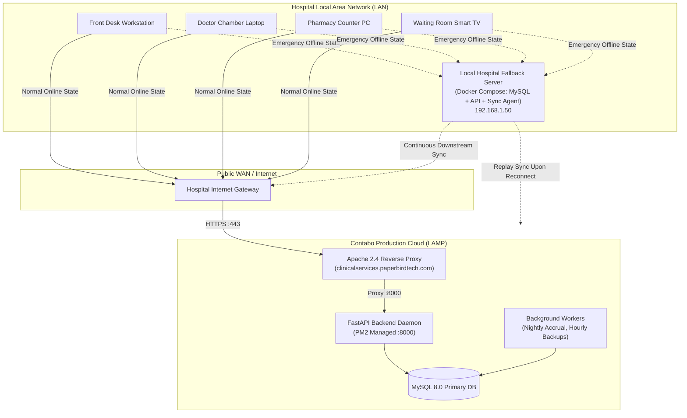

# D7 — Deployment Architecture Document
## Bright Solutions: Clinical Hospital Operating System

> **Document ID:** D7  
> **Version:** 1.0  
> **Status:** APPROVED ARCHITECTURE SPECIFICATION  
> **Depends On:** [01_PRD.md](file:///home/prem/Desktop/pbt/COS/docs/design/01_PRD.md), [02_feature_spec.md](file:///home/prem/Desktop/pbt/COS/docs/design/02_feature_spec.md), [09_database_schema_ddl.sql](file:///home/prem/Desktop/pbt/COS/docs/design/09_database_schema_ddl.sql), [11_api_endpoint_inventory.md](file:///home/prem/Desktop/pbt/COS/docs/design/11_api_endpoint_inventory.md), [03_technical_architecture.md](file:///home/prem/Desktop/pbt/COS/docs/design/03_technical_architecture.md), [08_security_access_control.md](file:///home/prem/Desktop/pbt/COS/docs/design/08_security_access_control.md)  
> **Prepared By:** Bright Solutions Backend Engineering Team  
> **Last Updated:** October 2026  

---

## Table of Contents

1. [Architectural Overview & Dual-Topology Model](#1-architectural-overview--dual-topology-model)
2. [Primary Production Deployment: Contabo LAMP Server](#2-primary-production-deployment-contabo-lamp-server)
3. [Local Hospital LAN Fallback: Edge Docker Bundle](#3-local-hospital-lan-fallback-edge-docker-bundle)
4. [Client-Side Failover & Heartbeat Switcher](#4-client-side-failover--heartbeat-switcher)
5. [Data Synchronization & Offline Replay Protocol](#5-data-synchronization--offline-replay-protocol)
6. [Apache Web Server & Reverse Proxy Configuration](#6-apache-web-server--reverse-proxy-configuration)
7. [Process Management with PM2 (`ecosystem.config.js`)](#7-process-management-with-pm2-ecosystemconfigjs)
8. [MySQL 8.0 Performance Tuning (`my.cnf`)](#8-mysql-80-performance-tuning-mycnf)
9. [SSL/TLS Certificate Lifecycle (Let's Encrypt / Certbot)](#9-ssltls-certificate-lifecycle-lets-encrypt--certbot)
10. [Automated Disaster Recovery & Backup Pipeline](#10-automated-disaster-recovery--backup-pipeline)

---

## 1. Architectural Overview & Dual-Topology Model

Bright Solutions implements a **Cloud-Primary with Local Hospital LAN Fallback** deployment topology:

1. **Primary Production Environment (Contabo Cloud LAMP):**
   - The authoritative production system runs on a **Contabo LAMP VPS** at `https://clinicalservices.paperbirdtech.com`.
   - All normal hospital traffic (Registration, OPD Queue, Doctor Consultations, Pharmacy Dispensation, IPD Stay, Pathology, Billing) connects to this server over HTTPS.
2. **Local Hospital LAN Fallback (Warm Standby Edge):**
   - A dedicated machine on the hospital local network (e.g. at `http://192.168.1.50:8000`) runs an identical containerized **Docker Compose bundle**.
   - If the hospital's internet connection drops, staff workstations automatically switch to this local server. Consultations, triage, and emergency registrations continue uninterrupted.
   - When internet is restored, an automated sync agent replays offline transactions back to Contabo without primary key collisions.



---

## 2. Primary Production Deployment: Contabo LAMP Server

### 2.1 Server Specifications
- **Provider:** Contabo Cloud VPS
- **OS:** Ubuntu 22.04 LTS (x86_64)
- **CPU / RAM:** 4 vCPU Cores, 8 GB RAM, 100 GB NVMe Storage
- **Domain:** `clinicalservices.paperbirdtech.com`
- **Application Root Directory:** `/home/prem/public_html/clinicalservices.paperbirdtech.com/`
- **Backend Directory:** `/home/prem/public_html/clinicalservices.paperbirdtech.com/backend/`
- **Python Virtualenv:** `/home/prem/public_html/clinicalservices.paperbirdtech.com/backend/venv/`

### 2.2 Directory Layout on Contabo Server

```
/home/prem/public_html/clinicalservices.paperbirdtech.com/
├── index.html                      # React production SPA entry
├── assets/                         # Compiled JS, CSS, and media bundles
├── .htaccess                       # Apache rewrite & proxy rules
└── backend/                        # FastAPI application root
    ├── main.py                     # API entry point
    ├── ecosystem.config.js         # PM2 production process configuration
    ├── requirements.txt            # Python dependencies
    ├── venv/                       # Dedicated Python 3.11 virtualenv
    ├── app/                        # Modular monolith codebase
    ├── alembic/                    # Database migrations
    ├── storage/                    # Uploaded diagnostic PDF reports (chmod 600)
    └── logs/                       # Rotating application logs
```

---

## 3. Local Hospital LAN Fallback: Edge Docker Bundle

Inside the physical hospital, a dedicated desktop PC or mini-server (e.g. Intel Core i5, 16GB RAM, 256GB SSD) runs the fallback bundle via **Docker Compose**.

### 3.1 File: `docker-compose.edge.yml`

```yaml
version: '3.8'

services:
  edge-db:
    image: mysql:8.0
    container_name: brightsolutions-edge-db
    restart: always
    environment:
      MYSQL_ROOT_PASSWORD: EdgeRootPassword123!
      MYSQL_DATABASE: bright_solutions_edge
      MYSQL_USER: edge_user
      MYSQL_PASSWORD: EdgeUserPassword123!
    volumes:
      - edge_mysql_data:/var/lib/mysql
      - ./config/my-edge.cnf:/etc/mysql/conf.d/my.cnf
    ports:
      - "3306:3306"
    networks:
      - edge-network

  edge-api:
    image: paperbirdtech/brightsolutions-backend:latest
    container_name: brightsolutions-edge-api
    restart: always
    depends_on:
      - edge-db
    environment:
      - DEPLOYMENT_MODE=EDGE_FALLBACK
      - OFFLINE_MODE=true
      - DB_HOST=edge-db
      - DB_PORT=3306
      - DB_USER=edge_user
      - DB_PASSWORD=EdgeUserPassword123!
      - DB_NAME=bright_solutions_edge
      - CLOUD_UPSTREAM_URL=https://clinicalservices.paperbirdtech.com/api/v1
    ports:
      - "8000:8000"
    networks:
      - edge-network

  edge-sync-agent:
    image: paperbirdtech/brightsolutions-sync:latest
    container_name: brightsolutions-edge-sync
    restart: always
    depends_on:
      - edge-api
    environment:
      - LOCAL_API_URL=http://edge-api:8000/api/v1
      - CLOUD_API_URL=https://clinicalservices.paperbirdtech.com/api/v1
      - SYNC_INTERVAL_SECONDS=30
    networks:
      - edge-network

volumes:
  edge_mysql_data:

networks:
  edge-network:
    driver: bridge
```

### 3.2 Starting the Local Edge Fallback
```bash
# 1-command startup on local hospital server
docker compose -f docker-compose.edge.yml up -d
```

---

## 4. Client-Side Failover & Heartbeat Switcher

The React frontend web app includes a built-in network health probe that guarantees staff never lose work during internet outages.

### 4.1 Heartbeat Architecture

```mermaid
graph TD
    A["React Client Initialized"] --> B["Probe Cloud API: GET /api/v1/healthz<br/>(Every 10 seconds)"]
    B --> C{"Cloud Responded?"}
    C -->|Yes (200 OK)| D["State: ONLINE<br/>Route traffic to Contabo Server"]
    C -->|No / Timeout x3| E["State: EMERGENCY_OFFLINE<br/>Display Amber Alert Banner in UI"]
    E --> F["Dynamically route API requests to Local Fallback Gateway<br/>(http://192.168.1.50:8000/api/v1)"]
    F --> G["Probe Cloud API in Background<br/>(Every 15 seconds)"]
    G --> H{"Cloud Restored?"}
    H -->|Yes| I["Trigger Sync Agent Replay Alert<br/>Switch back to Cloud"]
```

### 4.2 Frontend Implementation (`src/core/networkFailover.ts`)

```typescript
class NetworkFailoverManager {
  private isOnline = true;
  private failedAttempts = 0;
  private readonly primaryUrl = 'https://clinicalservices.paperbirdtech.com/api/v1';
  private readonly fallbackUrl = 'http://192.168.1.50:8000/api/v1';

  public async getActiveBaseUrl(): Promise<string> {
    return this.isOnline ? this.primaryUrl : this.fallbackUrl;
  }

  public async checkLiveness(): Promise<void> {
    try {
      const response = await fetch(`${this.primaryUrl}/healthz`, {
        method: 'GET',
        signal: AbortSignal.timeout(3000)
      });
      if (response.ok) {
        if (!this.isOnline) {
          this.isOnline = true;
          this.emitStatusChange('ONLINE');
        }
        this.failedAttempts = 0;
      } else {
        this.handleFailure();
      }
    } catch (e) {
      this.handleFailure();
    }
  }

  private handleFailure() {
    this.failedAttempts += 1;
    if (this.failedAttempts >= 3 && this.isOnline) {
      this.isOnline = false;
      this.emitStatusChange('EMERGENCY_OFFLINE');
    }
  }
}
```

---

## 5. Data Synchronization & Offline Replay Protocol

### 5.1 Downstream Master Sync (Cloud ➔ Edge)
While online, the `edge-sync-agent` polls Contabo every **5 minutes** to pull updated master data into the local database:
- `users`, `roles`, `doctor_profiles`, `doctor_schedules`
- `tariffs`, `lab_tests`, `lab_test_parameters`
- `pharmacy_items`, `pharmacy_batches`
- `patients` (recent updates)

### 5.2 Conflict-Free Sequence Partitioning
To guarantee that records created offline on the local LAN server never collide with records created on the cloud server:
- Cloud Contabo Sequences: `BS-001042`, `OPD-004521`, `INV-OPD-000382`
- Offline Edge Sequences: `OFFLINE-UHID-00001`, `OFFLINE-OPD-00001`, `OFFLINE-INV-00001`
- Internal primary keys (`id`) on the edge server start from `100,000,000` to avoid B-Tree clustered ID overlaps.
- Public UUIDs (`public_id`) are globally unique by definition (UUID v4).

### 5.3 Upstream Replay Protocol (Edge ➔ Cloud)
When internet connectivity is restored:
1. `edge-sync-agent` calls `POST /api/v1/sync/replay-batch` on the Contabo server, sending all records where `created_at >= last_sync_time`.
2. Contabo validates each record inside an isolated database transaction.
3. If an offline patient was registered with a temporary UHID (`OFFLINE-UHID-00001`), the cloud sequence engine assigns a permanent `UHID` (`BS-001050`), updating linked encounters, and returns the mapping to the edge server.
4. An audit log entry is recorded: `SYNC_OFFLINE_BATCH_REPLAYED` with total records reconciled.

---

## 6. Apache Web Server & Reverse Proxy Configuration

File: `/home/prem/public_html/clinicalservices.paperbirdtech.com/.htaccess`

```apache
<IfModule mod_rewrite.c>
  RewriteEngine On
  RewriteBase /

  # --------------------------------------------------------------------------
  # 1. SSL / HTTPS Enforcement
  # --------------------------------------------------------------------------
  RewriteCond %{HTTPS} !=on
  RewriteRule ^ https://%{HTTP_HOST}%{REQUEST_URI} [L,R=301]

  # --------------------------------------------------------------------------
  # 2. Real-Time Server-Sent Events (SSE) Proxy (No Buffering)
  # --------------------------------------------------------------------------
  RewriteCond %{REQUEST_URI} ^/api/v1/display/queue/stream [NC]
  RewriteRule ^(.*)$ http://127.0.0.1:8000/$1 [P,L]
  SetEnv no-gzip 1
  SetEnv proxy-nokeepalive 1

  # --------------------------------------------------------------------------
  # 3. REST API Reverse Proxy to FastAPI Uvicorn Daemon
  # --------------------------------------------------------------------------
  RewriteCond %{REQUEST_URI} ^/api/ [NC]
  RewriteRule ^api/(.*)$ http://127.0.0.1:8000/api/$1 [P,L]

  # --------------------------------------------------------------------------
  # 4. OpenAPI / Swagger Documentation Proxy
  # --------------------------------------------------------------------------
  RewriteCond %{REQUEST_URI} ^/(docs|redoc|openapi.json) [NC]
  RewriteRule ^(.*)$ http://127.0.0.1:8000/$1 [P,L]

  # --------------------------------------------------------------------------
  # 5. Static Frontend SPA Fallback (React Router)
  # --------------------------------------------------------------------------
  RewriteCond %{REQUEST_FILENAME} !-f
  RewriteCond %{REQUEST_FILENAME} !-d
  RewriteRule ^ index.html [L]
</IfModule>

# ----------------------------------------------------------------------------
# 6. HTTP Security Headers
# ----------------------------------------------------------------------------
<IfModule mod_headers.c>
  Header always set Strict-Transport-Security "max-age=31536000; includeSubDomains; preload"
  Header always set X-Frame-Options "DENY"
  Header always set X-Content-Type-Options "nosniff"
  Header always set Referrer-Policy "strict-origin-when-cross-origin"
  Header always set Permissions-Policy "camera=(), microphone=(), geolocation=()"
</IfModule>
```

---

## 7. Process Management with PM2 (`ecosystem.config.js`)

The FastAPI backend daemon is managed via **PM2** on the Contabo server, ensuring automatic respawns upon crashes and zero-downtime reloads.

### File: `backend/ecosystem.config.js`

```javascript
module.exports = {
  apps: [
    {
      name: "bright-solutions-api",
      script: "main.py",
      cwd: "/home/prem/public_html/clinicalservices.paperbirdtech.com/backend",
      interpreter: "/home/prem/public_html/clinicalservices.paperbirdtech.com/backend/venv/bin/python",
      args: "",
      instances: 2,               // 2 cluster workers for 4 vCPU cores
      exec_mode: "cluster",
      autorestart: true,
      watch: false,
      max_memory_restart: "1G",   // Restart worker if memory leaks exceed 1GB
      env: {
        PORT: 8000,
        NODE_ENV: "production",
        PYTHONUNBUFFERED: "1"
      },
      log_file: "/home/prem/public_html/clinicalservices.paperbirdtech.com/backend/logs/combined.log",
      out_file: "/home/prem/public_html/clinicalservices.paperbirdtech.com/backend/logs/out.log",
      error_file: "/home/prem/public_html/clinicalservices.paperbirdtech.com/backend/logs/error.log",
      time: true
    }
  ]
};
```

### Operational PM2 Commands
```bash
# Start backend daemon
pm2 start ecosystem.config.js

# View live cluster status
pm2 status

# View live aggregated streaming logs
pm2 logs bright-solutions-api

# Zero-downtime rolling restart
pm2 reload bright-solutions-api

# Save PM2 process list to resurrect on server reboot
pm2 save
```

---

## 8. MySQL 8.0 Performance Tuning (`my.cnf`)

File: `/etc/mysql/conf.d/brightsolutions.cnf` (Optimized for 8GB RAM Contabo server)

```ini
[mysqld]
# ----------------------------------------------------------------------------
# General & Networking
# ----------------------------------------------------------------------------
bind-address            = 127.0.0.1
port                    = 3306
max_connections         = 150
connect_timeout         = 10
wait_timeout            = 600
interactive_timeout     = 600

# ----------------------------------------------------------------------------
# Charset & Collation
# ----------------------------------------------------------------------------
character-set-server    = utf8mb4
collation-server        = utf8mb4_unicode_ci

# ----------------------------------------------------------------------------
# InnoDB Buffer Pool & Storage Optimization
# ----------------------------------------------------------------------------
# Allocate 50-60% of total system RAM to InnoDB Buffer Pool
innodb_buffer_pool_size         = 4G
innodb_buffer_pool_instances     = 4
innodb_log_file_size            = 512M
innodb_log_buffer_size          = 64M
innodb_flush_log_at_trx_commit  = 1        # Strict ACID durability for medical data
innodb_flush_method             = O_DIRECT
innodb_file_per_table           = 1

# ----------------------------------------------------------------------------
# Query Logging & Diagnostics
# ----------------------------------------------------------------------------
slow_query_log                  = 1
slow_query_log_file             = /var/log/mysql/mysql-slow.log
long_query_time                 = 1.0      # Log queries exceeding 1000ms
```

---

## 9. SSL/TLS Certificate Lifecycle (Let's Encrypt / Certbot)

Automated certificate management on the Contabo server:

```bash
# Initial TLS certificate generation
sudo certbot --apache -d clinicalservices.paperbirdtech.com --non-interactive --agree-tos --email dev@paperbirdtech.com

# Automated renewal check (runs via systemd certbot.timer twice daily)
sudo certbot renew --dry-run
```

---

## 10. Automated Disaster Recovery & Backup Pipeline

Backups execute via system cron using the script specified in [14_background_jobs_spec.md](file:///home/prem/Desktop/pbt/COS/docs/design/14_background_jobs_spec.md):

### Crontab Schedule (`/etc/cron.d/brightsolutions_backups`)
```cron
# Hourly non-blocking InnoDB snapshot
0 * * * * prem /home/prem/public_html/clinicalservices.paperbirdtech.com/backend/scripts/backup_database.sh >> /var/log/bs_backup.log 2>&1

# Nightly encrypted sync to secondary cloud storage at 03:00 AM
0 3 * * * prem rclone sync /var/backups/bright_solutions/ remote-s3:bs-hospital-backups/ --checksum
```
