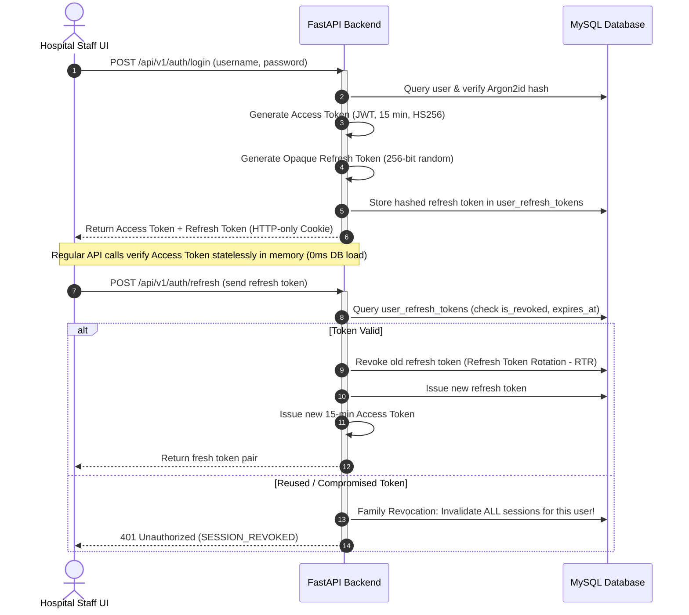
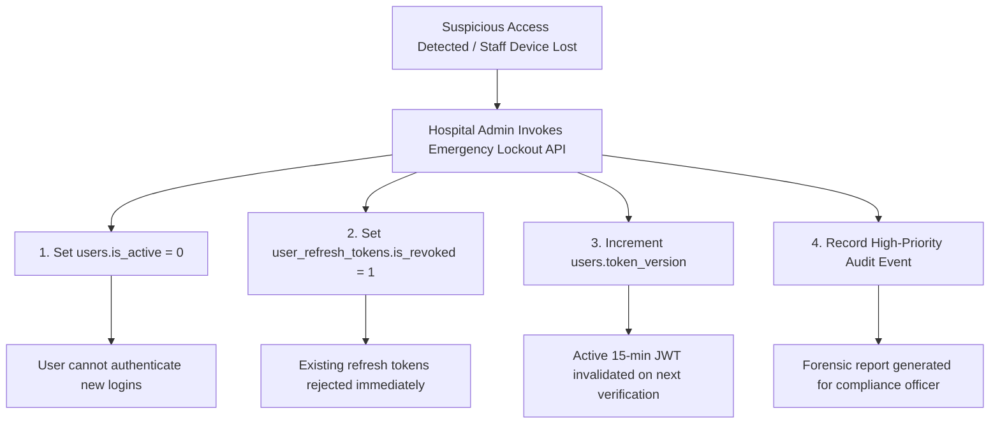

# D8 — Security & Access Control Specification
## Bright Solutions: Clinical Hospital Operating System

> **Document ID:** D8  
> **Version:** 1.0  
> **Status:** APPROVED ARCHITECTURE SPECIFICATION  
> **Depends On:** [01_PRD.md](file:///home/prem/Desktop/pbt/COS/docs/design/01_PRD.md), [02_feature_spec.md](file:///home/prem/Desktop/pbt/COS/docs/design/02_feature_spec.md), [09_database_schema_ddl.sql](file:///home/prem/Desktop/pbt/COS/docs/design/09_database_schema_ddl.sql), [11_api_endpoint_inventory.md](file:///home/prem/Desktop/pbt/COS/docs/design/11_api_endpoint_inventory.md), [13_rbac_permission_matrix.md](file:///home/prem/Desktop/pbt/COS/docs/design/13_rbac_permission_matrix.md), [03_technical_architecture.md](file:///home/prem/Desktop/pbt/COS/docs/design/03_technical_architecture.md)  
> **Prepared By:** Bright Solutions Backend Engineering Team  
> **Last Updated:** October 2026  

---

## Table of Contents

1. [Threat Model & Hospital Security Posture](#1-threat-model--hospital-security-posture)
2. [Authentication Architecture & Credentials Security](#2-authentication-architecture--credentials-security)
3. [Token Lifecycle & Session Revocation Framework](#3-token-lifecycle--session-revocation-framework)
4. [Role-Based Access Control (RBAC) & Contextual Guards](#4-role-based-access-control-rbac--contextual-guards)
5. [Protected Health Information (PHI) & DPDP Act 2023 Compliance](#5-protected-health-information-phi--dpdp-act-2023-compliance)
6. [Immutable Audit Logging & Tamper-Proof Trail](#6-immutable-audit-logging--tamper-proof-trail)
7. [Transport Security, HTTP Hardening & Network Defense](#7-transport-security-http-hardening--network-defense)
8. [Rate Limiting & Brute-Force Prevention](#8-rate-limiting--brute-force-prevention)
9. [Account Compromise & Emergency Lockout Playbook](#9-account-compromise--emergency-lockout-playbook)

---

## 1. Threat Model & Hospital Security Posture

Bright Solutions processes critical patient clinical records, electronic health prescriptions, financial transactions, and statutory identity numbers. The system's security architecture addresses the **STRIDE** threat model specifically contextualized for hospital operational environments:

| STRIDE Threat | Hospital Attack Vector | Bright Solutions Architectural Defense |
|:---|:---|:---|
| **Spoofing** | Rogue actor attempts to impersonate a doctor to prescribe narcotics or view celebrity medical files | Argon2id credential hashing, short-lived JWTs (15 min), Refresh Token Rotation (RTR), and cryptographic session binding |
| **Tampering** | Modification of signed clinical consultation notes or diagnostic lab reports | Post-signature immutability guard (`status = 'SIGNED'`), database audit triggers, and cryptographic report hash seals |
| **Repudiation** | Doctor denies authoring an erroneous prescription or billing clerk denies pocketing cash | Mandatory synchronous `audit_logs` entries capturing user ID, timestamp, client IP, action, and entity state on every mutating transaction |
| **Information Disclosure** | Leakage of patient diagnoses or Aadhaar identity via public waiting room TV or network sniffing | TLS 1.3 encryption in transit, SHA-256 one-way hashing for Aadhaar, zero-PHI data sanitization pipeline on TV display stream |
| **Denial of Service** | Flooding registration API or waiting room queue stream during peak hours | Apache reverse proxy rate limiting, connection pooling (`QueuePool`), and decoupled Server-Sent Events (SSE) streaming |
| **Elevation of Privilege** | Receptionist exploits API to approve bill discounts or discharge inpatients | Declarative FastAPI RBAC dependency injection checking granular permission tokens on every single route |

---

## 2. Authentication Architecture & Credentials Security

### 2.1 Password Storage & Derivation Standard

Staff credentials are protected using **Argon2id**, the industry-standard memory-hard password hashing algorithm (RFC 9106), with automatic fallback to **bcrypt** (work factor 12) if running on restricted legacy hardware.

```python
# app/core/security.py
from passlib.context import CryptContext

pwd_context = CryptContext(
    schemes=["argon2", "bcrypt"],
    deprecated="auto",
    argon2__memory_cost=65536,  # 64 MB memory cost
    argon2__time_cost=3,        # 3 iterations
    argon2__parallelism=4,      # 4 parallel threads
    bcrypt__rounds=12           # 12 rounds for bcrypt fallback
)

def verify_password(plain_password: str, hashed_password: str) -> bool:
    return pwd_context.verify(plain_password, hashed_password)

def get_password_hash(password: str) -> str:
    return pwd_context.hash(password)
```

### 2.2 Password Complexity Policy
- Minimum length: **10 characters**.
- Complexity requirements: At least 1 uppercase letter (`[A-Z]`), 1 lowercase letter (`[a-z]`), 1 numerical digit (`[0-9]`), and 1 special symbol (`[!@#$%^&*()_+\-=\[\]{};':"\\|,.<>\/?]`).
- Password reuse policy: System rejects reuse of the last 3 historical passwords.

### 2.3 Account Lockout Mechanism
To prevent credential stuffing and dictionary attacks:
- **Lockout Threshold:** 5 consecutive failed login attempts within a 10-minute sliding window.
- **Lockout Action:** Account is locked for **15 minutes**.
- **Audit Trigger:** Generates a high-priority security event: `SECURITY_ACCOUNT_LOCKED_FAILED_LOGINS`.

---

## 3. Token Lifecycle & Session Revocation Framework

To combine high-throughput stateless API verification with the ability to instantly revoke compromised staff sessions, Bright Solutions implements a **Hybrid Stateless Access + Stateful Refresh Token** architecture.



### 3.1 Access Token (JWT) Specification
- **Algorithm:** `HS256` (HMAC using SHA-256) with a minimum 256-bit cryptographically random secret (`JWT_SECRET_KEY`).
- **Lifespan:** **15 minutes** (`ACCESS_TOKEN_EXPIRE_MINUTES = 15`).
- **Payload Claims:**
```json
{
  "sub": "e5f6a7b8-c9d0-1e2f-3a4b-5c6d7e8f9a0b",
  "user_id": 4,
  "hospital_id": 1,
  "username": "dr_roy",
  "role_code": "DOCTOR",
  "doctor_profile_id": 2,
  "exp": 1729681500,
  "iat": 1729680600,
  "iss": "bright-solutions-auth"
}
```

### 3.2 Refresh Token Specification & Storage DDL
- **Format:** Opaque 64-character URL-safe random string (`secrets.token_urlsafe(48)`).
- **Lifespan:** **7 days** (`REFRESH_TOKEN_EXPIRE_DAYS = 7`).
- **Storage:** Stored in an HTTP-only, `Secure`, `SameSite=Strict` cookie to prevent Cross-Site Scripting (XSS) extraction.

#### Table: `user_refresh_tokens`
```sql
CREATE TABLE IF NOT EXISTS user_refresh_tokens (
    id BIGINT UNSIGNED AUTO_INCREMENT PRIMARY KEY,
    user_id BIGINT UNSIGNED NOT NULL,
    token_hash VARCHAR(64) NOT NULL UNIQUE COMMENT 'SHA-256 hash of refresh token string',
    session_family_id CHAR(36) NOT NULL COMMENT 'UUID grouping rotated tokens in same session',
    device_info VARCHAR(255) NULL,
    ip_address VARCHAR(45) NULL,
    is_revoked TINYINT(1) NOT NULL DEFAULT 0,
    expires_at DATETIME NOT NULL,
    created_at DATETIME NOT NULL DEFAULT CURRENT_TIMESTAMP,
    updated_at DATETIME NOT NULL DEFAULT CURRENT_TIMESTAMP ON UPDATE CURRENT_TIMESTAMP,
    INDEX idx_urt_user (user_id),
    INDEX idx_urt_lookup (token_hash, is_revoked),
    CONSTRAINT fk_urt_user FOREIGN KEY (user_id) REFERENCES users (id) ON DELETE CASCADE
) ENGINE=InnoDB DEFAULT CHARSET=utf8mb4 COLLATE=utf8mb4_unicode_ci;
```

### 3.3 Instant Session Revocation by Admin
When an administrator disables an account or clicks "Revoke Sessions" via `/api/v1/users/{uuid}/revoke-sessions`:
```sql
UPDATE user_refresh_tokens 
SET is_revoked = 1, updated_at = NOW() 
WHERE user_id = :target_user_id;
```
Within at most 15 minutes (or immediately upon refresh attempt), the staff user's session is terminated.

---

## 4. Role-Based Access Control (RBAC) & Contextual Guards

### 4.1 Granular Role-Permission Checks
As defined in [13_rbac_permission_matrix.md](file:///home/prem/Desktop/pbt/COS/docs/design/13_rbac_permission_matrix.md), all API endpoints declare mandatory permission requirements. The enforcement middleware caches role permissions in memory and evaluates them with zero database overhead:

```python
# app/core/security.py
def require_permission(permission_code: str):
    def dependency(current_user: User = Depends(get_current_active_user)):
        if current_user.role.role_code == "SUPER_ADMIN":
            return current_user
            
        user_perms = {p.permission_code for p in current_user.role.permissions}
        if permission_code not in user_perms:
            raise HTTPException(
                status_code=status.HTTP_403_FORBIDDEN,
                detail={
                    "code": "FORBIDDEN",
                    "message": f"User lacks required permission: '{permission_code}'"
                }
            )
        return current_user
    return dependency
```

### 4.2 Contextual Resource Ownership Guards

In addition to role permissions, the service layer enforces **Resource Ownership Checks**:

1. **Physician Encounter Isolation:** A doctor cannot edit or sign another doctor's consultation note. The service strictly validates:
   ```python
   if consultation.doctor_id != current_user.doctor_profile.id:
       raise PermissionDeniedException("You are not authorized to modify another physician's consultation note.")
   ```
2. **Multi-Tenant Data Barrier:** Every database query in the service layer includes `hospital_id = current_user.hospital_id` in the `WHERE` clause, strictly preventing cross-tenant leakage in multi-facility setups.
3. **Immutability of Signed Encounters:** If `consultation.status == 'SIGNED'`, any update attempt triggers an `EncounterAlreadySignedException` before any SQL query is dispatched.

---

## 5. Protected Health Information (PHI) & DPDP Act 2023 Compliance

Bright Solutions enforces compliance with India's **Digital Personal Data Protection (DPDP) Act, 2023** and **NABH Standards for Hospital Information Systems (HIS)**.

### 5.1 Aadhaar Number De-Identification Standard
- **The Rule:** The Unique Identification Authority of India (UIDAI) and DPDP regulations strictly prohibit storing raw 12-digit Aadhaar numbers in plaintext without an authorized Aadhaar Vault.
- **The Implementation:**
  1. The frontend accepts the 12-digit Aadhaar purely for initial entry verification.
  2. The backend immediately computes an irreversible, cryptographic HMAC-SHA-256 hash using a hospital-scoped secret salt:
     ```python
     aadhaar_hash = hmac.new(
         settings.AADHAAR_HASH_SALT.encode('utf-8'),
         raw_aadhaar.encode('utf-8'),
         hashlib.sha256
     ).hexdigest()
     ```
  3. Only `aadhaar_hash` (64 characters) is stored in the database for duplicate patient detection. The plaintext 12-digit number is immediately discarded from server memory and never written to logs or disk.

### 5.2 Encryption at Rest
- **Database Storage:** MySQL InnoDB Tablespace Encryption (TDE) utilizing `AES-256-CBC` encrypts all table files (`.ibd`), redo logs, and undo logs on disk.
- **Medical File Storage:** Diagnostic reports (PDFs, ECG traces, scans) are saved in local directories with strict OS filesystem permissions (`chmod 600`, owned exclusively by the `brightsolutions` system user). File names are non-guessable UUIDs (e.g. `c7a8b3d2-4e5f-4a6b-9c8d-1e2f3a4b5c6d.pdf`).

### 5.3 Public Display De-Identification Standard
Public TV display boards in outpatient waiting areas are visible to all visitors. Under DPDP privacy principles:
- **Excluded Attributes:** Patient names, phone numbers, ages, genders, UHIDs, and medical diagnoses are **100% excluded** from the waiting room database queries and SSE streaming feeds.
- **Permitted Attributes:** Only `doctor_name`, `room_number`, and anonymous numeric `token_number` (e.g. "Token 14, Room 102") are serialized.

---

## 6. Immutable Audit Logging & Tamper-Proof Trail

To guarantee non-repudiation and medico-legal accountability, Bright Solutions maintains an append-only audit trail.

### 6.1 Audit Log Mechanics
Every read or write access touching patient clinical files, prescriptions, or financial payments generates an synchronous insert into `audit_logs`:

```python
# app/core/audit.py
def log_audit_event(
    db: Session,
    user_id: Optional[int],
    hospital_id: int,
    action: str,
    entity_name: str,
    entity_id: Optional[int],
    entity_public_id: Optional[str],
    ip_address: Optional[str],
    user_agent: Optional[str],
    details: Optional[dict] = None
):
    entry = AuditLog(
        hospital_id=hospital_id,
        user_id=user_id,
        action=action,
        entity_name=entity_name,
        entity_id=entity_id,
        entity_public_id=entity_public_id,
        ip_address=ip_address,
        user_agent=user_agent,
        details_json=details or {}
    )
    db.add(entry)
```

### 6.2 Tamper Prevention
- The database user account used by the FastAPI web service has `GRANT INSERT, SELECT` on `audit_logs`. `UPDATE` and `DELETE` permissions are strictly revoked on this table.
- Monthly cold archives (`JOB-AUDIT-ARCHIVE`) generate an external SHA-256 cryptographic manifest file to guarantee forensic integrity in the event of legal proceedings.

---

## 7. Transport Security, HTTP Hardening & Network Defense

### 7.1 TLS 1.3 Transport Encryption
All communication between clients and the hospital server is encrypted using **TLS 1.3** (with TLS 1.2 compatibility):
- Ciphers: `TLS_AES_256_GCM_SHA384`, `TLS_CHACHA20_POLY1305_SHA256`, `ECDHE-ECDSA-AES256-GCM-SHA384`.
- Strict HTTP Strict Transport Security (HSTS) with a 1-year max age.

### 7.2 Apache Reverse Proxy Security Headers
The following headers are configured in the Apache reverse proxy / `.htaccess`:

```apache
<IfModule mod_headers.c>
  # Enforce TLS transport security
  Header always set Strict-Transport-Security "max-age=31536000; includeSubDomains; preload"

  # Prevent clickjacking / frame embedding
  Header always set X-Frame-Options "DENY"

  # Prevent MIME-type sniffing
  Header always set X-Content-Type-Options "nosniff"

  # Referrer policy for PHI privacy
  Header always set Referrer-Policy "strict-origin-when-cross-origin"

  # Restrict browser hardware permissions
  Header always set Permissions-Policy "camera=(), microphone=(), geolocation=(), payment=()"

  # Content Security Policy (CSP)
  Header always set Content-Security-Policy "default-src 'self'; script-src 'self'; style-src 'self' 'unsafe-inline'; img-src 'self' data:; connect-src 'self' https://clinicalservices.paperbirdtech.com;"
</IfModule>
```

### 7.3 CORS (Cross-Origin Resource Sharing) Policy
CORS origins are strictly whitelisted to prevent unauthorized third-party web apps from querying APIs with staff credentials:
- **Allowed Origins:** `https://clinicalservices.paperbirdtech.com` (staging), `http://localhost:5173` (local development), or `http://hospital-lan-ip` (on-prem).
- Wildcard `*` in `Access-Control-Allow-Origin` is strictly prohibited.
- `Allow-Credentials: true` is enabled to support HTTP-only refresh token cookies.

---

## 8. Rate Limiting & Brute-Force Prevention

Rate limiting is enforced at both the reverse proxy level and via FastAPI middleware (`slowapi`):

| Target Route / Resource | Rate Limit | Action on Violation |
|:---|:---:|:---|
| `POST /api/v1/auth/login` | **5 requests / minute** per IP | HTTP `429 Too Many Requests` + 5-minute IP freeze |
| `POST /api/v1/auth/refresh` | **15 requests / minute** per IP | HTTP `429 Too Many Requests` |
| General API Endpoints (`/api/v1/*`) | **120 requests / minute** per IP | HTTP `429 Too Many Requests` |
| Display SSE Stream (`/display/queue/stream`)| **10 connections / IP** | HTTP `429 Too Many Requests` |

---

## 9. Account Compromise & Emergency Lockout Playbook

If a staff member's device is stolen or suspicious access is detected, the following emergency response protocol is followed:



### Emergency CLI Lockout Command
In the event that the administrative UI is inaccessible, administrators can execute the server-side emergency command:

```bash
python scripts/revoke_user.py --username="compromised_user" --reason="Device lost"
```
