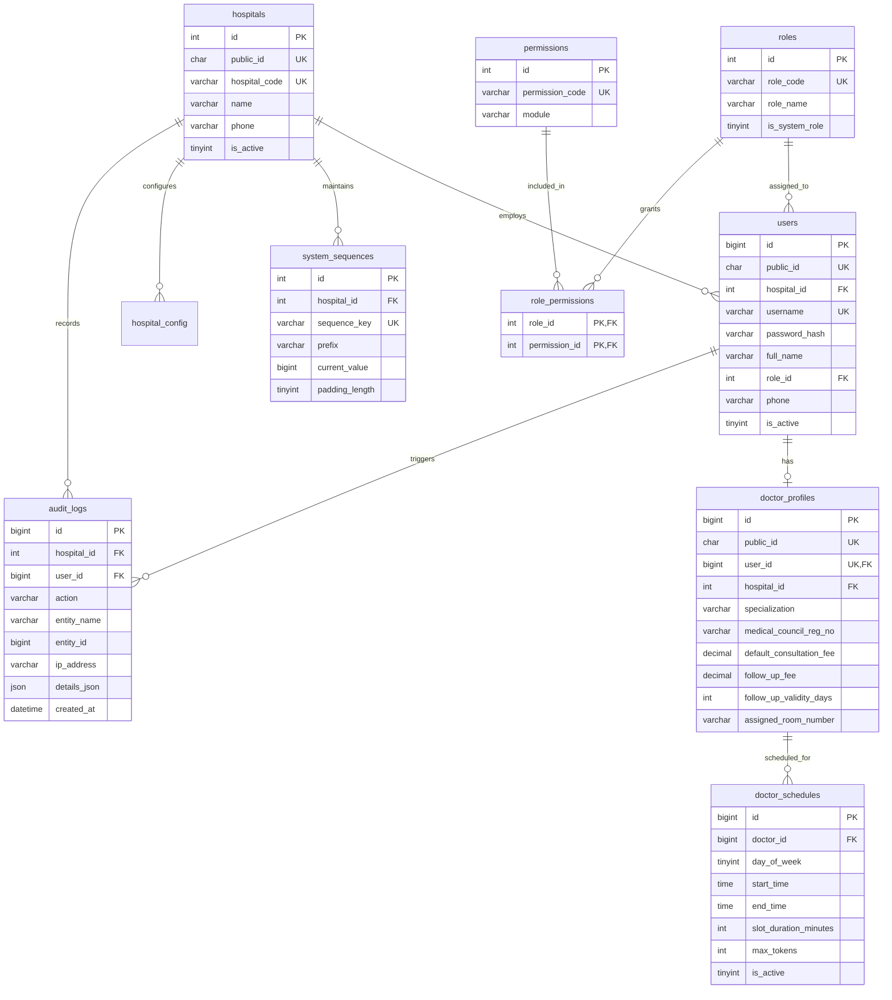
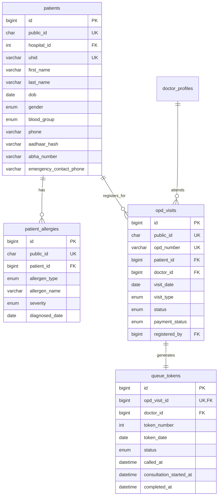
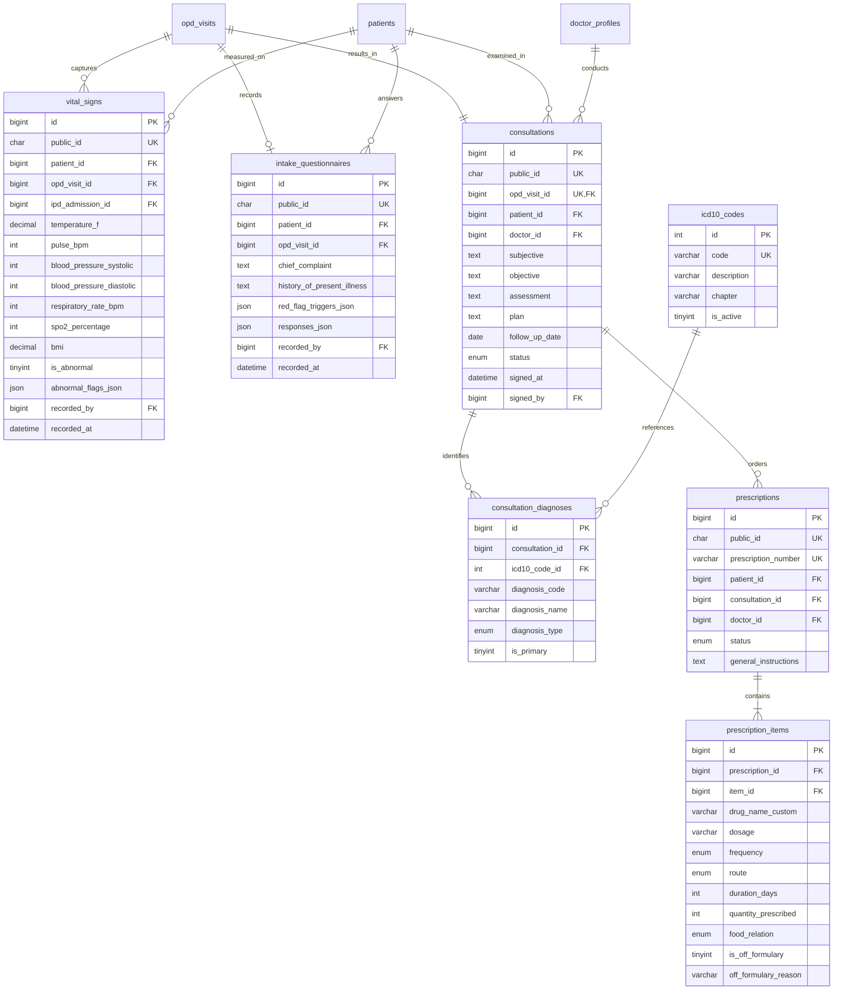
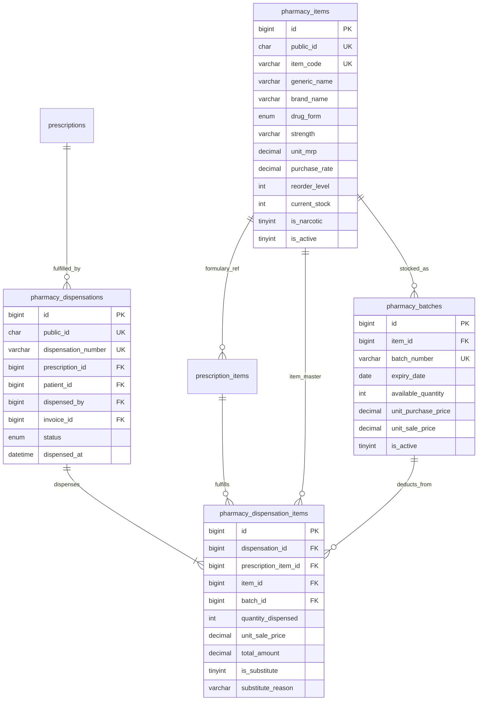
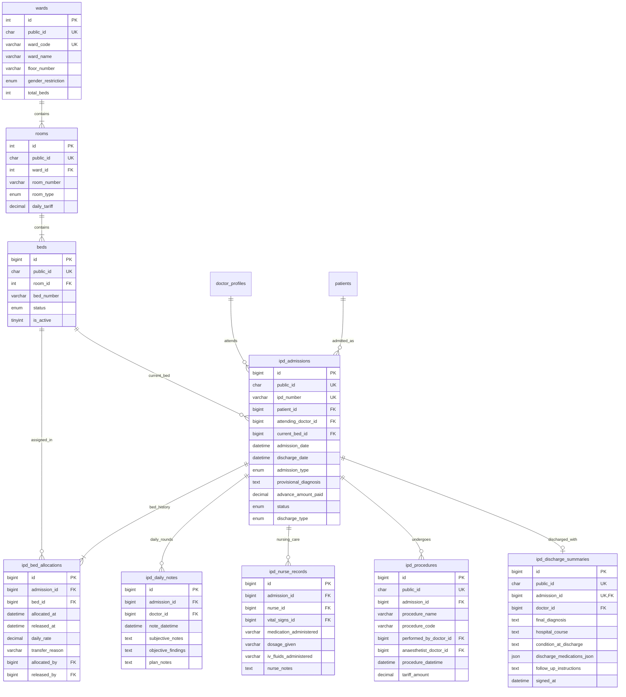
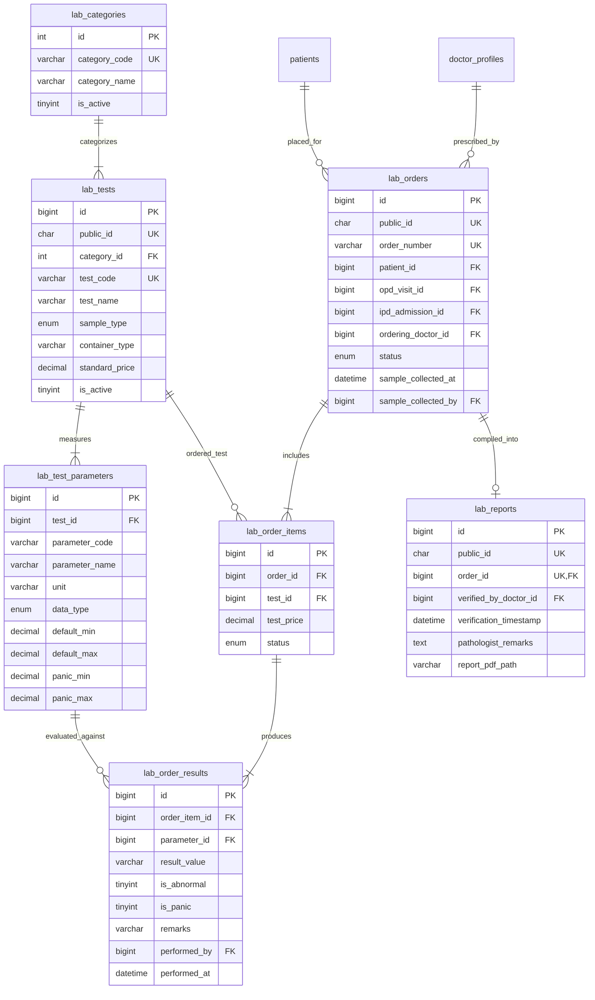
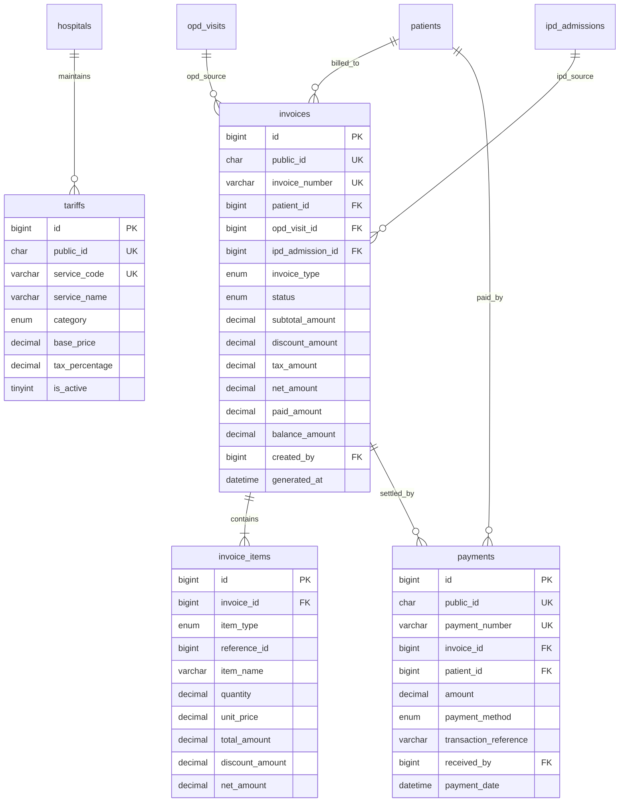
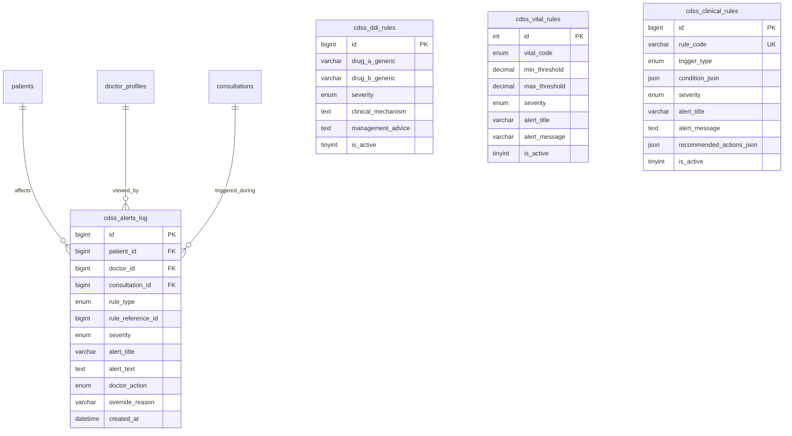
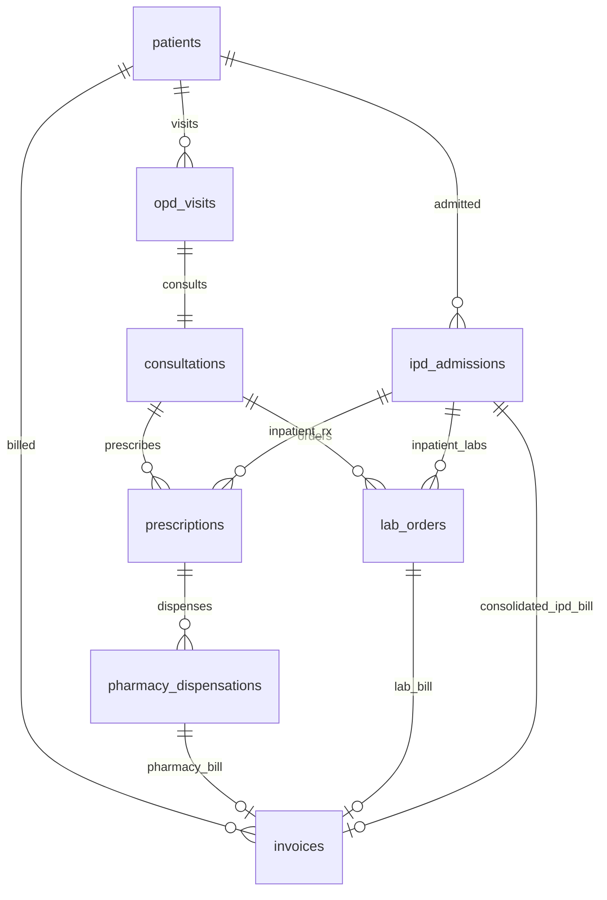

# D10 — Entity Relationship Diagrams (ERDs)
## Bright Solutions: Clinical Hospital Operating System

> **Document ID:** D10  
> **Version:** 1.0  
> **Status:** APPROVED ARCHITECTURE SPECIFICATION  
> **Depends On:** [09_database_schema_ddl.sql](file:///home/prem/Desktop/pbt/COS/docs/design/09_database_schema_ddl.sql)  
> **Prepared By:** Bright Solutions Engineering Team  
> **Last Updated:** October 2026  

---

## Table of Contents

1. [Architectural Overview & Reading Guide](#1-architectural-overview--reading-guide)
2. [Domain 1 — Auth, Roles & Administration](#2-domain-1--auth-roles--administration)
3. [Domain 2 — Patient Demographics & OPD Queue](#3-domain-2--patient-demographics--opd-queue)
4. [Domain 3 — Clinical Triage, Consultations & Prescriptions](#4-domain-3--clinical-triage-consultations--prescriptions)
5. [Domain 4 — Pharmacy Inventory & Dispensation](#5-domain-4--pharmacy-inventory--dispensation)
6. [Domain 5 — IPD Admission, Bed Management & Stay](#6-domain-5--ipd-admission-bed-management--stay)
7. [Domain 6 — Pathology & Laboratory Diagnostics](#7-domain-6--pathology--laboratory-diagnostics)
8. [Domain 7 — Multi-Point Billing & Payments](#8-domain-7--multi-point-billing--payments)
9. [Domain 8 — CDSS Rules & Clinical Safety Audit](#9-domain-8--cdss-rules--clinical-safety-audit)
10. [Cross-Domain Master Linkages](#10-cross-domain-master-linkages)

---

## 1. Architectural Overview & Reading Guide

This document specifies the Entity-Relationship structure for the **Bright Solutions** hospital database. To maintain readability and avoid visual clutter, diagrams are segmented into **8 cohesive functional domains**.

### Notation Key

| Symbol | Cardinality Meaning |
|:---:|:---|
| `||--||` | Exactly one to exactly one |
| `||--o|` | Exactly one to zero or one (optional) |
| `||--|{` | Exactly one to one or more (mandatory parent) |
| `||--o{` | Exactly one to zero or more (standard parent-child) |

### Key Identifier Conventions
- **`PK`**: Primary Key (`BIGINT UNSIGNED AUTO_INCREMENT` or `INT UNSIGNED AUTO_INCREMENT`).
- **`UK`**: Unique Key constraint (e.g., `public_id CHAR(36)` UUID v4 or domain code like `uhid`, `opd_number`).
- **`FK`**: Foreign Key constraint.

---

## 2. Domain 1 — Auth, Roles & Administration

Covers user authentication, role-based access control (RBAC), doctor schedules, hospital configuration, and system-wide audit logging.

---

## 3. Domain 2 — Patient Demographics & OPD Queue

Covers patient identity (UHID), demographic details, known drug/food allergies, and monotonic OPD queue visits with token assignment.

---

## 4. Domain 3 — Clinical Triage, Consultations & Prescriptions

Covers triage vitals intake, red-flag screening questionnaire, doctor SOAP consultation notes, ICD-10 diagnostic coding, and e-prescription authoring.

---

## 5. Domain 4 — Pharmacy Inventory & Dispensation

Covers formulary master catalog, warehouse/shelf batch management with expiry tracking, pharmacist dispensing queue, partial/substitute dispensing, and stock depletion.

---

## 6. Domain 5 — IPD Admission, Bed Management & Stay

Covers hospital infrastructure (Wards, Rooms, Beds), inpatient admission lifecycle, split-rate bed movement history, daily rounds notes, nursing medication records, surgical procedures, and final discharge summaries.

---

## 7. Domain 6 — Pathology & Laboratory Diagnostics

Covers test master hierarchy, parameter reference ranges, lab test ordering, specimen collection, technician result entry with panic/abnormal flags, and pathologist sign-off.

---

## 8. Domain 7 — Multi-Point Billing & Payments

Covers universal service tariff catalog, multi-point invoices (OPD Consultation, Pharmacy, Lab, and IPD 10-head Consolidated), line item breakdowns, and payment collection tracking.

---

## 9. Domain 8 — CDSS Rules & Clinical Safety Audit

Covers deterministic rule bases (Drug-Drug Interactions, Vital Red Flags, Clinical Symptom Trios) and doctor override audit logging.

---

## 10. Cross-Domain Master Linkages

The diagram below illustrates how core clinical and administrative records tie across the hospital boundary.

