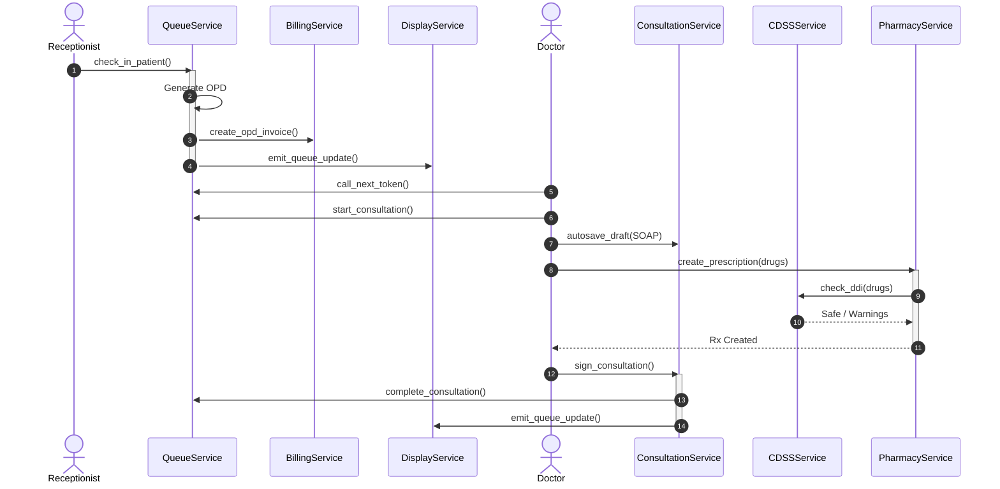

# D12 — Service Layer Design
## Bright Solutions: Clinical Hospital Operating System

> **Document ID:** D12  
> **Version:** 1.0  
> **Status:** APPROVED ARCHITECTURE SPECIFICATION  
> **Depends On:** [01_PRD.md](file:///home/prem/Desktop/pbt/COS/docs/design/01_PRD.md), [02_feature_spec.md](file:///home/prem/Desktop/pbt/COS/docs/design/02_feature_spec.md), [09_database_schema_ddl.sql](file:///home/prem/Desktop/pbt/COS/docs/design/09_database_schema_ddl.sql), [11_api_endpoint_inventory.md](file:///home/prem/Desktop/pbt/COS/docs/design/11_api_endpoint_inventory.md), [13_rbac_permission_matrix.md](file:///home/prem/Desktop/pbt/COS/docs/design/13_rbac_permission_matrix.md), [03_technical_architecture.md](file:///home/prem/Desktop/pbt/COS/docs/design/03_technical_architecture.md)  
> **Prepared By:** Bright Solutions Backend Engineering Team  
> **Last Updated:** October 2026  

---

## Table of Contents

1. [Architectural Conventions & Service Patterns](#1-architectural-conventions--service-patterns)
2. [Module 1 — PatientService](#2-module-1--patientservice)
3. [Module 2 — QueueService](#3-module-2--queueservice)
4. [Module 3 — TriageService](#4-module-3--triageservice)
5. [Module 4 — ConsultationService](#5-module-4--consultationservice)
6. [Module 5 — PharmacyService](#6-module-5--pharmacyservice)
7. [Module 6 — IPDService](#7-module-6--ipdservice)
8. [Module 7 — LabService](#8-module-7--labservice)
9. [Module 8 — BillingService](#9-module-8--billingservice)
10. [Module 9 — CDSSService](#10-module-9--cdssservice)
11. [Module 10 & 11 — AuthService & AdminService](#11-module-10--11--authservice--adminservice)
12. [Module 12 — DisplayService](#12-module-12--displayservice)
13. [Cross-Service Transactional Workflows](#13-cross-service-transactional-workflows)

---

## 1. Architectural Conventions & Service Patterns

1. **Transactional Boundaries:** Every mutating service method accepts an active SQLAlchemy `Session` (`db: Session`). The service method executes all operations inside the transaction; commits and rollbacks are managed explicitly by the caller or dependency context.
2. **DTO In / DTO Out:** Service methods accept strongly typed Pydantic v2 schemas (`CreateDTO`, `UpdateDTO`) and return response DTOs or domain entities. Raw unvalidated dictionaries are strictly forbidden.
3. **Audit by Default:** Every mutating service method records a record in `audit_logs` detailing the user ID, entity name, entity ID, and action taken.
4. **Deterministic Exceptions:** Services never return HTTP response codes or raw SQL errors. They raise typed domain exceptions deriving from `BrightSolutionsException`.

---

## 2. Module 1 — PatientService

Responsible for patient demographic onboarding, master patient index (MPI) search, Aadhaar de-duplication, and allergy tracking.

```python
class PatientService:
    def __init__(self, db: Session):
        self.db = db

    def register_patient(self, dto: PatientCreateDTO, registered_by_user_id: int) -> Patient:
        """
        Validates demographics, generates unique UHID, and persists patient record.
        """
```
- **Business Validations:**
  - Phone number must match 10-digit Indian mobile format (`^[6-9]\d{9}$`).
  - If `aadhaar_number` is provided, compute `SHA-256(aadhaar_number)` and query for existing match. If found, raise `DuplicatePatientException(existing_uhid)`.
  - Date of birth (`dob`) must not be in the future.
- **Transactional Steps:**
  1. Call `SequenceService.get_next_number(self.db, hospital_id, 'UHID')` with row lock to generate next UHID (e.g. `BS-001042`).
  2. Insert row into `patients` with `public_id = uuid4()`.
  3. Write `audit_logs` (`action = 'REGISTER_PATIENT'`).
  4. Return created `Patient` model.
- **Exceptions Raised:** `DuplicatePatientException`, `InvalidDemographicsException`.

---

## 3. Module 2 — QueueService

Responsible for outpatient visit creation, monotonic global OPD number generation, daily token assignment, and live doctor chamber state transitions.

```python
class QueueService:
    def __init__(self, db: Session):
        self.db = db

    def check_in_patient(self, dto: OPDCheckInDTO, registered_by_user_id: int) -> OPDVisit:
        """
        Creates OPD visit, generates global OPD#, assigns daily doctor token, and triggers fee billing.
        """
```
- **Business Validations:**
  - Patient must exist and be active.
  - Doctor must exist and have `is_available_for_opd = 1`.
  - Check doctor's `doctor_schedules.max_tokens` for today. If total tokens allocated for this doctor today >= `max_tokens`, raise `DoctorTokenLimitExceededException`.
  - Determine `visit_type`: Query patient's prior visits with this doctor. If last visit was within `doctor_profiles.follow_up_validity_days` (default 7 days), classify as `FOLLOW_UP` and apply `follow_up_fee`, else `NEW`.
- **Transactional Steps:**
  1. Generate global monotonic `OPD_NUMBER` via `SequenceService` (e.g. `OPD-004521`). No date resets.
  2. Query `MAX(token_number)` from `queue_tokens` WHERE `doctor_id = ? AND token_date = CURRENT_DATE` with lock. Assign `token_number = max + 1`.
  3. Insert into `opd_visits`.
  4. Insert into `queue_tokens` with status `WAITING`.
  5. If `collect_fee_now == True`: call `BillingService.create_opd_invoice(db, visit_id, fee, payment_method)`.
  6. Emit event to `DisplayService` event queue.
- **Queue State Transitions:**
  - `call_token(token_uuid: UUID, doctor_id: int) -> QueueToken`: Validates doctor ownership. Sets `status = 'CALLED'`, `called_at = NOW()`.
  - `start_consultation(token_uuid: UUID, doctor_id: int) -> QueueToken`: Sets `status = 'IN_CONSULTATION'`, `consultation_started_at = NOW()`. Auto-initializes draft consultation record.
  - `complete_consultation(token_uuid: UUID, doctor_id: int) -> QueueToken`: Sets `status = 'COMPLETED'`, `completed_at = NOW()`. Marks `opd_visits.status = 'COMPLETED'`.
  - `skip_token(token_uuid: UUID, doctor_id: int) -> QueueToken`: Sets `status = 'SKIPPED'`.

---

## 4. Module 3 — TriageService

Responsible for nurse-led triage intake, vital signs measurement, BMI auto-computation, and red-flag symptom screening.

```python
class TriageService:
    def __init__(self, db: Session):
        self.db = db

    def record_vitals(self, dto: VitalsCreateDTO, nurse_user_id: int) -> VitalSigns:
        """
        Computes BMI, runs CDSS threshold evaluation, and persists vitals.
        """
```
- **Business Validations & Rules:**
  - Height (cm) and Weight (kg): automatically compute `bmi = round(weight_kg / ((height_cm / 100) ** 2), 1)`.
  - Call `CDSSService.evaluate_vitals(dto)`:
    - If `BP_SYS > 180` or `BP_SYS < 90`: append abnormal flag.
    - If `BP_DIA > 120` or `BP_DIA < 60`: append abnormal flag.
    - If `SPO2 < 92`: append critical hypoxia flag.
    - If `TEMP > 102.0`: append hyperpyrexia flag.
  - If any flags detected, set `is_abnormal = 1` and populate `abnormal_flags_json`.
  - Insert record into `vital_signs`.

```python
    def submit_questionnaire(self, dto: QuestionnaireCreateDTO, nurse_user_id: int) -> IntakeQuestionnaire:
        """
        Evaluates symptom questionnaire responses for emergency red flags.
        """
```
- **Rules:** Compares complaint answers against clinical red-flag matrices (e.g. Chest pain + sweating → triggers ACS alert). Stores responses in `responses_json` and red flags in `red_flag_triggers_json`.

---

## 5. Module 4 — ConsultationService

Responsible for doctor consultation SOAP notes, ICD-10 diagnostic coding, and digital encounter signing.

```python
class ConsultationService:
    def __init__(self, db: Session):
        self.db = db

    def autosave_draft(self, dto: ConsultationDraftDTO, doctor_profile_id: int) -> Consultation:
        """
        Saves or updates draft SOAP notes. Enforces post-signature immutability.
        """
```
- **Business Validations & Rules:**
  - Query consultation: if `status == 'SIGNED'`, raise `EncounterAlreadySignedException("Cannot edit signed clinical note")`.
  - Verify doctor ownership: `consultation.doctor_id == doctor_profile_id`.
  - Update `subjective`, `objective`, `assessment`, `plan`.

```python
    def sign_consultation(self, consultation_uuid: UUID, dto: ConsultationSignDTO, doctor_profile_id: int) -> Consultation:
        """
        Locks consultation note permanently. Enforces diagnostic coding.
        """
```
- **Rules:**
  - Validates that at least one diagnosis is attached in `consultation_diagnoses`.
  - Sets `status = 'SIGNED'`, `signed_at = NOW()`, `signed_by = user_id`.
  - Marks linked `opd_visits.status = 'COMPLETED'`.
  - Marks linked `queue_tokens.status = 'COMPLETED'`.

---

## 6. Module 5 — PharmacyService

Responsible for formulary inventory, batch tracking with expiry, pharmacist dispensing queue, partial/substitute dispensing, and stock depletion.

```python
class PharmacyService:
    def __init__(self, db: Session):
        self.db = db

    def create_prescription(self, dto: PrescriptionCreateDTO, doctor_profile_id: int) -> Prescription:
        """
        Evaluates DDI safety, generates Rx sequence, and creates prescription items.
        """
```
- **Business Validations & Rules:**
  - Extract generic drug names from `dto.items`.
  - Call `CDSSService.check_ddi(generic_names)`.
  - If any interaction has `severity == 'CONTRAINDICATED'`:
    - Check if doctor supplied a non-empty `override_reason`.
    - If no justification supplied, raise `UnjustifiedContraindicationException`.
    - If justification supplied, log override into `cdss_alerts_log`.
  - Generate sequence `PRESCRIPTION` (e.g. `RX-001042`).
  - Insert into `prescriptions` and `prescription_items`.

```python
    def dispense_medications(self, dto: DispenseCreateDTO, pharmacist_user_id: int) -> PharmacyDispensation:
        """
        Deducts batch stock, generates dispensation record, and creates pharmacy invoice.
        """
```
- **Business Validations & Rules:**
  - For each item dispensed, query `pharmacy_batches` WHERE `id = batch_id` with lock (`FOR UPDATE`).
  - Validate `expiry_date > CURRENT_DATE`. If expired, raise `ExpiredBatchException`.
  - Validate `available_quantity >= quantity_dispensed`. If insufficient, raise `InsufficientStockException`.
  - Deduct `pharmacy_batches.available_quantity -= quantity_dispensed`.
  - Deduct `pharmacy_items.current_stock -= quantity_dispensed`.
  - Insert `pharmacy_dispensations` and `pharmacy_dispensation_items`.
  - Check total dispensed against prescription items:
    - If all items fully dispensed → set `prescriptions.status = 'DISPENSED'`.
    - If partial → set `prescriptions.status = 'PARTIALLY_DISPENSED'`.
  - Automatically call `BillingService.create_pharmacy_invoice()` for total dispensed amount.

---

## 7. Module 6 — IPDService

Responsible for inpatient admissions, bed allocation history, daily rounds notes, nursing medication administrations, surgical procedures, and discharge workflows.

```python
class IPDService:
    def __init__(self, db: Session):
        self.db = db

    def admit_patient(self, dto: IPDAdmitDTO, user_id: int) -> IPDAdmission:
        """
        Admits patient (via OPD referral token or direct intake), locks bed,
        captures MLC and Guardian/Kin consent data (Forms 8 & 9), and records advance.
        """
```
- **Business Validations & Rules:**
  - Query `beds` WHERE `id = bed_id` with lock (`FOR UPDATE`).
  - Validate `bed.status == 'AVAILABLE'`. If not, raise `BedNotAvailableException`.
  - Generate sequence `IPD_NUMBER` (e.g. `IPD-000512`).
  - Update `bed.status = 'OCCUPIED'`.
  - Insert `ipd_admissions` (`status = 'ADMITTED'`, `admission_source = dto.source`, `is_mlc = dto.is_mlc`, `guardian_name = dto.guardian_name`, `payment_category = dto.payment_category`).
  - Insert `ipd_bed_allocations` (`allocated_at = NOW()`, `daily_rate = room.daily_tariff`).
  - If `dto.opd_appointment_id`: validate appointment exists and link reference.
  - If `advance_amount > 0`: invoke `BillingService.record_advance(patient_id, admission_id, amount)`.

```python
    def record_admission_assessment(self, admission_uuid: UUID, dto: IPDAdmissionAssessmentDTO, doctor_id: int) -> IPDAdmissionAssessment:
        """
        Records Doctor H&P Admission Note (AH/MRD/FORM - 10) with systemic exam and diagnosis.
        """
```
- **Rules:**
  - Verify admission exists and `status == 'ADMITTED'`.
  - Insert or update `ipd_admission_assessments` record.

```python
    def create_treatment_order(self, admission_uuid: UUID, dto: IPDTreatmentOrderDTO, doctor_id: int) -> IPDTreatmentOrder:
        """
        Doctor creates inpatient medication order or Oxygen therapy on Treatment Sheet (Form 29).
        """
```
- **Rules:**
  - If `order_type == 'MEDICATION'`: trigger CDSS bilateral DDI check against patient's active inpatient medications.
  - Insert `ipd_treatment_orders` with `status = 'ACTIVE'`.

```python
    def record_medication_administration(self, order_uuid: UUID, dto: IPDAdministerDTO, nurse_id: int) -> IPDMedicationAdministration:
        """
        Nurse logs medication administration or omission on Form 29 (MAR).
        """
```
- **Rules:**
  - Validate treatment order is `ACTIVE`.
  - Record execution timestamp, status (`GIVEN`, `OMITTED`, `REFUSED`), and clinical omission reason.

```python
    def record_intake_output(self, admission_uuid: UUID, dto: IPDIntakeOutputDTO, nurse_id: int) -> IPDIntakeOutput:
        """
        Nurse logs shift Intake and Output chart (Form 61) with net fluid balance calculation.
        """
```
- **Rules:**
  - Compute `total_intake = oral_rt_intake_ml + iv_fluid_intake_ml + blood_products_ml`.
  - Compute `total_output = urine_output_ml + vomitus_rt_aspirate_ml + drain_output_ml`.
  - Compute `net_balance_ml = total_intake - total_output`.
  - Insert `ipd_intake_output`.

```python
    def transfer_bed(self, admission_uuid: UUID, new_bed_id: int, reason: str, user_id: int) -> IPDBedAllocation:
        """
        Transfers patient to new bed, closing previous allocation and adjusting daily tariff.
        """
```
- **Rules:**
  - Lock `new_bed_id`: must be `AVAILABLE`.
  - Query active `ipd_bed_allocations` for this admission where `released_at IS NULL`.
  - Close active allocation: set `released_at = NOW()`, `released_by = user_id`, `transfer_reason = reason`.
  - Set old bed status to `CLEANING`.
  - Set new bed status to `OCCUPIED`.
  - Insert new `ipd_bed_allocations` with new bed's room rate.
  - Update `ipd_admissions.current_bed_id = new_bed_id`.

```python
    def finalize_discharge(self, admission_uuid: UUID, user_id: int) -> IPDAdmission:
        """
        Validates clinical sign-off, verifies financial settlement, and releases bed.
        """
```
- **Rules:**
  - Validate that an `ipd_discharge_summaries` record exists and has `signed_at IS NOT NULL`. If missing, raise `DischargeSummaryMissingException`.
  - Query final invoice for this admission: `invoices.balance_amount` must be `0.00` (or have authorized waiver). If balance > 0, raise `UnsettledBalanceException`.
  - Close active bed allocation: `released_at = NOW()`.
  - Set bed status to `CLEANING`.
  - Set `ipd_admissions.status = 'DISCHARGED'`, `discharge_date = NOW()`.

---

## 8. Module 7 — LabService

Responsible for diagnostic order entry, specimen collection tracking, multi-parameter technician results entry with panic/abnormal flags, and pathologist sign-off.

```python
class LabService:
    def __init__(self, db: Session):
        self.db = db

    def create_order(self, dto: LabOrderCreateDTO, doctor_user_id: int) -> LabOrder:
        """
        Creates lab order header, items, and triggers lab counter billing.
        """
```
- **Rules:**
  - Generates sequence `LAB_ORDER` (e.g. `LAB-001042`).
  - Inserts `lab_orders` (`status = 'ORDERED'`).
  - Fetches standard prices from `lab_tests`, inserts `lab_order_items`.
  - Invokes `BillingService.create_lab_invoice(order_id)`.

```python
    def enter_results(self, order_uuid: UUID, results: List[ParameterResultDTO], tech_user_id: int) -> LabOrder:
        """
        Evaluates parameter results against normal/panic reference ranges.
        """
```
- **Rules:**
  - For each parameter result, fetch `lab_test_parameters` reference ranges (`default_min`, `default_max`, `panic_min`, `panic_max`).
  - If numeric:
    - If `value < panic_min` or `value > panic_max`: set `is_panic = 1`, `is_abnormal = 1`.
    - Else if `value < default_min` or `value > default_max`: set `is_abnormal = 1`.
  - Insert `lab_order_results`.
  - Update `lab_orders.status = 'IN_ANALYSIS'`.

```python
    def verify_report(self, order_uuid: UUID, doctor_user_id: int, remarks: str) -> LabReport:
        """
        Signs off lab report, locks results, and generates final PDF.
        """
```
- **Rules:**
  - Sets `lab_orders.status = 'COMPLETED'`.
  - Inserts `lab_reports` (`verification_timestamp = NOW()`, `verified_by_doctor_id = doctor_user_id`).

---

## 9. Module 8 — BillingService

Responsible for multi-point billing, live IPD charge aggregation across 10 cost centers, consolidated final billing, and payment collection.

```python
class BillingService:
    def __init__(self, db: Session):
        self.db = db

    def calculate_accrued_ipd_charges(self, admission_id: int) -> AccruedIPDChargesDTO:
        """
        Calculates live uninvoiced charges across all 10 IPD cost centers.
        """
```
- **Calculation Logic (10 Heads):**
  1. `bed_rent`: For each bed allocation in `ipd_bed_allocations`, calculate `ceil((released_at or NOW() - allocated_at).total_seconds() / 86400) * daily_rate`.
  2. `doctor_visits`: Count of `ipd_daily_notes` × `doctor_visit_tariff`.
  3. `nursing_charges`: Total admitted days × `nursing_tariff_per_day`.
  4. `procedures`: Sum of `ipd_procedures.tariff_amount`.
  5. `pharmacy_medications`: Sum of all `pharmacy_dispensation_items.total_amount` linked to this admission.
  6. `laboratory_investigations`: Sum of all `lab_order_items.test_price` linked to this admission.
  7. `operation_theatre`: Sum of OT tariffs linked to surgical procedures.
  8. `anaesthesia`: Specialist anaesthetist procedure tariffs.
  9. `oxygen_support`: Calculated hourly/daily respiratory support charges.
  10. `consumables`: Itemized disposables and materials recorded during stay.
  - Aggregate subtotal, subtract `ipd_admissions.advance_amount_paid`, compute estimated balance.

```python
    def generate_final_ipd_invoice(self, admission_uuid: UUID, user_id: int) -> Invoice:
        """
        Generates single consolidated final invoice and itemizes all 10 charge heads.
        """
```
- **Rules:**
  - Generates sequence `INVOICE_IPD` (e.g. `INV-IPD-000052`).
  - Inserts `invoices` (`invoice_type = 'IPD_FINAL'`, `status = 'UNPAID'`).
  - Inserts `invoice_items` for each of the 10 charge heads.
  - Automatically records previous advance payment as an applied payment row.

```python
    def record_payment(self, invoice_uuid: UUID, dto: PaymentCreateDTO, user_id: int) -> Payment:
        """
        Records manual payment, generates receipt number, and updates invoice balance.
        """
```
- **Rules:**
  - Locks invoice row (`FOR UPDATE`).
  - Generates sequence `PAYMENT` (e.g. `RCP-001042`).
  - Inserts `payments` (`payment_method`, `transaction_reference`, `amount`).
  - Updates `invoices.paid_amount += dto.amount`.
  - Updates `invoices.balance_amount = max(0.00, invoices.net_amount - invoices.paid_amount)`.
  - If `balance_amount == 0.00` → set `invoices.status = 'PAID'`.
  - Else if `paid_amount > 0` → set `invoices.status = 'PARTIALLY_PAID'`.

---

## 10. Module 9 — CDSSService

Responsible for deterministic safety checks across prescription authoring, vitals intake, and doctor consultations.

```python
class CDSSService:
    def __init__(self, db: Session):
        self.db = db

    def check_ddi(self, drug_generics: List[str]) -> DDIReportDTO:
        """
        Evaluates all pairs of drugs against the cdss_ddi_rules table.
        """
```
- **Algorithm:**
  - Generates all unique 2-combinations: `combinations(drug_generics, 2)`.
  - Executes single query:
    ```sql
    SELECT * FROM cdss_ddi_rules 
    WHERE (drug_a_generic IN (...) AND drug_b_generic IN (...))
      AND is_active = 1;
    ```
  - Returns detected interactions categorized by severity (`CONTRAINDICATED`, `MAJOR`, `MODERATE`, `MINOR`).

```python
    def evaluate_vitals(self, dto: VitalsInputDTO) -> List[str]:
        """
        Evaluates vitals against cdss_vital_rules threshold tables.
        """
```
- Compares inputs against `cdss_vital_rules` and returns actionable clinical warning strings.

---

## 11. Module 10 & 11 — AuthService & AdminService

- **`AuthService.authenticate(username, password)`:** Verifies credentials using Argon2id/bcrypt. Emits JWT access token (15m) and secure refresh token (7d).
- **`AuthService.refresh_token(refresh_token)`:** Validates active session and issues fresh JWT.
- **`AdminService.update_sequence_config(key, prefix, padding)`:** Updates sequence formatting rules in `system_sequences`.
- **`AdminService.set_doctor_schedule(doctor_id, schedule_dto)`:** Configures working hours and max token limits.

---

## 12. Module 12 — DisplayService

Responsible for public waiting room television streams with zero PHI leakage.

```python
class DisplayService:
    def get_public_queue_snapshot(self, db: Session) -> DisplaySnapshotDTO:
        """
        Queries today's tokens and doctor chambers. Strips all patient names.
        """
```
- **Sanitization Rule:** The SQL query joins `queue_tokens` and `doctor_profiles` only. `patients` table is intentionally NOT joined. Output contains only `token_number`, `room_number`, `doctor_name`, and `status`.

---

## 13. Cross-Service Transactional Workflows

### Complete Outpatient Encounter Flow


