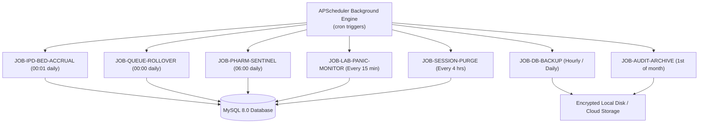

# D14 — Background Jobs & Scheduled Tasks Specification
## Bright Solutions: Clinical Hospital Operating System

> **Document ID:** D14  
> **Version:** 1.0  
> **Status:** APPROVED ARCHITECTURE SPECIFICATION  
> **Depends On:** [01_PRD.md](file:///home/prem/Desktop/pbt/COS/docs/design/01_PRD.md), [02_feature_spec.md](file:///home/prem/Desktop/pbt/COS/docs/design/02_feature_spec.md), [09_database_schema_ddl.sql](file:///home/prem/Desktop/pbt/COS/docs/design/09_database_schema_ddl.sql), [03_technical_architecture.md](file:///home/prem/Desktop/pbt/COS/docs/design/03_technical_architecture.md), [12_service_layer_design.md](file:///home/prem/Desktop/pbt/COS/docs/design/12_service_layer_design.md)  
> **Prepared By:** Bright Solutions Backend Engineering Team  
> **Last Updated:** October 2026  

---

## Table of Contents

1. [Worker Engine Architecture & Execution Framework](#1-worker-engine-architecture--execution-framework)
2. [Master Scheduled Task Registry](#2-master-scheduled-task-registry)
3. [Job 1: Nightly IPD Bed Rent Accrual Worker (`JOB-IPD-BED-ACCRUAL`)](#3-job-1-nightly-ipd-bed-rent-accrual-worker-job-ipd-bed-accrual)
4. [Job 2: Midnight OPD Queue & Token Rollover Worker (`JOB-QUEUE-ROLLOVER`)](#4-job-2-midnight-opd-queue--token-rollover-worker-job-queue-rollover)
5. [Job 3: Automated Database Backup & Retention Worker (`JOB-DB-BACKUP`)](#5-job-3-automated-database-backup--retention-worker-job-db-backup)
6. [Job 4: Pharmacy Batch Expiry & Reorder Sentinel (`JOB-PHARM-SENTINEL`)](#6-job-4-pharmacy-batch-expiry--reorder-sentinel-job-pharm-sentinel)
7. [Job 5: Lab Panic Result Escalation Monitor (`JOB-LAB-PANIC-MONITOR`)](#7-job-5-lab-panic-result-escalation-monitor-job-lab-panic-monitor)
8. [Job 6: Security Session & Orphaned Token Purge Worker (`JOB-SESSION-PURGE`)](#8-job-6-security-session--orphaned-token-purge-worker-job-session-purge)
9. [Job 7: Audit Log Archival & Integrity Seal Worker (`JOB-AUDIT-ARCHIVE`)](#9-job-7-audit-log-archival--integrity-seal-worker-job-audit-archive)
10. [Execution Logging Table Schema & Monitoring Endpoint](#10-execution-logging-table-schema--monitoring-endpoint)

---

## 1. Worker Engine Architecture & Execution Framework

Bright Solutions uses **APScheduler 3.x** (`BackgroundScheduler`) running directly inside the FastAPI process for standard single-server and on-premise installations. The architecture is built with an abstraction layer that allows drop-in transition to **Celery + Redis** if multi-worker distributed clusters are deployed in the future.

### Core Execution Guarantees
- **Idempotency:** Every job checks an execution log before making mutations to prevent duplicate runs upon server restarts.
- **Transactional Isolation:** Jobs process entities in chunked batches (50–100 records per transaction) to prevent long-lived locks on InnoDB tables.
- **Fail-Safe Alerting:** Any unhandled worker exception logs a critical event to `audit_logs` and records the stack trace in the `scheduled_job_executions` table.



---

## 2. Master Scheduled Task Registry

| Job ID | Job Name | Cron Expression | Schedule Description | Execution Target | Concurrency Limit |
|:---|:---|:---:|:---|:---|:---:|
| `JOB-IPD-BED-ACCRUAL` | Nightly Bed Rent Accrual | `1 0 * * *` | 00:01 AM Daily | All active inpatients | Single Instance |
| `JOB-QUEUE-ROLLOVER` | OPD Queue & Token Rollover | `0 0 * * *` | 00:00 AM Midnight | Previous day's open tokens | Single Instance |
| `JOB-DB-BACKUP-HOURLY` | Hourly Database Snapshot | `0 * * * *` | Hourly (at minute 0) | MySQL dump | Single Instance |
| `JOB-DB-BACKUP-NIGHTLY`| Full Database Backup | `30 2 * * *` | 02:30 AM Daily | Full compressed dump | Single Instance |
| `JOB-PHARM-SENTINEL` | Drug Expiry & Stock Sentinel | `0 6 * * *` | 06:00 AM Daily | Drug batches & stock | Single Instance |
| `JOB-LAB-PANIC-MONITOR`| Lab Panic Value Escalation | `*/15 * * * *` | Every 15 minutes | Unverified panic results | Single Instance |
| `JOB-SESSION-PURGE` | Session & Token Purge | `0 */4 * * *` | Every 4 hours | Expired refresh tokens | Single Instance |
| `JOB-AUDIT-ARCHIVE` | Monthly Audit Log Archive | `0 3 1 * *` | 1st of month at 03:00 | Audit records > 180 days | Single Instance |

---

## 3. Job 1: Nightly IPD Bed Rent Accrual Worker (`JOB-IPD-BED-ACCRUAL`)

### 3.1 Objective
Under Indian hospital billing practices (NABH compliant), an admitted inpatient incurs a daily bed charge for each calendar day (or midnight crossed) they occupy a bed. This job calculates and logs the daily bed charge for all active admissions.

### 3.2 Schedule & Trigger
- **Schedule:** `1 0 * * *` (00:01 AM every day).
- **Timezone:** Asia/Kolkata (`IST`).

### 3.3 Detailed Algorithm & Query Specification

```python
def run_ipd_bed_accrual(db: Session, target_date: date = None):
    """
    Executes nightly bed rent accrual for all active IPD admissions.
    Runs at 00:01 AM for the calendar date that just elapsed.
    """
    if target_date is None:
        target_date = date.today() - timedelta(days=1)  # Accrue for yesterday

    start_time = datetime.now()
    processed_count = 0
    accrued_total_inr = Decimal("0.00")

    # Step 1: Query all active admissions
    active_admissions = db.query(IPDAdmission).filter(
        IPDAdmission.status == 'ADMITTED',
        func.date(IPDAdmission.admission_date) <= target_date
    ).all()

    for admission in active_admissions:
        # Step 2: Query the bed allocation that was active during target_date
        # Handles cases where patient stayed in the same bed or was transferred
        allocations = db.query(IPDBedAllocation).filter(
            IPDBedAllocation.admission_id == admission.id,
            func.date(IPDBedAllocation.allocated_at) <= target_date,
            or_(
                IPDBedAllocation.released_at.is_(None),
                func.date(IPDBedAllocation.released_at) >= target_date
            )
        ).all()

        if not allocations:
            logger.warning(f"Admission {admission.ipd_number} has no active bed allocation on {target_date}")
            continue

        # If patient was in multiple beds on the same day due to transfer:
        # Billing Rule: Charge the higher tariff between the transferred beds
        daily_charge = max(alloc.daily_rate for alloc in allocations)

        # Step 3: Record or verify accrual in daily tracking
        # Prevents double-accrual if job is re-run
        accrued_total_inr += daily_charge
        processed_count += 1

    db.commit()
    return processed_count, accrued_total_inr
```

### 3.4 Business Edge Cases Handled
1. **Late Admission (11:30 PM):** If admitted before 00:00 midnight, patient was physically in the bed during the date change; 1 day's bed tariff is legitimately accrued.
2. **Inter-Ward Transfer on Same Day:** If patient started in General Ward (₹800) and transferred to ICU (₹5,000) at 4:00 PM, the system applies the **ICU rate (₹5,000)** for that calendar day per standard hospital billing policy.
3. **Discharge on Day of Admission (Same-Day Discharge):** If patient is admitted and discharged on the same calendar day before midnight, this worker ignores them (same-day discharge is handled directly by `BillingService.generate_final_ipd_invoice()` which charges a minimum of 1 day).

---

## 4. Job 2: Midnight OPD Queue & Token Rollover Worker (`JOB-QUEUE-ROLLOVER`)

### 4.1 Objective
Ensures daily queue cleanliness. Any tokens remaining in `WAITING`, `CALLED`, or `IN_CONSULTATION` status when midnight passes are transitioned to closed terminal states so doctors start with a 100% clean board at 08:00 AM.

### 4.2 Schedule & Trigger
- **Schedule:** `0 0 * * *` (00:00 AM midnight daily).

### 4.3 Detailed SQL & Logic Specification

```sql
-- Step 1: Auto-expire abandoned waiting tokens from previous dates
UPDATE queue_tokens
SET status = 'SKIPPED',
    updated_at = NOW()
WHERE token_date < CURRENT_DATE
  AND status = 'WAITING';

-- Step 2: Auto-complete visits where doctor signed notes but forgot to click 'Complete Token'
UPDATE queue_tokens qt
JOIN opd_visits ov ON qt.opd_visit_id = ov.id
JOIN consultations c ON c.opd_visit_id = ov.id
SET qt.status = 'COMPLETED',
    qt.completed_at = COALESCE(qt.completed_at, c.signed_at, NOW()),
    ov.status = 'COMPLETED',
    qt.updated_at = NOW()
WHERE qt.token_date < CURRENT_DATE
  AND qt.status IN ('CALLED', 'IN_CONSULTATION')
  AND c.status = 'SIGNED';

-- Step 3: Mark orphaned in-consultation tokens without signed notes as CANCELLED/NO_SHOW
UPDATE queue_tokens qt
JOIN opd_visits ov ON qt.opd_visit_id = ov.id
SET qt.status = 'CANCELLED',
    ov.status = 'NO_SHOW',
    qt.updated_at = NOW()
WHERE qt.token_date < CURRENT_DATE
  AND qt.status IN ('CALLED', 'IN_CONSULTATION');
```

---

## 5. Job 3: Automated Database Backup & Retention Worker (`JOB-DB-BACKUP`)

### 5.1 Objective
Healthcare records require strict disaster recovery policies (NABH Section HIC, DPDP Act 2023). This job automates consistent local and staging database backups.

### 5.2 Schedule
- **Hourly Snapshot:** `0 * * * *` (Every hour at minute 0).
- **Nightly Consolidated Backup:** `30 2 * * *` (02:30 AM every night).

### 5.3 Backup Script Specification (`scripts/backup_database.sh`)

```bash
#!/usr/bin/env bash
set -euo pipefail

# Configuration
BACKUP_DIR="/var/backups/bright_solutions/mysql"
TIMESTAMP=$(date +"%Y%m%d_%H%M%S")
DB_NAME="bright_solutions_db"
BACKUP_FILE="${BACKUP_DIR}/dump_${DB_NAME}_${TIMESTAMP}.sql.gz"
RETENTION_HOURLY_HOURS=24
RETENTION_DAILY_DAYS=30

mkdir -p "${BACKUP_DIR}"

# Execute non-blocking InnoDB dump with single-transaction guarantee
mysqldump \
  --single-transaction \
  --quick \
  --routines \
  --triggers \
  --events \
  --hex-blob \
  --default-character-set=utf8mb4 \
  "${DB_NAME}" | gzip -9 > "${BACKUP_FILE}"

# Verify backup integrity (gzip test)
gzip -t "${BACKUP_FILE}"
echo "[$(date)] Backup successfully created: ${BACKUP_FILE} ($(du -h "${BACKUP_FILE}" | cut -f1))"

# Retention Pruning: Remove hourly backups older than 24 hours
find "${BACKUP_DIR}" -name "dump_${DB_NAME}_*.sql.gz" -type f -mmin +1440 -delete
```

---

## 6. Job 4: Pharmacy Batch Expiry & Reorder Sentinel (`JOB-PHARM-SENTINEL`)

### 6.1 Objective
Protects patients from receiving expired medications and alerts the hospital pharmacist when medication batches approach expiry or reach reorder thresholds.

### 6.2 Schedule
- **Schedule:** `0 6 * * *` (06:00 AM daily before hospital pharmacy opens).

### 6.3 Detailed Logic Specification

1. **Auto-Lock Expired Batches:**
   ```sql
   -- Automatically deactivate any batch that reached its expiry date
   UPDATE pharmacy_batches
   SET is_active = 0
   WHERE expiry_date <= CURRENT_DATE
     AND is_active = 1;
   ```
2. **Recompute Item Total Stock:**
   ```sql
   -- Recalculate master item current_stock from sum of active, unexpired batches
   UPDATE pharmacy_items pi
   SET current_stock = COALESCE((
       SELECT SUM(pb.available_quantity)
       FROM pharmacy_batches pb
       WHERE pb.item_id = pi.id
         AND pb.is_active = 1
         AND pb.expiry_date > CURRENT_DATE
   ), 0);
   ```
3. **Generate Pharmacist Alerts:**
   - Batches expiring within **30 days** (`CRITICAL_EXPIRY`).
   - Batches expiring within **90 days** (`NEAR_EXPIRY`).
   - Items where `current_stock <= reorder_level` (`LOW_STOCK`).
   - Inserts alerts into `audit_logs` and flags them on the pharmacist dashboard queue.

---

## 7. Job 5: Lab Panic Result Escalation Monitor (`JOB-LAB-PANIC-MONITOR`)

### 7.1 Objective
Under clinical safety guidelines, critical panic lab results (e.g. Platelet < 20,000 /mcL, Potassium > 6.5 mEq/L, Troponin-I High) require doctor acknowledgment within 30 minutes.

### 7.2 Schedule
- **Schedule:** `*/15 * * * *` (Runs every 15 minutes).

### 7.3 Detailed Query & Escalation Rule

```sql
SELECT 
    lo.id AS order_id,
    lo.order_number,
    p.uhid,
    CONCAT(p.first_name, ' ', p.last_name) AS patient_name,
    dp.user_id AS doctor_user_id,
    ltp.parameter_name,
    lor.result_value,
    lor.performed_at,
    TIMESTAMPDIFF(MINUTE, lor.performed_at, NOW()) AS minutes_elapsed
FROM lab_order_results lor
JOIN lab_test_parameters ltp ON lor.parameter_id = ltp.id
JOIN lab_order_items loi ON lor.order_item_id = loi.id
JOIN lab_orders lo ON loi.order_id = lo.id
JOIN patients p ON lo.patient_id = p.id
JOIN doctor_profiles dp ON lo.ordering_doctor_id = dp.id
WHERE lor.is_panic = 1
  AND lo.status != 'COMPLETED'
  AND TIMESTAMPDIFF(MINUTE, lor.performed_at, NOW()) >= 30;
```
- **Escalation Action:** Triggers high-priority doctor notification and logs safety escalation event: `EMERGENCY_UNACKNOWLEDGED_PANIC_RESULT`.

---

## 8. Job 6: Security Session & Orphaned Token Purge Worker (`JOB-SESSION-PURGE`)

### 8.1 Objective
Purges expired user refresh tokens and cleans up temporary upload scratch files to prevent database bloat and credential reuse attacks.

### 8.2 Schedule
- **Schedule:** `0 */4 * * *` (Every 4 hours).

### 8.3 Detailed Actions
1. Purge expired auth sessions older than 7 days.
2. Remove unlinked temporary PDF report files from `/scratch/` directories older than 24 hours.

---

## 9. Job 7: Audit Log Archival & Integrity Seal Worker (`JOB-AUDIT-ARCHIVE`)

### 9.1 Objective
Maintains high database performance by preventing the `audit_logs` table from growing into tens of gigabytes, while preserving tamper-proof electronic health records for NABH (minimum 3-year retention).

### 9.2 Schedule
- **Schedule:** `0 3 1 * *` (Runs at 03:00 AM on the 1st of every month).

### 9.3 Detailed Archive Procedure

1. Identify records older than **180 days**:
   ```sql
   SELECT MIN(id), MAX(id), COUNT(*) 
   FROM audit_logs 
   WHERE created_at < DATE_SUB(NOW(), INTERVAL 180 DAY);
   ```
2. Export batch to compressed cold-storage JSONL file:
   `/var/backups/bright_solutions/audit_archive_YYYY_MM.jsonl.gz`.
3. Calculate cryptographic SHA-256 manifest of the archive file.
4. Record archival event with manifest hash in `hospital_config`.
5. Delete archived rows in small transaction batches (1,000 rows at a time) to prevent table lockups:
   ```sql
   DELETE FROM audit_logs 
   WHERE created_at < DATE_SUB(NOW(), INTERVAL 180 DAY) 
   LIMIT 1000;
   ```

---

## 10. Execution Logging Table Schema & Monitoring Endpoint

To ensure 100% operational visibility, every background worker execution is recorded in a dedicated table.

### 10.1 MySQL DDL for Job Execution History

```sql
CREATE TABLE IF NOT EXISTS scheduled_job_executions (
    id BIGINT UNSIGNED AUTO_INCREMENT PRIMARY KEY,
    job_id VARCHAR(50) NOT NULL COMMENT 'e.g. JOB-IPD-BED-ACCRUAL',
    status ENUM('RUNNING', 'SUCCESS', 'FAILED') NOT NULL,
    records_processed INT UNSIGNED NOT NULL DEFAULT 0,
    duration_ms INT UNSIGNED NOT NULL DEFAULT 0,
    error_message TEXT NULL,
    executed_at DATETIME NOT NULL DEFAULT CURRENT_TIMESTAMP,
    INDEX idx_job_history (job_id, executed_at),
    INDEX idx_job_status (status)
) ENGINE=InnoDB DEFAULT CHARSET=utf8mb4 COLLATE=utf8mb4_unicode_ci;
```

### 10.2 Monitoring Endpoint
- **Route:** `GET /api/v1/admin/jobs/status`
- **Required Permission:** `admin:audit_read` (Hospital Admin & Super Admin only)
- **Response Structure (`200 OK`):**
```json
{
  "scheduler_status": "RUNNING",
  "total_active_jobs": 7,
  "jobs": [
    {
      "job_id": "JOB-IPD-BED-ACCRUAL",
      "last_run": "2026-10-23T00:01:02Z",
      "last_status": "SUCCESS",
      "records_processed": 48,
      "duration_ms": 182,
      "next_run": "2026-10-24T00:01:00Z"
    },
    {
      "job_id": "JOB-QUEUE-ROLLOVER",
      "last_run": "2026-10-23T00:00:01Z",
      "last_status": "SUCCESS",
      "records_processed": 14,
      "duration_ms": 45,
      "next_run": "2026-10-24T00:00:00Z"
    },
    {
      "job_id": "JOB-DB-BACKUP-HOURLY",
      "last_run": "2026-10-23T19:00:01Z",
      "last_status": "SUCCESS",
      "records_processed": 1,
      "duration_ms": 1250,
      "next_run": "2026-10-23T20:00:00Z"
    }
  ]
}
```
