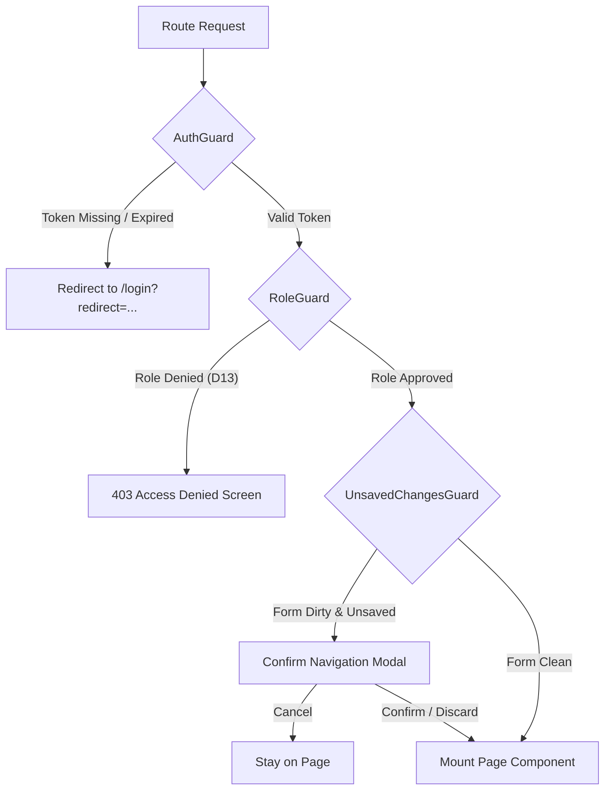

# D15 — Page Route Map & Navigation Architecture
## Bright Solutions: Clinical Hospital Operating System

> **Document ID:** D15  
> **Version:** 1.1 (Audit-Revised)  
> **Status:** APPROVED FRONTEND ARCHITECTURE SPECIFICATION  
> **Depends On:** [01_PRD.md](file:///c:/Study%20Material%20And%20Projects/Intership-Paperbird_tech/bright_solutions/docs/design/01_PRD.md), [02_feature_spec.md](file:///c:/Study%20Material%20And%20Projects/Intership-Paperbird_tech/bright_solutions/docs/design/02_feature_spec.md), [11_api_endpoint_inventory.md](file:///c:/Study%20Material%20And%20Projects/Intership-Paperbird_tech/bright_solutions/docs/design/11_api_endpoint_inventory.md), [13_rbac_permission_matrix.md](file:///c:/Study%20Material%20And%20Projects/Intership-Paperbird_tech/bright_solutions/docs/design/13_rbac_permission_matrix.md), [23_cycle_1_pitch.md](file:///c:/Study%20Material%20And%20Projects/Intership-Paperbird_tech/bright_solutions/docs/design/23_cycle_1_pitch.md)  
> **Prepared By:** Bright Solutions Frontend Engineering Team  
> **Last Updated:** October 2026  
> **Revision Notes:**  
> - v1.1: DEFECT-01 fixed — all permission codes now match exact D13 §3 Granular Permission Catalog strings  
> - v1.1: DEFECT-02 fixed — all API endpoint paths now include mandatory `/api/v1` prefix; paths verified against D11  
> - v1.1: DEFECT-04 fixed — pharmacy and lab active-work routes now specify patient-context banner requirement  
> - v1.1: DEFECT-08 fixed — Tab-level write RBAC sub-table added for `/ipd/admissions/:id/folio`

---

## Table of Contents

1. [Architectural Overview & Principles](#1-architectural-overview--principles)
2. [Layout Shell Architecture](#2-layout-shell-architecture)
   - 2.1 [ChamberLayout (Doctor Consultation)](#21-chamberlayout-doctor-consultation)
   - 2.2 [WardLayout (Inpatient Station & Beds)](#22-wardlayout-inpatient-station--beds)
   - 2.3 [CounterLayout (Reception & Billing)](#23-counterlayout-reception--billing)
   - 2.4 [TVDisplayLayout (Waiting Room Public Screens)](#24-tvdisplaylayout-waiting-room-public-screens)
   - 2.5 [AuthLayout & AdminLayout](#25-authlayout--adminlayout)
3. [Route Guard Pipeline](#3-route-guard-pipeline)
4. [Master Route Inventory](#4-master-route-inventory)
5. [Inpatient (IPD) 6-Day Book Digitized Route Hierarchy](#5-inpatient-ipd-6-day-book-digitized-route-hierarchy)
6. [Navigation State, Breadcrumbs & Deep-Linking](#6-navigation-state-breadcrumbs--deep-linking)
7. [Offline Edge Fallback Routing](#7-offline-edge-fallback-routing)

---

## 1. Architectural Overview & Principles

The Bright Solutions frontend navigation architecture is designed for high-throughput Indian hospital environments (OPD clinics, multi-bed inpatient wards, 24/7 billing counters, and unauthenticated waiting room displays). It adheres to four structural mandates:

1. **Role-Isolated Workspaces:** Rather than a generic administrative dashboard with uniform margins, screens mount within specialized layout shells tailored to clinical ergonomics (e.g. pinned patient vitals bar in consultation chambers, keyboard-first numeric keypad layouts at billing counters).
2. **Zero Information Leakage on Displays:** Public waiting room screens (`/display/*`) are 100% unauthenticated, read-only, chromeless Server-Sent Events (SSE) displays that never consume or render Protected Health Information (PHI) such as patient names, diagnoses, or phone numbers.
3. **Deterministic State Preservation:** Clinical routes (`/doctor/consultation/:id`, `/ipd/admissions/:id/folio/*`) enforce navigation locks (`UnsavedChangesGuard`) to guarantee uncommitted doctor SOAP notes or nurse MAR logs cannot be accidentally destroyed by browser back buttons or route transitions.
4. **Offline Edge Alignment:** All routes function identically in cloud deployment and local hospital LAN Docker containers (`docker-compose.edge.yml`), gracefully exposing local edge synchronization indicators without route breakage.

> **Permission Code Convention:** All permission codes listed in this document use the **exact strings** defined in [13_rbac_permission_matrix.md](file:///c:/Study%20Material%20And%20Projects/Intership-Paperbird_tech/bright_solutions/docs/design/13_rbac_permission_matrix.md) §3 Granular Permission Catalog. The frontend `hasPermission(code)` in `useAuthStore` must check for these exact strings against the JWT `permissions[]` array returned by `GET /api/v1/auth/me`.

> **API Path Convention:** All endpoint paths in this document include the mandatory `/api/v1` base prefix as defined in [11_api_endpoint_inventory.md](file:///c:/Study%20Material%20And%20Projects/Intership-Paperbird_tech/bright_solutions/docs/design/11_api_endpoint_inventory.md) §1 Global API Conventions.

---

## 2. Layout Shell Architecture

Every page route in Bright Solutions inherits from one of six layout shells:

```
+------------------------------------------------------------------------------------+
|                                    RootLayout                                      |
|  +------------------------------------------------------------------------------+  |
|  |                       Global Toast & Edge LAN Sync Beacon                    |  |
|  +------------------------------------------------------------------------------+  |
|         |                     |                     |                     |        |
|  +--------------+    +--------------+    +--------------+    +--------------+      |
|  | ChamberLayout|    |  WardLayout  |    |CounterLayout |    |TVDisplayLay. |      |
|  | (Doctor OPD) |    | (Nurse IPD)  |    | (Front-Desk) |    | (Chromeless) |      |
|  +--------------+    +--------------+    +--------------+    +--------------+      |
+------------------------------------------------------------------------------------+
```

### 2.1 ChamberLayout (Doctor Consultation)
- **Primary Use:** OPD Doctor Cabin Consultation, Telemetry Dossier Review.
- **Top Bar:** Fixed Hospital Identity, Cabin Number, Logged-in Doctor Name, Active Department, and Emergency Consultation Switcher.
- **Pinned Sub-Header:** Active Patient Encounter Strip containing Avatar Squircle, Patient Name, Master UHID, Token #, Vitals Badges (BP, HR, SpO2, Temp, BMI), Primary Allergy Alert Pill, and Print Rx / Sign-and-Lock action buttons.
- **Body:** Rigid 2-Column Clinical Split (`290px` Left Queue Drawer + `1fr` Tabbed Clinical Workspace with internal scroll containment).

### 2.2 WardLayout (Inpatient Station & Beds)
- **Primary Use:** Nurse Station, Bed Occupancy Matrix, Inpatient Clinical Folio (6-Day Book).
- **Top Bar:** Ward Selector (General Ward, Semi-Private, ICU, Post-Op Daycare), Active Shift Indicator (Morning, Evening, Night), Emergency Code-Blue Beacon.
- **Navigation Drawer:** Collapsible left navigation showing Bed Status (Occupied, Clean, Dirty, Reserved), Patient Roster, and Daily Medication Due Counters.
- **Body:** Full-height viewport containing either the Interactive Bed Grid or the 5-Tab Inpatient Clinical Folio.

### 2.3 CounterLayout (Reception & Billing)
- **Primary Use:** Front-Desk Patient Registration, OPD Token Check-in, Multi-Point Cashier POS, Pharmacy Dispensing Desk.
- **Top Bar:** Hospital Counter Identifier (e.g. Counter 03), Current Cashier Ledger Shift ID, Quick Cash Drawer Balance, Fast Token Call Shortcut.
- **Ergonomics:** Tabular data grids with high contrast, compact line-height (`density="compact"`), autofocus on search inputs, and hardware thermal printer trigger bindings (`Ctrl+P` / `F9`).
- **Patient Context Strip (Active-Work Variant):** Routes that require a pharmacist or lab technician to work against a specific patient's record (e.g. `/pharmacy/dispense/:rxId`, `/lab/entry/:orderId`) **must mount a read-only `ActivePatientBanner` sub-header** above the work surface within `CounterLayout`, mirroring the patient demographics strip in `ChamberLayout`. This is mandatory for clinical safety to confirm the correct patient before dispensing or reporting.

### 2.4 TVDisplayLayout (Waiting Room Public Screens)
- **Primary Use:** Large format waiting lounge LED TVs, hallway token annunciators.
- **Structure:** 100% Chromeless, black/navy high-visibility contrast (`#0f172a`), zero browser scrollbars (`overflow: hidden`).
- **Data Surface:** Doctor Cabin Name, Large Monospace Token Number (`#142`), Room Number, Audible Chime Trigger Hook, and scrolling clinic marquee footer. Zero patient names or clinical details.

### 2.5 AuthLayout & AdminLayout
- **AuthLayout:** Minimalist centered card container with hospital branding, facility selector, and secure login form.
- **AdminLayout:** Standard institutional drawer shell with audit log feeds, tariff master rate tables, user RBAC role assignment grids, and bed master management.

---

## 3. Route Guard Pipeline

Route transitions pass through a sequential pipeline of four client-side guards:



1. **`AuthGuard`:** Validates JWT access token existence in memory. If missing or expired, triggers silent refresh via `POST /api/v1/auth/refresh`. If refresh fails, redirects to `/login` preserving target query URI. Public routes (`/login`, `/display/*`, `/health`) bypass this guard.
2. **`RoleGuard`:** Compares current user's role against route's `allowedRoles` array based on [13_rbac_permission_matrix.md](file:///c:/Study%20Material%20And%20Projects/Intership-Paperbird_tech/bright_solutions/docs/design/13_rbac_permission_matrix.md). Unauthorized attempts render `<ForbiddenView code="403" />`.
3. **`UnsavedChangesGuard`:** Checks `useConsultationStore.isDirty` or `useInpatientStore.isDirty`. If active form contains uncommitted changes, blocks navigation and renders modal: *"You have unsaved clinical documentation. Discard changes or continue editing?"*.
4. **`EdgeFallbackGuard`:** In local LAN fallback mode (`OFFLINE-MODE`), disables routes requiring live cloud gateways (e.g. external ABDM gateway sync) and badges routes with offline warnings.

---

## 4. Master Route Inventory

> **Column Definitions:**
> - **Permissions (D13):** Exact permission codes from D13 §3 Granular Permission Catalog. These are the strings checked by `useAuthStore.hasPermission()`.
> - **Backend Endpoints (D11):** Full paths including `/api/v1` prefix, matching D11 exactly.

| Route Path | Page Component | Layout Shell | Allowed Roles (D13) | Permissions (D13) | Backend Endpoints (D11) | Description |
|:---|:---|:---|:---|:---|:---|:---|
| `/login` | `LoginPage` | `AuthLayout` | `PUBLIC` | None | `POST /api/v1/auth/login` | Staff authentication — plaintext credentials transmitted over HTTPS; Argon2id hashing performed server-side |
| `/unauthorized` | `ForbiddenPage` | `AuthLayout` | `PUBLIC` | None | None | 403 Access Denied notification screen |
| `/` | `RootRedirector` | None | Authenticated | None | `GET /api/v1/auth/me` | Redirects to default role dashboard upon login |
| **OUTPATIENT (OPD)** | | | | | | |
| `/reception/queue` | `ReceptionQueuePage` | `CounterLayout` | `RECEPTIONIST`, `HOSPITAL_ADMIN`, `SUPER_ADMIN` | `opd:read`, `opd:checkin` | `GET /api/v1/opd/visits`, `POST /api/v1/opd/visits` | Front desk OPD visit check-in & patient queue tracker |
| `/reception/register` | `PatientRegisterPage` | `CounterLayout` | `RECEPTIONIST`, `HOSPITAL_ADMIN`, `SUPER_ADMIN` | `patient:create` | `POST /api/v1/patients`, `GET /api/v1/patients` | Master patient index onboarding & UHID generation |
| `/reception/patients` | `PatientDirectoryPage` | `CounterLayout` | `RECEPTIONIST`, `BILLING_CLERK`, `HOSPITAL_ADMIN` | `patient:read` | `GET /api/v1/patients` | Hospital patient archive with filter by UHID/Phone |
| `/reception/patients/:patientId` | `PatientProfilePage` | `CounterLayout` | `RECEPTIONIST`, `BILLING_CLERK`, `HOSPITAL_ADMIN` | `patient:read`, `patient:update` | `GET /api/v1/patients/{patient_uuid}`, `PUT /api/v1/patients/{patient_uuid}` | Non-clinical demographic update & visit history |
| `/nurse/triage` | `NurseTriageQueuePage` | `CounterLayout` | `NURSE`, `HOSPITAL_ADMIN` | `triage:vitals_read`, `opd:read` | `GET /api/v1/opd/visits` | Queue of patients waiting for triage intake |
| `/nurse/triage/:visitId` | `NurseVitalsIntakePage` | `ChamberLayout` | `NURSE`, `HOSPITAL_ADMIN` | `triage:vitals_write` | `POST /api/v1/vitals`, `GET /api/v1/patients/{patient_uuid}` | Form for BP, HR, SpO2, Temp, RR, Height, Weight |
| `/doctor/queue` | `DoctorQueuePage` | `ChamberLayout` | `DOCTOR`, `HOSPITAL_ADMIN` | `opd:read`, `opd:call` | `GET /api/v1/queue/doctors/{doctor_uuid}/live` | Doctor's active chamber queue & calling dashboard |
| `/doctor/consultation/:visitId` | `DoctorConsultationPage` | `ChamberLayout` | `DOCTOR` | `consultation:write`, `consultation:sign`, `consultation:diagnose`, `cdss:evaluate`, `rx:write` | `GET /api/v1/consultations/visit/{visit_uuid}`, `POST /api/v1/consultations/{consultation_uuid}/sign`, `POST /api/v1/cdss/check-ddi` | SOAP notes, ICD-10 linking, e-Rx, lab orders |
| `/doctor/history/:patientId` | `DoctorPatientDossierPage` | `ChamberLayout` | `DOCTOR` | `consultation:read`, `lab:order_read` | `GET /api/v1/patients/{patient_uuid}`, `GET /api/v1/consultations/visit/{visit_uuid}` | Longitudinal outpatient history & prior prescriptions |
| **INPATIENT (IPD)** | | | | | | |
| `/ipd/beds` | `BedMatrixPage` | `WardLayout` | `NURSE`, `DOCTOR`, `RECEPTIONIST`, `HOSPITAL_ADMIN` | `ipd:read` | `GET /api/v1/beds/matrix` | Visual ward bed occupancy grid with color states |
| `/ipd/admissions` | `AdmissionRosterPage` | `WardLayout` | `NURSE`, `DOCTOR`, `RECEPTIONIST`, `HOSPITAL_ADMIN` | `ipd:read` | `GET /api/v1/ipd/admissions/active` | Active admitted patient census across all wards |
| `/ipd/admissions/new` | `AdmissionIntakePage` | `CounterLayout` | `RECEPTIONIST`, `HOSPITAL_ADMIN` | `ipd:admit` | `POST /api/v1/ipd/admissions`, `GET /api/v1/beds/matrix` | Inpatient admission booking & bed reservation (Forms 8 & 9) |
| `/ipd/admissions/:admissionId/folio` | `InpatientFolioPage` | `WardLayout` | `NURSE`, `DOCTOR`, `HOSPITAL_ADMIN` | `ipd:read` | `GET /api/v1/ipd/admissions/{admission_uuid}` | Primary container for Client 6-Day Book Digitization |
| `/ipd/admissions/:admissionId/discharge`| `DischargeSummaryPage`| `ChamberLayout` | `DOCTOR` | `ipd:discharge_summary_write`, `ipd:discharge` | `POST /api/v1/ipd/admissions/{admission_uuid}/discharge-summary` | Mandatory doctor discharge summary & clinical lock |
| **PHARMACY & LAB** | | | | | | |
| `/pharmacy/queue` | `PharmacistQueuePage` | `CounterLayout` | `PHARMACIST`, `HOSPITAL_ADMIN` | `pharmacy:queue_read` | `GET /api/v1/pharmacy/queue` | Pending e-prescription fulfillment queue |
| `/pharmacy/dispense/:rxId` | `DrugDispensationPage` | `CounterLayout` *(with Patient Context Banner — see §2.3)* | `PHARMACIST` | `pharmacy:dispense`, `rx:read` | `POST /api/v1/pharmacy/dispensations`, `GET /api/v1/prescriptions/{rx_uuid}` | Batch allocation, expiry check & counter bill. Must show patient name/UHID banner for clinical safety. |
| `/pharmacy/inventory` | `PharmacyInventoryPage` | `CounterLayout` | `PHARMACIST`, `HOSPITAL_ADMIN` | `pharmacy:inventory_read`, `pharmacy:inventory_write` | `GET /api/v1/pharmacy/items`, `POST /api/v1/pharmacy/items/batches` | Stock levels, reorder alerts & lot receiving |
| `/lab/orders` | `LabOrdersQueuePage` | `CounterLayout` | `LAB_TECHNICIAN`, `HOSPITAL_ADMIN` | `lab:order_read` | `GET /api/v1/lab/orders` | Worklist of ordered tests requiring collection |
| `/lab/specimens` | `SpecimenIntakePage` | `CounterLayout` | `LAB_TECHNICIAN` | `lab:sample_collect` | `POST /api/v1/lab/orders/{order_uuid}/collect-sample` | Specimen barcode acknowledgment & phlebotomy |
| `/lab/entry/:orderId` | `LabResultEntryPage` | `CounterLayout` *(with Patient Context Banner — see §2.3)* | `LAB_TECHNICIAN` | `lab:result_write` | `POST /api/v1/lab/orders/{order_uuid}/results`, `GET /api/v1/lab/orders/{order_uuid}` | Multi-parameter numeric result entry & panic flags. Must show patient name/UHID banner for clinical safety. |
| **BILLING & CASHIER** | | | | | | |
| `/billing/pos` | `BillingCounterPage` | `CounterLayout` | `BILLING_CLERK`, `HOSPITAL_ADMIN` | `billing:invoice_create`, `billing:payment_collect` | `POST /api/v1/invoices`, `POST /api/v1/invoices/{invoice_uuid}/payments` | Rapid OPD fee collection & 80mm thermal receipt |
| `/billing/invoices` | `InvoiceLedgerPage` | `CounterLayout` | `BILLING_CLERK`, `HOSPITAL_ADMIN` | `billing:invoice_read` | `GET /api/v1/invoices` | Master invoice ledger with filter by payment state |
| `/billing/ipd-settlement/:admissionId` | `IpdSettlementPage` | `CounterLayout` | `BILLING_CLERK`, `HOSPITAL_ADMIN` | `billing:invoice_create`, `billing:payment_collect`, `billing:discount_apply` | `GET /api/v1/billing/ipd/{admission_uuid}/accrued-charges`, `POST /api/v1/billing/ipd/{admission_uuid}/generate-final`, `POST /api/v1/invoices/{invoice_uuid}/payments` | 10-Head consolidated IPD bill & payment clearance |
| **HOSPITAL ADMIN** | | | | | | |
| `/admin/users` | `UserManagementPage` | `AdminLayout` | `HOSPITAL_ADMIN`, `SUPER_ADMIN` | `admin:user_manage` | `GET /api/v1/users`, `POST /api/v1/users` | Staff credentials, role assignment & status toggle |
| `/admin/tariffs` | `TariffMasterPage` | `AdminLayout` | `HOSPITAL_ADMIN`, `SUPER_ADMIN` | `billing:tariff_manage` | `GET /api/v1/tariffs`, `POST /api/v1/tariffs` | Standard service price schedules & bed tariffs |
| `/admin/beds` | `BedConfigPage` | `AdminLayout` | `HOSPITAL_ADMIN`, `SUPER_ADMIN` | `admin:config_manage` | `GET /api/v1/wards`, `PATCH /api/v1/beds/{bed_uuid}/status` | Ward creation, room config, and bed inventory |
| `/admin/audit-logs` | `SecurityAuditLogPage` | `AdminLayout` | `HOSPITAL_ADMIN`, `SUPER_ADMIN` | `admin:audit_read` | `GET /api/v1/audit/logs` | Immutable audit trail of sign-offs & DDI overrides |
| **WAITING ROOM DISPLAY** | | | | | | |
| `/display/waiting-room` | `WaitingRoomDisplayPage`| `TVDisplayLayout` | `PUBLIC` (No Auth) | None | `GET /api/v1/display/queue/stream` (SSE) | Fullscreen waiting lounge token announcer |
| `/display/ward-matrix` | `WardPublicBoardPage` | `TVDisplayLayout` | `PUBLIC` (No Auth) | None | `GET /api/v1/display/queue` | Bed matrix whiteboard for nursing station TV |

---

## 5. Inpatient (IPD) 6-Day Book Digitized Route Hierarchy

To faithfully represent the client's physical 6-day admission binder (`docs/client_docs/IPD Book 6 Days.pdf`), the `/ipd/admissions/:admissionId/folio` route is structured as an integrated clinical hub with synchronized tab navigation:

```
/ipd/admissions/:admissionId/folio
  ├── ?tab=consent          --> Form 8 & 9: Face Sheet, Medico-Legal Status (MLC) & Consents
  ├── ?tab=admission-note   --> Form 10: Doctor Comprehensive H&P Admission Note
  ├── ?tab=mar              --> Form 29: Inpatient Treatment Sheet & 6-Day Medication Grid
  ├── ?tab=fluid-chart      --> Form 61: Daily 24h Intake & Output Balance Ledger
  └── ?tab=nurse-notes      --> Form 72: Nurse 3-Shift Observations & Vitals Record
```

### Route & Form Parity Table

| Tab Parameter | Client PDF Document Form | Primary Clinical Actor | Key Interactions | Print Template Binding (D20) |
|:---|:---|:---|:---|:---|
| `?tab=consent` | **Forms 8 & 9:** Face Sheet & General / High-Risk Consent | Receptionist / Admitting Nurse | MLC checkbox, Next of Kin contact, Cash/TPA scheme, Signature capture | `TEMPLATE_IPD_FACE_SHEET` (A4 Portrait) |
| `?tab=admission-note` | **Form 10:** Doctor H&P Note | Attending Consultant | Chief complaints, Past medical history, Systemic review, Provisional ICD-10 | `TEMPLATE_IPD_ADMISSION_NOTE` (A4 Portrait) |
| `?tab=mar` | **Form 29:** Treatment Sheet & MAR | Staff Nurse & Doctor | 6-Day time-slot grid (06:00, 12:00, 18:00, 22:00), O2 flow rate, IV pump mL/hr | `TEMPLATE_IPD_MAR_SHEET` (A4 Landscape) |
| `?tab=fluid-chart` | **Form 61:** 24h Intake & Output Chart | Staff Nurse | Hourly oral/IV intake vs urine/drain output, auto-calculated Net Balance | `TEMPLATE_IPD_FLUID_BALANCE` (A4 Landscape) |
| `?tab=nurse-notes` | **Form 72:** Daily Vitals & Shift Notes | Staff Nurse | Morning, Evening, Night shift logs, NEWS2 score calculation, 0–10 Pain score | `TEMPLATE_IPD_NURSE_NOTES` (A4 Portrait) |

### 5.1 Tab-Level Write RBAC (Fix: DEFECT-08)

The parent route `/ipd/admissions/:admissionId/folio` is accessible to `NURSE`, `DOCTOR`, and `HOSPITAL_ADMIN` with `ipd:read`. However, **individual tab write operations** enforce additional fine-grained permissions at the API level. The frontend must disable save/submit actions and render `[Read Only]` indicators accordingly:

| Tab | Write Permission (D13) | Roles with Write | Read-Only Roles |
|:---|:---|:---|:---|
| `?tab=consent` | `ipd:admit` (initial) + `patient:update` (amendments) | `RECEPTIONIST`, `HOSPITAL_ADMIN` | `NURSE` (read only), `DOCTOR` (read only) |
| `?tab=admission-note` | `ipd:daily_notes_write` | `DOCTOR` only | `NURSE` (read only), `RECEPTIONIST` (hidden tab) |
| `?tab=mar` | `ipd:nurse_record_write` (administer dose) + `ipd:daily_notes_write` (new orders) | `NURSE` (administer), `DOCTOR` (prescribe orders) | `RECEPTIONIST` (hidden tab) |
| `?tab=fluid-chart` | `ipd:nurse_record_write` | `NURSE` only | `DOCTOR` (read only), `RECEPTIONIST` (hidden tab) |
| `?tab=nurse-notes` | `ipd:nurse_record_write` | `NURSE` only | `DOCTOR` (read only), `RECEPTIONIST` (hidden tab) |

> **Implementation Note:** Tab write access is enforced at two layers: (1) Frontend disables form inputs and hides save buttons via `hasPermission()` check; (2) Backend API calls (`POST /api/v1/ipd/admissions/{id}/assessment`, etc.) enforce server-side role guards independently.

---

## 6. Navigation State, Breadcrumbs & Deep-Linking

### 6.1 Clinical Breadcrumb Schema
Clinical routes dynamically generate breadcrumb trails to enable rapid parent navigation without losing context:
- Consultation: `OPD Queue (Cabin 01) > Consultation > Ananya Sharma (UHID-2026-00142)`
- Inpatient: `Ward Matrix > Ward 3 (Female Semi-Private) > Bed 302 > Clinical Folio (Day 3)`
- Invoicing: `Billing Counter > IPD Discharge Settlements > Rajan Pillai (INV-2026-00891)`

### 6.2 Deep-Link Query Parameters
- `?token=<num>`: Automatically highlights and focuses the requested token in queue lists.
- `?highlight=<id>`: Flashes target table row in blue accent for 1500ms after navigation.
- `?day=<1-6>`: Directly opens the target day column in Form 29 (MAR) or Form 61 (Intake/Output).
- `?filter=WAITING|IN_ROOM|COMPLETED`: Preserves active queue filter tab across page reloads.

---

## 7. Offline Edge Fallback Routing

When the hospital broadband fiber breaks and drops cloud connection, the local Edge Docker service activates. The frontend router responds through deterministic fallback mechanics:

1. **Beacon Pill:** Topbar displays persistent Amber badge: `[ LOCAL EDGE LAN ACTIVE • 4 Pending Cloud Syncs ]`.
2. **Blocked Cloud Routes:** External gateway routes (e.g. cloud ABDM health ID validation) redirect to `/offline-advisory` with a retry beacon.
3. **Preserved Core Flow:** OPD token issue, Doctor consultation, Nurse MAR execution, and Billing counter operations continue seamlessly, appending the `OFFLINE-` sequence prefix to generated IDs.
