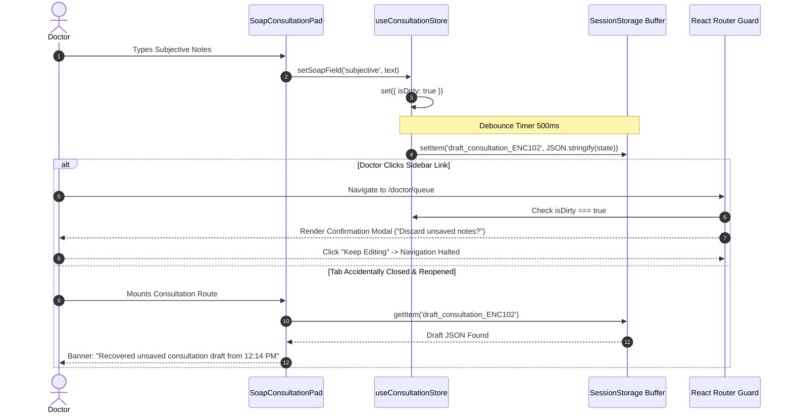

# D19 — State Management & Offline Data Synchronization Architecture
## Bright Solutions: Clinical Hospital Operating System

> **Document ID:** D19  
> **Version:** 1.0  
> **Status:** APPROVED FRONTEND ARCHITECTURE SPECIFICATION  
> **Depends On:** [01_PRD.md](file:///c:/Study%20Material%20And%20Projects/Intership-Paperbird_tech/bright_solutions/docs/design/01_PRD.md), [02_feature_spec.md](file:///c:/Study%20Material%20And%20Projects/Intership-Paperbird_tech/bright_solutions/docs/design/02_feature_spec.md), [04_data_model_spec.md](file:///c:/Study%20Material%20And%20Projects/Intership-Paperbird_tech/bright_solutions/docs/design/04_data_model_spec.md), [11_api_endpoint_inventory.md](file:///c:/Study%20Material%20And%20Projects/Intership-Paperbird_tech/bright_solutions/docs/design/11_api_endpoint_inventory.md), [15_page_route_map.md](file:///c:/Study%20Material%20And%20Projects/Intership-Paperbird_tech/bright_solutions/docs/design/15_page_route_map.md)  
> **Prepared By:** Bright Solutions Frontend Engineering Team  
> **Last Updated:** October 2026  

---

## Table of Contents

1. [State Architecture & Technology Stack](#1-state-architecture--technology-stack)
2. [Domain Store Slices (Zustand Architecture)](#2-domain-store-slices-zustand-architecture)
   - 2.1 [useAuthStore (Tenant, Credentials & RBAC)](#21-useauthstore-tenant-credentials--rbac)
   - 2.2 [useQueueStore (SSE Stream & Live Tokens)](#22-usequeuestore-sse-stream--live-tokens)
   - 2.3 [useConsultationStore (Active SOAP & e-Rx Draft)](#23-useconsultationstore-active-soap--e-rx-draft)
   - 2.4 [useInpatientStore (6-Day Book Folio & Bed Matrix)](#24-useinpatientstore-6-day-book-folio--bed-matrix)
   - 2.5 [useEdgeSyncStore (LAN Fallback & Offline Queue)](#25-useedgesyncstore-lan-fallback--offline-queue)
3. [Server-State Caching Strategy (TanStack Query)](#3-server-state-caching-strategy-tanstack-query)
4. [Clinical Autosave, Dirty State & Draft Recovery](#4-clinical-autosave-dirty-state--draft-recovery)
5. [Docker Edge Fallback & LAN Reconciliation Lifecycle](#5-docker-edge-fallback--lan-reconciliation-lifecycle)

---

## 1. State Architecture & Technology Stack

Bright Solutions bifurcates client-side data into two distinct layers:
1. **Asynchronous Server State (Managed via TanStack Query v5):** Patient demographics, formulary master catalogs, bed matrix occupancy, and billing invoices. Handled with optimistic mutations, query deduplication, and stale-while-revalidate invalidation.
2. **Synchronous Client Workspace State (Managed via Zustand v4):** Active user credentials, live unbuffered Server-Sent Events (SSE) queue streams, in-progress doctor consultation notes, 6-Day MAR execution popover state, and the local hospital Docker edge synchronization beacon.

```
+-----------------------------------------------------------------------------------------+
|                                    React UI Components                                  |
+-----------------------------------------------------------------------------------------+
       |                                          |                                |
       v                                          v                                v
+--------------------------+    +----------------------------------+    +------------------+
|    TanStack Query v5     |    |         Zustand v4 Stores        |    | Local Storage /  |
|  (Server State & Cache)  |    |     (Client Transient State)     |    |  SessionStorage  |
|--------------------------|    |----------------------------------|    |------------------|
| • queryClient            |    | • useAuthStore (JWT/Roles)       |    | • 500ms Autosave |
| • staleTime: 15s - 24h   |    | • useQueueStore (Live SSE Stream)|    | • Draft Backup   |
| • Optimistic Updates     |    | • useConsultationStore (Dirty)   |    | • Offline Queue  |
| • Automatic Background   |    | • useInpatientStore (6-Day Folio)|    |                  |
|   Refetch on Focus       |    | • useEdgeSyncStore (LAN Beacon)  |    |                  |
+--------------------------+    +----------------------------------+    +------------------+
       |                                          |                                |
       +------------------------------------------+--------------------------------+
                                                  |
                                                  v
                                     FastAPI Backend & SSE Bus
```

---

## 2. Domain Store Slices (Zustand Architecture)

### 2.1 useAuthStore (Tenant, Credentials & RBAC)
Maintains current session tokens, user identity, and granular permissions validated against [13_rbac_permission_matrix.md](file:///c:/Study%20Material%20And%20Projects/Intership-Paperbird_tech/bright_solutions/docs/design/13_rbac_permission_matrix.md):

```typescript
interface AuthState {
  accessToken: string | null;
  user: {
    id: string;
    username: string;
    fullName: string;
    role: 'SUPER_ADMIN' | 'HOSPITAL_ADMIN' | 'RECEPTIONIST' | 'NURSE' | 'DOCTOR' | 'PHARMACIST' | 'LAB_TECHNICIAN' | 'BILLING_CLERK';
    department?: string;
    doctorRegistrationNumber?: string;
  } | null;
  hospital: {
    id: string;
    name: string;
    abdmFacilityId: string;
    logoUrl: string;
  } | null;
  isAuthenticated: boolean;
  login: (credentials: { username: string; passwordHash: string }) => Promise<void>;
  logout: () => void;
  refreshToken: () => Promise<boolean>;
  hasPermission: (permissionCode: string) => boolean;
}
```

### 2.2 useQueueStore (SSE Stream & Live Tokens)
Manages the real-time event listener connected to `GET /api/v1/display/queue/stream`:

```typescript
interface QueueState {
  activeTokens: Array<{
    tokenNumber: number;
    patientId: string;
    patientName: string;
    cabinId: string;
    status: 'WAITING' | 'IN_CONSULTATION' | 'COMPLETED';
    waitTimeMinutes: number;
  }>;
  currentlyCalling: {
    tokenNumber: number;
    cabinName: string;
    doctorName: string;
  } | null;
  sseConnectionState: 'CONNECTED' | 'CONNECTING' | 'DISCONNECTED';
  initQueueStream: (cabinId?: string) => void;
  closeQueueStream: () => void;
  callNextToken: (cabinId: string) => Promise<void>;
}
```

### 2.3 useConsultationStore (Active SOAP & e-Rx Draft)
Maintains the doctor's active outpatient consultation workspace and tracks dirty states to prevent data loss:

```typescript
interface ConsultationState {
  activeEncounterId: string | null;
  activePatient: any | null;
  soapNote: {
    subjective: string;
    objective: string;
    duration: string;
    assessmentNarrative: string;
    plan: string;
  };
  icd10Diagnoses: Array<{
    code: string;
    title: string;
    isPrimary: boolean;
  }>;
  prescriptions: Array<{
    id: string;
    drugName: string;
    dose: string;
    route: string;
    frequency: string;
    durationDays: number;
    mealTiming: string;
    instructions: string;
  }>;
  labOrders: Array<{ testCode: string; testName: string; urgency: 'ROUTINE' | 'STAT' }>;
  activeDdiCollisions: Array<any>;
  isDirty: boolean;
  setSoapField: (field: string, value: string) => void;
  addIcd10: (icd: any) => void;
  removeIcd10: (code: string) => void;
  addPrescription: (rx: any) => void;
  removePrescription: (id: string) => void;
  clearConsultation: () => void;
  saveAutosaveDraft: () => void;
  restoreDraftFromStorage: (encounterId: string) => boolean;
}
```

### 2.4 useInpatientStore (6-Day Book Folio & Bed Matrix)
Powers the digitized Inpatient Binder (`IPD Book 6 Days.pdf`):

```typescript
interface InpatientState {
  selectedAdmissionId: string | null;
  activeFolioTab: 'consent' | 'admission-note' | 'mar' | 'fluid-chart' | 'nurse-notes';
  activeMarDayIndex: 1 | 2 | 3 | 4 | 5 | 6;
  activeFluidChartDayIndex: 1 | 2 | 3 | 4 | 5 | 6;
  
  // MAR Execution State
  pendingMarVerification: {
    orderId: string;
    drugName: string;
    dayIndex: number;
    slotTime: string;
  } | null;
  
  // Fluid Ledger State
  hourlyFluidEntries: Record<string, any>; // hour -> entry
  cumulativeNetBalanceMl: number;
  
  setFolioTab: (tab: any) => void;
  setMarDay: (day: 1 | 2 | 3 | 4 | 5 | 6) => void;
  openMarPopover: (orderId: string, drugName: string, day: number, slot: string) => void;
  closeMarPopover: () => void;
  recordMarDose: (status: 'GIVEN' | 'OMITTED', reason?: string) => Promise<void>;
  updateFluidEntry: (hour: string, field: string, amountMl: number) => void;
}
```

### 2.5 useEdgeSyncStore (LAN Fallback & Offline Queue)
Tracks hospital network reachability and buffers offline mutations when broadband cuts occur:

```typescript
interface EdgeSyncState {
  isOnline: boolean;
  isEdgeFallbackActive: boolean;
  lastSuccessfulPing: string;
  pendingOfflineMutationsCount: number;
  offlineMutationsQueue: Array<{
    id: string;
    endpoint: string;
    method: 'POST' | 'PUT';
    payload: any;
    queuedTimestamp: string;
  }>;
  checkHealthPing: () => Promise<void>;
  queueOfflineMutation: (endpoint: string, method: string, payload: any) => void;
  reconcileOfflineMutations: () => Promise<void>;
}
```

---

## 3. Server-State Caching Strategy (TanStack Query)

TanStack Query parameters are tuned for clinical safety: master catalogs are cached aggressively, while transactional beds and queues are invalidated immediately upon change.

| Query Key Pattern | Stale Time | Cache Time (gcTime) | Refetch Policy | Invalidation Trigger |
|:---|:---:|:---:|:---|:---|
| `['icd10', 'search', query]` | `Infinity` | `24 Hours` | Cache First | None (Static ICD-10 Master) |
| `['pharmacy', 'formulary']` | `1 Hour` | `12 Hours` | Background Revalidate | Admin Formulary Update (`PUT /pharmacy/items`) |
| `['ipd', 'beds', wardId]` | `15 Seconds`| `5 Minutes` | Window Focus | Bed Transfer, New Admission, Bed Cleaned |
| `['opd', 'queue', cabinId]`| `0 Seconds` | `1 Minute` | SSE Bus Driven | Token Called (`POST /opd/queue/token/call`) |
| `['patient', uhid]` | `5 Minutes` | `30 Minutes` | Stale-While-Revalidate| Patient Demographic Update (`PUT /patients/{id}`) |
| `['ipd', 'mar', admissionId]`| `10 Seconds`| `10 Minutes` | Window Focus | Nurse Dose Stamp (`POST /ipd/mar/execute`) |

---

## 4. Clinical Autosave, Dirty State & Draft Recovery

To prevent accidental destruction of lengthy clinical narratives due to accidental navigation, browser tab closure, or power blips:



---

## 5. Docker Edge Fallback & LAN Reconciliation Lifecycle

When broadband internet fails, Bright Solutions falls back to the local Docker Edge daemon (`docker-compose.edge.yml`) on the hospital LAN subnet (`192.168.1.X`):

1. **Beacon Detection:** Every 10 seconds, `useEdgeSyncStore` probes `GET /api/v1/health`. If 2 consecutive pings fail, `isOnline` drops to `false`, and network calls redirect to the local edge port (`http://localhost:8080/api/v1`).
2. **Offline Identifier Allocation:** Generated records receive the conflict-free sequence prefix: `OFFLINE-UHID-XXXX` and `OFFLINE-OPD-XXXX`.
3. **Local Mutation Queuing:** In the event the local edge is unreachable or read-only, mutating requests (e.g. nurse vital entry) append to IndexedDB under `offlineMutationsQueue`.
4. **Reconnection & Dual-Reconciliation:** Upon restoration of cloud connectivity:
   - Queued local mutations are flushed sequentially to `POST /api/v1/edge/sync/upstream`.
   - Temporary IDs (`OFFLINE-UHID-*`) are reconciled against permanent cloud sequences, and the local UI cache is refreshed without operator intervention.
