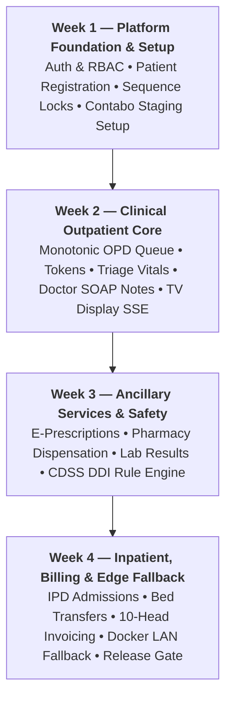

# D23 — Cycle 1 Pitch Document (4-Week MVP)
## Bright Solutions: Clinical Hospital Operating System

> **Document ID:** D23  
> **Version:** 1.0  
> **Status:** APPROVED ARCHITECTURE SPECIFICATION  
> **Build Cycle:** Cycle 1 (Weeks 1–4)  
> **Depends On:** [01_PRD.md](file:///home/prem/Desktop/pbt/COS/docs/design/01_PRD.md), [02_feature_spec.md](file:///home/prem/Desktop/pbt/COS/docs/design/02_feature_spec.md), [03_technical_architecture.md](file:///home/prem/Desktop/pbt/COS/docs/design/03_technical_architecture.md), [07_deployment_architecture.md](file:///home/prem/Desktop/pbt/COS/docs/design/07_deployment_architecture.md), [12_service_layer_design.md](file:///home/prem/Desktop/pbt/COS/docs/design/12_service_layer_design.md)  
> **Prepared By:** Bright Solutions Backend Engineering Team  
> **Last Updated:** October 2026  

---

## Table of Contents

1. [Problem Statement & Clinical Pain Points](#1-problem-statement--clinical-pain-points)
2. [Cycle Appetite & Team Allocation](#2-cycle-appetite--team-allocation)
3. [Fat-Marker Solution Shape (The 4-Week Scope)](#3-fat-marker-solution-shape-the-4-week-scope)
4. [Week-by-Week Milestone Roadmap](#4-week-by-week-milestone-roadmap)
5. [Developer Work Breakdown (Lead vs. Junior Devs)](#5-developer-work-breakdown-lead-vs-junior-devs)
6. [Known Rabbit Holes & Time-Boxes](#6-known-rabbit-holes--time-boxes)
7. [Explicit No-Goes for Cycle 1](#7-explicit-no-goes-for-cycle-1)
8. [Cycle 1 Compliance & Release Gate](#8-cycle-1-compliance--release-gate)

---

## 1. Problem Statement & Clinical Pain Points

Small-to-medium hospitals and polyclinics in India face severe operational and clinical friction:
- **Paper Slips & Fragmented Billing:** OPD consultation fees, pharmacy medications, and pathology tests are billed on disconnected paper pads or separate single-function software, resulting in unbilled services and revenue leakage.
- **Queue Chaos & Patient Anxiety:** Overcrowded waiting areas with shouting token numbers create patient frustration and front-desk conflict.
- **Medication Safety Blind Spots:** Doctors prescribing under extreme time constraints lack automated warnings for lethal Drug-Drug Interactions (DDIs) or critical physiological thresholds (e.g. Stage 2 hypertension, hypoxia).
- **Internet Vulnerability:** Pure cloud systems grind to a complete halt during frequent broadband fiber cuts or ISP disruptions.

---

## 2. Cycle Appetite & Team Allocation

- **Cycle Appetite:** **Fixed 4-Week Delivery Window (Weeks 1–4)**.
- **Engineering Headcount:**
  - **Backend Lead (You):** Core system architecture, financial calculation engines, sequence locks, CDSS rule evaluation, Docker edge sync agent, and staging deployment.
  - **Junior Backend Developer (1 Dev):** Standard CRUD services, Pydantic schemas, master catalog endpoints, and Pytest test cases.
  - **Frontend Lead (1 Dev):** Owns UI application architecture, design system, screens, and frontend design documents (D15–D20).
  - **Junior Frontend Developers (1–2 Devs):** Isolated UI components and form views.

---

## 3. Fat-Marker Solution Shape (The 4-Week Scope)

---

## 4. Week-by-Week Milestone Roadmap

### Week 1: Core Foundation & Platform Infrastructure
- **Objective:** Provision databases, setup Contabo LAMP staging server, and implement authentication and patient onboarding.
- **Key Deliverables:**
  - MySQL 8.0 schema executed on Contabo staging (`09_database_schema_ddl.sql`).
  - Auth module (`POST /api/v1/auth/login`, `/auth/refresh`, `/auth/me`) with Argon2id and stateful refresh tokens.
  - RBAC enforcement middleware (`PermissionChecker`).
  - Concurrency-safe `system_sequences` table with row locks.
  - Patient registration (`POST /api/v1/patients`) with auto-generated `UHID` (`BS-001001`) and salted Aadhaar de-duplication hash.

### Week 2: Outpatient (OPD) Queue & Clinical Encounters
- **Objective:** Enable front-desk check-in, nurse vitals intake, doctor chamber SOAP notes, and real-time waiting room TV updates.
- **Key Deliverables:**
  - Monotonic OPD number generation (`OPD-001001`) and daily doctor token allocation.
  - Nursing triage vitals intake with automatic BMI and abnormal range tagging.
  - Doctor consultation workflow: autosave draft SOAP notes, attach ICD-10 codes, and digital signing with immutable locking (`status = 'SIGNED'`).
  - Unbuffered Server-Sent Events (SSE) stream (`/api/v1/display/queue/stream`) for waiting room TV screens with zero PHI leakage.

### Week 3: Ancillary Clinical Services & Safety Engine
- **Objective:** Deliver e-prescribing with drug safety screening, pharmacy batch inventory fulfillment, and pathology results processing.
- **Key Deliverables:**
  - Deterministic CDSS engine: real-time bilateral DDI collision detection (`cdss_ddi_rules`) with mandatory written override justifications logged to `cdss_alerts_log`.
  - Pharmacy module: formulary lookup, stock batch receiving, pharmacist fulfillment queue, and FIFO inventory deduction.
  - Pathology module: test ordering, specimen collection acknowledgment, multi-parameter technician entry, and panic value escalation.

### Week 4: Inpatient Care, Multi-Point Billing & Edge Fallback
- **Objective:** Complete IPD stay lifecycle, consolidated 10-head invoicing, containerized local LAN fallback, and end-to-end UAT.
- **Key Deliverables:**
  - IPD admission, bed occupancy locking, inter-ward transfers with historical tariff splits, and mandatory signed discharge summary enforcement.
  - Unified multi-point billing engine: OPD consultation fee receipts, pharmacy dispensing bills, lab invoices, and the **10-head consolidated IPD discharge bill** (Bed rent, doctor visits, nursing, procedures, pharmacy, lab, OT, anaesthesia, oxygen, consumables).
  - Production `docker-compose.edge.yml` edge fallback bundle for local hospital LAN with conflict-free sequence partitioning (`OFFLINE-UHID-*`, `OFFLINE-OPD-*`).
  - Staging compliance gate and client demonstration sign-off.

---

## 5. Developer Work Breakdown (Lead vs. Junior Devs)

To maximize velocity without merge conflicts, work is partitioned by technical risk:

| Module / Component | Primary Owner | Reviewer / Collaborator | Key Responsibilities |
|:---|:---:|:---:|:---|
| **Database DDL & Alembic** | Backend Lead | Junior Backend Dev | Canonical schema, indexes, migrations |
| **Auth & Security Framework** | Backend Lead | Junior Backend Dev | JWT, refresh token rotation, RBAC guards |
| **System Sequences Engine** | Backend Lead | Junior Backend Dev | Concurrency-safe row-level locking |
| **Patient Registration (M1)** | Junior Backend Dev | Backend Lead | DTO validation, CRUD routes, MPI search |
| **OPD Queue Engine (M2)** | Backend Lead | Junior Backend Dev | Token rollover, doctor calling, SSE stream |
| **Vitals & Triage (M3)** | Junior Backend Dev | Backend Lead | BMI formula, range checks, intake form |
| **Doctor Consultation (M4)** | Backend Lead | Junior Backend Dev | Draft autosave, ICD-10 linking, sign-off lock |
| **Pharmacy & Batches (M5)** | Junior Backend Dev | Backend Lead | Batch entry, stock deduction, queue CRUD |
| **CDSS Safety Engine (M9)** | Backend Lead | Junior Backend Dev | DDI pair algorithm, override audit trail |
| **Pathology & Lab (M7)** | Junior Backend Dev | Backend Lead | Test catalog, parameter results, panic alerts |
| **IPD Stay & Beds (M6)** | Backend Lead | Junior Backend Dev | Bed allocations, ward transfer rate splits |
| **10-Head Billing Ledger (M8)** | Backend Lead | Junior Backend Dev | Consolidated invoice calculation, payments |
| **Admin & Doctor Sched (M11)**| Junior Backend Dev | Backend Lead | Tariff rates, doctor working hours |
| **Edge Docker LAN Fallback** | Backend Lead | DevOps / Frontend Lead | Docker Compose, sync agent, failover |
| **Pytest Automated Tests** | Junior Backend Dev | Backend Lead | Unit test cases, client endpoint assertions |

---

## 6. Known Rabbit Holes & Time-Boxes

The following high-risk items are explicitly time-boxed to prevent schedule slippage:

1. **Payment Gateway SDK Integration (Time-Boxed to 0 Hours):**
   - *Rabbit Hole:* Implementing Razorpay/Stripe webhooks, signature verification, and reconciliation edge cases can consume 1–2 full weeks.
   - *Boundary:* **Zero payment gateway SDK code in Cycle 1.** Multi-point billing supports manual recording of Cash, UPI UTR numbers, Card authorization codes, and Cheques only.
2. **Physical Lab Analyzer Hardware Drivers (Time-Boxed to 0 Hours):**
   - *Rabbit Hole:* Parsing proprietary RS-232 / ASTM / HL7 serial protocols for haematology analyzers requires physical laboratory machine access and custom driver development.
   - *Boundary:* **Technician manual parameter entry only.** Standard multi-parameter form with automated min/max/panic range validation.
3. **External LLM Prompt Engineering (Time-Boxed to 0 Hours):**
   - *Rabbit Hole:* Fine-tuning OpenAI/Claude prompts for medical advice introduces non-deterministic outputs, hallucination risks, and latency delays.
   - *Boundary:* **Deterministic relational SQL rules only** (`cdss_ddi_rules`, `cdss_vital_rules`). Sub-5ms execution, zero hallucination, and 100% auditability.
4. **Complex Supply Chain & Vendor PO Lifecycles (Time-Boxed to 0 Hours):**
   - *Rabbit Hole:* Vendor purchase orders, goods receipt notes (GRN), and multi-warehouse transfers.
   - *Boundary:* **Simple batch entry with FIFO deduction.** Pharmacist logs incoming lots (Batch#, expiry, quantity) and dispenses directly.

---

## 7. Explicit No-Goes for Cycle 1

The following features are **explicitly excluded** from Cycle 1:

- ❌ **Telemedicine & Video Consultation:** In-person outpatient and inpatient clinical workflows only.
- ❌ **Native Biometric Fingerprint Scanners:** Standard keyboard/mobile demographic entry only.
- ❌ **Patient-Facing Mobile App / Web Portal:** Staff-facing clinical and administrative applications only.
- ❌ **Multi-Hospital Tenant Switcher UI:** Schema is forward-compatible with `hospital_id`, but the user interface is scoped strictly to a single hospital facility in Cycle 1.
- ❌ **Direct WhatsApp / SMS Gateway Messaging:** Digital slips and reports are downloaded or printed directly from the workstation.

---

## 8. Cycle 1 Compliance & Release Gate

At the end of Week 4, the software must pass the following release gates before final deployment to the hospital:

1. **Safety Gate:** 100% of CDSS DDI rules verified against test drug pairs (Warfarin + Aspirin must reliably block without justification).
2. **Financial Gate:** IPD consolidated discharge invoices must balance to the exact rupee (`net_amount == subtotal - discount + tax == paid + balance`) across all 10 charge heads.
3. **Privacy Gate:** Zero patient names or diagnoses present in the waiting room display SSE stream.
4. **Reliability Gate:** Local edge Docker fallback successfully boots and accepts emergency check-ins while the Contabo connection is severed.
