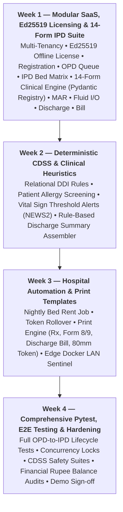

# D23 — Cycle 1 Pitch Document (4-Week MVP)
## Bright Solutions: Clinical Hospital Operating System

> **Document ID:** D23  
> **Version:** 1.0  
> **Status:** APPROVED ARCHITECTURE SPECIFICATION  
> **Build Cycle:** Cycle 1 (Weeks 1–4)  
> **Depends On:** [01_PRD.md](file:///home/prem/Desktop/pbt/COS/docs/design/01_PRD.md), [02_feature_spec.md](file:///home/prem/Desktop/pbt/COS/docs/design/02_feature_spec.md), [03_technical_architecture.md](file:///home/prem/Desktop/pbt/COS/docs/design/03_technical_architecture.md), [07_deployment_architecture.md](file:///home/prem/Desktop/pbt/COS/docs/design/07_deployment_architecture.md), [12_service_layer_design.md](file:///home/prem/Desktop/pbt/COS/docs/design/12_service_layer_design.md)  
> **Prepared By:** Bright Solutions Backend Engineering Team  
> **Last Updated:** October 2026  

---

## Table of Contents

1. [Problem Statement & Clinical Pain Points](#1-problem-statement--clinical-pain-points)
2. [Cycle Appetite & Team Allocation](#2-cycle-appetite--team-allocation)
3. [Fat-Marker Solution Shape (The 4-Week Scope)](#3-fat-marker-solution-shape-the-4-week-scope)
4. [Week-by-Week Milestone Roadmap](#4-week-by-week-milestone-roadmap)
5. [Developer Work Breakdown (Lead vs. Junior Devs)](#5-developer-work-breakdown-lead-vs-junior-devs)
6. [Known Rabbit Holes & Time-Boxes](#6-known-rabbit-holes--time-boxes)
7. [Explicit No-Goes for Cycle 1](#7-explicit-no-goes-for-cycle-1)
8. [Cycle 1 Compliance & Release Gate](#8-cycle-1-compliance--release-gate)

---

## 1. Problem Statement & Clinical Pain Points

Small-to-medium hospitals and polyclinics in India face severe operational and clinical friction:
- **Paper Slips & Fragmented Billing:** OPD consultation fees, pharmacy medications, and pathology tests are billed on disconnected paper pads or separate single-function software, resulting in unbilled services and revenue leakage.
- **Queue Chaos & Patient Anxiety:** Overcrowded waiting areas with shouting token numbers create patient frustration and front-desk conflict.
- **Medication Safety Blind Spots:** Doctors prescribing under extreme time constraints lack automated warnings for lethal Drug-Drug Interactions (DDIs) or critical physiological thresholds (e.g. Stage 2 hypertension, hypoxia).
- **Internet Vulnerability:** Pure cloud systems grind to a complete halt during frequent broadband fiber cuts or ISP disruptions.

---

## 2. Cycle Appetite & Team Allocation

- **Cycle Appetite:** **Fixed 4-Week Delivery Window (Weeks 1–4)**.
- **Engineering Headcount:**
  - **Backend Lead (You):** Core system architecture, financial calculation engines, sequence locks, CDSS rule evaluation, Docker edge sync agent, and staging deployment.
  - **Junior Backend Developer (1 Dev):** Standard CRUD services, Pydantic schemas, master catalog endpoints, and Pytest test cases.
  - **Frontend Lead (1 Dev):** Owns UI application architecture, design system, screens, and frontend design documents (D15–D20).
  - **Junior Frontend Developers (1–2 Devs):** Isolated UI components and form views.

---

## 3. Fat-Marker Solution Shape (The 4-Week Scope)

---

## 4. Week-by-Week Milestone Roadmap

### Week 1: Modular SaaS Core, On-Premise Licensing & Complete 14-Form Inpatient Flow
- **Objective:** Deliver the complete, functional clinical vertical slice from Outpatient arrival to Inpatient discharge within Week 1, fully aligned with the hospital's client dossier (`IPD Book 6 Days.pdf` - 86 pages) and powered by a modular SaaS multi-tenant engine with offline air-gapped protection.
- **Key Deliverables:**
  - **Modular SaaS & Security Framework:** MySQL 8.0 schema on Contabo LAMP and local Docker LAN, Argon2id auth, JWT refresh token rotation, RBAC guards, and monotonic concurrency locks (`UHID`, `OPD`, `IPD`, `BILL`).
  - **Asymmetric Ed25519 Cryptographic Licensing (ADR-010):** Offline license validation via embedded public key; anti-clock rollback detection (`last_known_monotonic_time`); 14-day healthcare safety grace period; and `@require_module("<MODULE>")` route decorators allowing autonomous module rental (`OPD`, `IPD`, `PHARMACY`, `PATHOLOGY`, `BILLING`) without code branching.
  - **OPD Flow:** Patient registration (`POST /api/v1/patients`), daily doctor queue token assignment (`OPD-001001`), nurse triage vitals, and doctor consultation chamber with prescription creation and "Admit to IPD" referral order.
  - **IPD Admission & Bed Assignment:** Support both Doctor OPD referral and Direct Emergency/Walk-in admission (vital for standalone IPD module rental!). Real-time bed matrix allocation, MLC tagging, Next-of-Kin/Guardian capture, advance deposit payment, and digital generation of **Admission Consent (Form 8)** and **Admission Face Sheet (Form 9)**.
  - **Full 14-Form Inpatient Clinical Suite (Pydantic Form Registry — ADR-009):**
    - **Relational Operational Flowsheets:**
      - **Daily Treatment Sheet Orders (AH/MRD/FORM - 29):** Doctor drug orders (dosage, route, frequency, start/stop times), O2 therapy parameters (device, flow rate L/min), and dietary rules.
      - **Medication Administration Record (MAR - Form 29):** Shift-wise nurse dose execution logging with omitted/refused justifications.
      - **24-Hour Fluid Intake & Output Chart (AH/MRD/FORM - 61):** Shift-wise recording of Oral/RT, IV fluids, Urine, Vomitus, Stool, Surgical Drain with signed net balance (`total_intake - total_output`).
      - **Daily Vitals & Pain Score:** Temperature, Pulse, Resp, BP, SpO2, and Wong-Baker 0–10 Pain Score.
    - **Dynamic Document Form Engine (`ipd_clinical_form_submissions`):**
      - **Form 8 & 9:** Admission Consent & Inpatient Demographics Face Sheet.
      - **Form 10:** Doctor H&P Admission Note (Chief Complaints, HPI, Past History, Systemic Review).
      - **Form 70:** Nursing Initial Admission Assessment (15-min triage, Morse fall risk, Braden scale).
      - **Form 71:** Nurse Care Plan & Daily Goals.
      - **Form 72:** Nurse Progress Notes & Shift Handover.
      - **Form 15 / 151:** Pre-Anaesthesia Assessment & Surgical Consent.
      - **Form 54:** Preoperative Nurse Checklist & Surgeon Pre-Op Note.
      - **Surgical Notes:** Operation Notes & Post-Op Recovery Note.
      - **Clinical Transitions:** Doctor Handover/Takeover Form & Department Transfer Form.
      - **Patient Feedback:** Inpatient Experience & Feedback Form (Bilingual English/Gujarati).
  - **Inpatient Discharge & Settlement:** Doctor signed discharge summary (`status = 'SIGNED'`), bed release, and consolidated 10-head final invoice generation with balance reconciliation.

### Week 2: Deterministic Clinical Decision Support (CDSS) & Heuristics Engine
- **Objective:** Layer deterministic, sub-5 millisecond clinical safety screening and heuristic automation over the working Week 1 flow (100% rule-based and auditable; strictly NO ambient audio, speech-to-text, or non-deterministic LLMs in this MVP).
- **Key Deliverables:**
  - **Deterministic CDSS Safety Engine (Module 9):** Real-time bilateral Drug-Drug Interaction (DDI) collision detection querying relational database rules (`cdss_ddi_rules`) with severity levels (`CONTRAINDICATED`, `MAJOR`, `MODERATE`). Mandatory written doctor override justifications logged immutably to `cdss_alerts_log`.
  - **Patient Allergy Cross-Screening:** Active ingredient cross-matching against patient known allergies (`allergies_json` on patient profile) when prescribing medications in OPD or IPD Treatment Sheets (Form 29).
  - **Heuristic Vital Signs & Early Warning Engine:** Automated heuristic alerting for critical physiologic thresholds (severe hypoxia SpO2 < 90%, hypertensive crisis BP > 180/120, pediatric tachycardia, high fever) based on standard clinical scorecards (NEWS2 / MEWS).
  - **Rule-Based Inpatient Discharge Summary Assembler:** Deterministic template assembler that programmatically extracts and formats the patient's multi-day stay records (synthesizing Admission H&P Form 10, Treatment MAR administration records Form 29, daily vital trends, and lab test results into structured discharge sections without hallucination or LLM dependency).
  - **Heuristic Queue Prioritization:** Automatic tagging of high-acuity/abnormal triage vitals to flag urgent patients for earlier consultation in the OPD queue.

### Week 3: Background Automation, Print Templates & Edge LAN Fallback
- **Objective:** Implement automated hospital operations, pixel-perfect physical print outputs, and local network failover.
- **Key Deliverables:**
  - **Automated Hospital Background Jobs:**
    - Nightly Bed-Rent Billing Job (midnight accrual of room tariffs per active bed allocation).
    - Midnight OPD Queue Rollover & No-Show Auto-Closure.
    - Automated Daily Database Backup & S3/Contabo Cold Storage Upload.
  - **Pixel-Perfect Print Templates (D20 Integration):**
    - OPD Prescription Slip (A4 doctor header, Rx grid, dosage schedule, follow-up).
    - OPD 80mm Thermal Queue Token Slip with QR code.
    - IPD Admission Face Sheet & Consent Form (Forms 8 & 9).
    - IPD Consolidated Discharge Bill (10 standard NABH charge heads).
    - Diagnostic Lab Report with reference ranges and abnormal flags.
  - **Local Edge Docker Fallback:** `docker-compose.edge.yml` configuration with SQLite/MySQL edge replica, conflict-free sequence partitioning (`OFFLINE-UHID-*`), and background reconciliation sentinel when WAN internet recovers.

### Week 4: Comprehensive Automated Testing, Hardening & Release Gate
- **Objective:** Exhaustive automated test coverage, load testing, security audits, and client acceptance sign-off.
- **Key Deliverables:**
  - **Pytest Suite:** 100% test coverage across critical clinical and financial paths:
    - End-to-end OPD-to-IPD patient journey lifecycle tests.
    - Concurrency tests: race condition validation on bed allocations and sequence counters under 50 simultaneous threads.
    - CDSS safety verification: 100% interception of lethal test drug pairs (Warfarin + Aspirin, Methotrexate + NSAIDs).
    - Financial balance audit: exact rupee matching (`subtotal - discount + tax == paid + balance`) across all invoices.
  - **Security & NABH Audit Trail:** Comprehensive access control validation (RBAC matrix) and immutable audit log verification.
  - **Client Demo Sign-Off:** Full-scale demonstration of the operational hospital flow with real seed data matching the client's oncology and general surgical departments.

---

## 5. Developer Work Breakdown (Lead vs. Junior Devs)

To maximize velocity without merge conflicts, work is partitioned by technical risk:

| Module / Component | Primary Owner | Reviewer / Collaborator | Key Responsibilities |
|:---|:---:|:---:|:---|
| **Database DDL & Schema Updates** | Backend Lead | Junior Backend Dev | Schema update for 56 tables, JSON generated columns, migration scripts |
| **Modular SaaS & Ed25519 Licensing (ADR-010)** | Backend Lead | Junior Backend Dev | Ed25519 public key validator, anti-clock rollback check, `@require_module` guards |
| **Auth & Security Framework** | Backend Lead | Junior Backend Dev | Argon2id, JWT rotation, RBAC permission guards, tenant context |
| **System Sequences Engine** | Backend Lead | Junior Backend Dev | Concurrency-safe monotonic numbering scoped by `(hospital_id, sequence_key)` |
| **Patient Registration & MPI (M1)** | Junior Backend Dev | Backend Lead | Patient CRUD, Aadhaar salted hash, emergency contacts |
| **OPD Queue & Token Engine (M2)** | Backend Lead | Junior Backend Dev | Daily token generation, doctor calling, SSE TV stream |
| **Vitals & Triage (M3)** | Junior Backend Dev | Backend Lead | Intake vitals, BMI formula, abnormal range flags |
| **Doctor Consultation (M4)** | Backend Lead | Junior Backend Dev | Draft SOAP autosave, ICD-10 linking, "Admit to IPD" referral |
| **IPD Admissions & Beds (M6)** | Backend Lead | Junior Backend Dev | Bed allocation, Form 8 & 9 consent, MLC flag, advance deposit |
| **14-Form Clinical Engine (ADR-009)** | Backend Lead | Junior Backend Dev | Universal `ipd_clinical_form_submissions` engine & Pydantic v2 registry |
| **IPD Treatment & MAR (Form 29)** | Junior Backend Dev | Backend Lead | Doctor medication orders, O2 therapy, nurse administration log |
| **IPD Intake & Output (Form 61)** | Junior Backend Dev | Backend Lead | Fluid intake (Oral/IV) & output (Urine/Drain) shift records |
| **IPD Discharge & 10-Head Bill** | Backend Lead | Junior Backend Dev | Discharge summary signing, bed release, consolidated ledger |
| **Deterministic CDSS Engine (M9)**| Backend Lead | Junior Backend Dev | Relational DDI table rules, allergy cross-check, override logging |
| **Vital Alerting & Heuristics** | Junior Backend Dev | Backend Lead | NEWS2 / MEWS thresholds, pediatric tachycardia, hypoxia flags |
| **Discharge Summary Assembler** | Junior Backend Dev | Backend Lead | Deterministic template assembler for Forms 10, 29, 61 records |
| **Background Automation Jobs** | Junior Backend Dev | Backend Lead | Nightly bed rent, token rollover, database backup scripts |
| **Print Template Engines (D20)** | Junior Backend Dev | Frontend Lead | `@media print` CSS, thermal 80mm & A4 layouts |
| **Edge Docker LAN Fallback** | Backend Lead | DevOps / Frontend Lead | Docker Compose bundle, offline sync sentinel |
| **Pytest Automated Test Suites** | Junior Backend Dev | Backend Lead | Integration tests, concurrency assertions, CDSS safety tests |

---

## 6. Known Rabbit Holes & Time-Boxes

The following high-risk items are explicitly time-boxed to prevent schedule slippage:

1. **Payment Gateway SDK Integration (Time-Boxed to 0 Hours):**
   - *Rabbit Hole:* Implementing Razorpay/Stripe webhooks, signature verification, and reconciliation edge cases can consume 1–2 full weeks.
   - *Boundary:* **Zero payment gateway SDK code in Cycle 1.** Multi-point billing supports manual recording of Cash, UPI UTR numbers, Card authorization codes, and Cheques only.
2. **Physical Lab Analyzer Hardware Drivers (Time-Boxed to 0 Hours):**
   - *Rabbit Hole:* Parsing proprietary RS-232 / ASTM / HL7 serial protocols for haematology analyzers requires physical laboratory machine access and custom driver development.
   - *Boundary:* **Technician manual parameter entry only.** Standard multi-parameter form with automated min/max/panic range validation.
3. **External LLM Prompt Engineering & Ambient AI (Time-Boxed to 0 Hours):**
   - *Rabbit Hole:* Fine-tuning OpenAI/Claude prompts or Whisper STT audio pipelines introduces latency delays, hallucination risks, dependency on cloud internet, and non-deterministic medical outputs.
   - *Boundary:* **Deterministic relational SQL rules and heuristic scoring only** (`cdss_ddi_rules`, `cdss_vital_rules`). Sub-5ms execution, zero hallucination, 100% auditable, and zero external API costs.
4. **Complex Supply Chain & Vendor PO Lifecycles (Time-Boxed to 0 Hours):**
   - *Rabbit Hole:* Vendor purchase orders, goods receipt notes (GRN), and multi-warehouse transfers.
   - *Boundary:* **Simple batch entry with FIFO deduction.** Pharmacist logs incoming lots (Batch#, expiry, quantity) and dispenses directly.

---

## 7. Explicit No-Goes for Cycle 1

The following features are **explicitly excluded** from Cycle 1:

- ❌ **Ambient AI Scribing & Audio Speech-to-Text:** No Whisper, audio streaming, microphone recording, or ambient room listening in this MVP.
- ❌ **Non-Deterministic Large Language Models (LLMs):** Zero OpenAI, Claude, or generative AI prompt calls. All clinical safety and summaries are 100% deterministic rules and code heuristics.
- ❌ **Telemedicine & Video Consultation:** In-person outpatient and inpatient clinical workflows only.
- ❌ **Native Biometric Fingerprint Scanners:** Standard keyboard/mobile demographic entry only.
- ❌ **Patient-Facing Mobile App / Web Portal:** Staff-facing clinical and administrative applications only.
- ❌ **Multi-Hospital Tenant Switcher UI:** Schema is forward-compatible with `hospital_id`, but the user interface is scoped strictly to a single hospital facility in Cycle 1.
- ❌ **Direct WhatsApp / SMS Gateway Messaging:** Digital slips and reports are downloaded or printed directly from the workstation.

---

## 8. Cycle 1 Compliance & Release Gate

At the end of Week 4, the software must pass the following release gates before final deployment to the hospital:

1. **Safety Gate:** 100% of CDSS DDI rules verified against test drug pairs (Warfarin + Aspirin must reliably block without justification).
2. **Financial Gate:** IPD consolidated discharge invoices must balance to the exact rupee (`net_amount == subtotal - discount + tax == paid + balance`) across all 10 charge heads.
3. **Privacy Gate:** Zero patient names or diagnoses present in the waiting room display SSE stream.
4. **Reliability Gate:** Local edge Docker fallback successfully boots and accepts emergency check-ins while the Contabo connection is severed.
