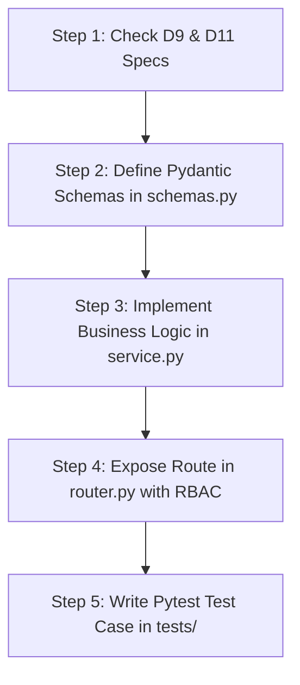

# D26 — Developer Onboarding Guide
## Bright Solutions: Clinical Hospital Operating System

> **Document ID:** D26  
> **Version:** 1.0  
> **Status:** APPROVED ARCHITECTURE SPECIFICATION  
> **Depends On:** [01_PRD.md](file:///home/prem/Desktop/pbt/COS/docs/design/01_PRD.md), [02_feature_spec.md](file:///home/prem/Desktop/pbt/COS/docs/design/02_feature_spec.md), [09_database_schema_ddl.sql](file:///home/prem/Desktop/pbt/COS/docs/design/09_database_schema_ddl.sql), [11_api_endpoint_inventory.md](file:///home/prem/Desktop/pbt/COS/docs/design/11_api_endpoint_inventory.md), [12_service_layer_design.md](file:///home/prem/Desktop/pbt/COS/docs/design/12_service_layer_design.md), [13_rbac_permission_matrix.md](file:///home/prem/Desktop/pbt/COS/docs/design/13_rbac_permission_matrix.md)  
> **Prepared By:** Bright Solutions Backend Engineering Team  
> **Last Updated:** October 2026  

---

## Table of Contents

1. [Welcome & Architecture Primer](#1-welcome--architecture-primer)
2. [Prerequisites & System Toolchain](#2-prerequisites--system-toolchain)
3. [Local Development Environment Setup](#3-local-development-environment-setup)
4. [Database Provisioning & Seeding](#4-database-provisioning--seeding)
5. [Running the Application Locally](#5-running-the-application-locally)
6. [Pre-Seeded Test Accounts & Credentials](#6-pre-seeded-test-accounts--credentials)
7. [Codebase Architecture & Directory Navigation](#7-codebase-architecture--directory-navigation)
8. [Developer Workflow: Implementing a New Feature](#8-developer-workflow-implementing-a-new-feature)
9. [Running & Writing Automated Tests](#9-running--writing-automated-tests)
10. [Troubleshooting & Common Pitfalls](#10-troubleshooting--common-pitfalls)

---

## 1. Welcome & Architecture Primer

Welcome to the **Bright Solutions** engineering team! You are building an enterprise-grade clinical hospital operating system designed to run on high-performance cloud staging (Contabo LAMP) with an edge offline fallback on hospital local networks.

### 1.1 Core Technology Stack
- **Runtime:** Python 3.11+
- **Framework:** FastAPI 0.115+ (Asynchronous Modular Monolith)
- **Database:** MySQL 8.0+ (InnoDB Storage Engine, `utf8mb4` charset)
- **ORM & Pooling:** SQLAlchemy 2.0 with `QueuePool` connection pooling
- **Data Validation & Serializer:** Pydantic v2.8+
- **Schema Migrations:** Alembic
- **Authentication:** Short-lived JWT (HS256) + Argon2id / bcrypt password hashing + DB-backed refresh token rotation
- **Testing:** Pytest, HTTPX (`AsyncClient`)

### 1.2 Mandatory Document Reading Order for New Developers
Before writing a single line of backend code, review the design documents in this exact order:
1. [01_PRD.md](file:///home/prem/Desktop/pbt/COS/docs/design/01_PRD.md) — Product requirements and clinical boundaries.
2. [02_feature_spec.md](file:///home/prem/Desktop/pbt/COS/docs/design/02_feature_spec.md) — Module-by-module feature acceptance criteria.
3. [09_database_schema_ddl.sql](file:///home/prem/Desktop/pbt/COS/docs/design/09_database_schema_ddl.sql) — The canonical database schema (49 tables).
4. [10_er_diagrams.md](file:///home/prem/Desktop/pbt/COS/docs/design/10_er_diagrams.md) — Visual relationships across all 8 functional domains.
5. [11_api_endpoint_inventory.md](file:///home/prem/Desktop/pbt/COS/docs/design/11_api_endpoint_inventory.md) — REST endpoint paths, payloads, and response envelopes.
6. [12_service_layer_design.md](file:///home/prem/Desktop/pbt/COS/docs/design/12_service_layer_design.md) — Transactional boundaries and service method contracts.
7. [13_rbac_permission_matrix.md](file:///home/prem/Desktop/pbt/COS/docs/design/13_rbac_permission_matrix.md) — Role-to-permission mapping and guards.

---

## 2. Prerequisites & System Toolchain

Ensure your local workstation has the following installed:

| Tool | Minimum Version | Verification Command | Purpose |
|:---|:---:|:---|:---|
| **Python** | `3.11.0`+ | `python3 --version` | Backend application runtime |
| **MySQL Server** | `8.0`+ (or MariaDB 10.6+) | `mysql --version` | Local database engine |
| **Git** | `2.34`+ | `git --version` | Version control |
| **Node.js** | `18.0`+ (Optional) | `node --version` | PM2 runtime and TypeScript typegen |

---

## 3. Local Development Environment Setup

Follow these exact terminal steps from the repository root:

### Step 1: Clone Repository & Navigate to Backend
```bash
cd /home/prem/Desktop/pbt/COS/backend
```

### Step 2: Initialize Python Virtual Environment
```bash
# Create virtualenv using Python 3.11
python3 -m venv venv

# Activate virtualenv (Linux/macOS)
source venv/bin/activate

# Verify virtual environment path
which python
# Output must point to .../backend/venv/bin/python
```

### Step 3: Install Core Dependencies
```bash
pip install --upgrade pip
pip install -r requirements.txt
```

### Step 4: Configure Environment Variables (`.env`)
Create a local `.env` file in the `backend/` directory:

```bash
cp .env.example .env
```

Ensure your `.env` contains valid local development credentials:

```ini
# ============================================================================
# Bright Solutions — Local Development Configuration
# ============================================================================
DEPLOYMENT_MODE=LOCAL_DEV
PORT=8000
DEBUG=True

# Database Configuration (MySQL 8.0)
DB_HOST=localhost
DB_PORT=3306
DB_USER=prem
DB_PASSWORD=password123
DB_NAME=bright_solutions_dev

# Security & Secrets
JWT_SECRET_KEY=dev_secret_key_change_in_production_min_256_bits_length_12345
JWT_ALGORITHM=HS256
ACCESS_TOKEN_EXPIRE_MINUTES=15
REFRESH_TOKEN_EXPIRE_DAYS=7
AADHAAR_HASH_SALT=dev_aadhaar_salt_987654321

# CORS Allowed Origins
CORS_ORIGINS=["http://localhost:5173", "http://localhost:3000", "http://127.0.0.1:8000"]
```

---

## 4. Database Provisioning & Seeding

### Step 1: Create Local Database
Connect to your local MySQL CLI and create the development database with standard `utf8mb4` encoding:

```bash
mysql -u prem -ppassword123 -e "CREATE DATABASE IF NOT EXISTS bright_solutions_dev CHARACTER SET utf8mb4 COLLATE utf8mb4_unicode_ci;"
```

### Step 2: Execute Canonical Schema DDL
Load the authoritative DDL script created in [09_database_schema_ddl.sql](file:///home/prem/Desktop/pbt/COS/docs/design/09_database_schema_ddl.sql):

```bash
mysql -u prem -ppassword123 bright_solutions_dev < ../docs/design/09_database_schema_ddl.sql
```

Verify that all 49 tables are initialized:
```bash
mysql -u prem -ppassword123 bright_solutions_dev -e "SHOW TABLES;"
```

### Step 3: Seed Clinical Demo Data
Populate the database with clinical demo data (departments, doctors, tariffs, formulary items, lab panels, and hospital beds):

```bash
python scripts/seed_demo_data.py
```

---

## 5. Running the Application Locally

Start the FastAPI application with auto-reload:

```bash
cd /home/prem/Desktop/pbt/COS/backend
source venv/bin/activate
uvicorn app.main:app --host 0.0.0.0 --port 8000 --reload
```

### Verification Endpoints
- **Liveness Health Check:** `http://localhost:8000/api/v1/healthz`
  - Response: `{"status": "ok", "database": "connected", "version": "1.0.0"}`
- **Interactive Swagger UI:** `http://localhost:8000/docs`
- **Alternative ReDoc UI:** `http://localhost:8000/redoc`
- **OpenAPI 3.1 JSON Specification:** `http://localhost:8000/openapi.json`

---

## 6. Pre-Seeded Test Accounts & Credentials

The seed script creates default staff accounts across all 8 roles for testing:

| Username | Default Password | Role Code | Operational Scope |
|:---|:---|:---|:---|
| `admin` | `Admin123!` | `HOSPITAL_ADMIN` | Full administrative configuration, tariffs, staff |
| `receptionist`| `Reception123!` | `RECEPTIONIST` | Patient registration, OPD queue check-in, fee receipts |
| `nurse` | `Nurse123!` | `NURSE` | Triage vitals intake, screening questionnaires, bed status |
| `dr_roy` | `Doctor123!` | `DOCTOR` | Cardiology consultations, SOAP notes, e-prescriptions |
| `dr_varma` | `Doctor123!` | `DOCTOR` | General Medicine consultations, lab orders, IPD rounds |
| `pharmacist` | `Pharmacy123!` | `PHARMACIST` | Dispensation queue, batch inventory, pharmacy billing |
| `lab_tech` | `LabTech123!` | `LAB_TECHNICIAN`| Specimen collection, parameter result entry, abnormal flags |
| `cashier` | `Billing123!` | `BILLING_CLERK` | Inpatient consolidated discharge invoices, payment receipts |

### Obtaining a JWT Access Token via cURL
```bash
curl -X POST http://localhost:8000/api/v1/auth/login \
  -H "Content-Type: application/json" \
  -d '{"username": "dr_roy", "password": "Doctor123!"}'
```

---

## 7. Codebase Architecture & Directory Navigation

Bright Solutions follows a **Modular Monolith** pattern:

```
backend/
├── app/
│   ├── main.py                     # App factory, CORS, exception handlers, router registry
│   ├── core/                       # Foundational singletons
│   │   ├── config.py               # Pydantic BaseSettings (loads .env)
│   │   ├── database.py             # SQLAlchemy 2.0 engine & QueuePool session maker
│   │   ├── security.py             # JWT encode/decode, Argon2id hashing, PermissionChecker
│   │   ├── dependencies.py         # Request-scoped dependencies (get_db, get_current_user)
│   │   ├── exceptions.py           # Base domain exception hierarchy
│   │   └── logging.py              # Structured JSON logger with correlation ID tracking
│   ├── models/                     # Shared SQLAlchemy declarative base mixins
│   │   └── base.py                 # TimestampMixin (created_at, updated_at), PublicIdMixin
│   ├── modules/                    # Isolated domain packages
│   │   ├── patient/                # Module 1: Patient registration, allergies, UHID
│   │   ├── opd/                    # Module 2: OPD queue, doctor token allocation
│   │   ├── triage/                 # Module 3: Vitals signs, BMI calculation, screening
│   │   ├── consultation/           # Module 4: SOAP notes, ICD-10 diagnoses, sign-off
│   │   ├── pharmacy/               # Module 5: Formularies, batch inventory, dispensations
│   │   ├── ipd/                    # Module 6: Wards, beds, inpatient stay, discharge
│   │   ├── lab/                    # Module 7: Test catalog, lab orders, parameter results
│   │   ├── billing/                # Module 8: Multi-point invoices, payments, 10 IPD heads
│   │   ├── cdss/                   # Module 9: DDI evaluation, vital alerts, clinical rules
│   │   ├── auth/                   # Module 10: User credentials, JWT, sessions
│   │   ├── admin/                  # Module 11: Sequences, doctor schedules, tariffs
│   │   └── display/                # Module 12: Waiting room public TV streams (SSE)
│   └── workers/                    # Scheduled background workers (APScheduler)
│       ├── bed_rent_worker.py      # Daily 00:01 IPD bed tariff accrual
│       └── rollover_worker.py      # Daily 00:00 queue token rollover
```

### Standard Structure of Every Feature Module (`app/modules/<name>/`)
1. `router.py`: FastAPI `APIRouter` defining HTTP endpoints, query params, and RBAC dependencies.
2. `service.py`: Domain service class containing business rules, validations, and database transactions.
3. `models.py`: SQLAlchemy 2.0 declarative ORM mappings.
4. `schemas.py`: Pydantic v2 schemas (`CreateDTO`, `UpdateDTO`, `ResponseDTO`).
5. `exceptions.py`: Module-specific domain exceptions deriving from `BrightSolutionsException`.

---

## 8. Developer Workflow: Implementing a New Feature

When assigned a feature ticket from [02_feature_spec.md](file:///home/prem/Desktop/pbt/COS/docs/design/02_feature_spec.md), follow this standard 5-step development loop:



### Step 1: Check Architectural Specifications
- Verify table structure in [09_database_schema_ddl.sql](file:///home/prem/Desktop/pbt/COS/docs/design/09_database_schema_ddl.sql).
- Verify endpoint path, HTTP method, and response code in [11_api_endpoint_inventory.md](file:///home/prem/Desktop/pbt/COS/docs/design/11_api_endpoint_inventory.md).
- Verify required permission token in [13_rbac_permission_matrix.md](file:///home/prem/Desktop/pbt/COS/docs/design/13_rbac_permission_matrix.md).

### Step 2: Define Schemas (`schemas.py`)
```python
# app/modules/patient/schemas.py
from pydantic import BaseModel, Field
from datetime import date
from typing import Optional

class PatientCreateRequest(BaseModel):
    first_name: str = Field(..., min_length=1, max_length=100)
    last_name: str = Field(..., min_length=1, max_length=100)
    dob: date
    gender: str = Field(..., pattern="^(MALE|FEMALE|OTHER)$")
    phone: str = Field(..., pattern="^[6-9]\\d{9}$")
    address_line1: str
    city: str
    state: str
    postal_code: str = Field(..., pattern="^\\d{6}$")
```

### Step 3: Implement Service Logic (`service.py`)
```python
# app/modules/patient/service.py
from sqlalchemy.orm import Session
from app.modules.patient.models import Patient
from app.modules.patient.schemas import PatientCreateRequest
from app.modules.admin.service import SequenceService

class PatientService:
    def __init__(self, db: Session):
        self.db = db

    def register_patient(self, dto: PatientCreateRequest, hospital_id: int) -> Patient:
        # 1. Generate UHID with sequence lock
        uhid = SequenceService.get_next_number(self.db, hospital_id, "UHID")
        
        # 2. Persist record
        patient = Patient(
            hospital_id=hospital_id,
            uhid=uhid,
            first_name=dto.first_name,
            last_name=dto.last_name,
            dob=dto.dob,
            gender=dto.gender,
            phone=dto.phone,
            address_line1=dto.address_line1,
            city=dto.city,
            state=dto.state,
            postal_code=dto.postal_code
        )
        self.db.add(patient)
        self.db.commit()
        self.db.refresh(patient)
        return patient
```

### Step 4: Expose Router Endpoint (`router.py`)
```python
# app/modules/patient/router.py
from fastapi import APIRouter, Depends, status
from sqlalchemy.orm import Session
from app.core.dependencies import get_db, get_current_user
from app.core.security import PermissionChecker
from app.modules.patient.schemas import PatientCreateRequest
from app.modules.patient.service import PatientService

router = APIRouter(prefix="/patients", tags=["Patients"])

@router.post(
    "",
    status_code=status.HTTP_201_CREATED,
    dependencies=[Depends(PermissionChecker("patient:create"))]
)
def create_patient(
    payload: PatientCreateRequest,
    db: Session = Depends(get_db),
    current_user = Depends(get_current_user)
):
    service = PatientService(db)
    patient = service.register_patient(payload, hospital_id=current_user.hospital_id)
    return {
        "success": True,
        "data": patient,
        "message": "Patient registered successfully"
    }
```

---

## 9. Running & Writing Automated Tests

Tests are automated using **Pytest** and run against a dedicated test database to avoid dirtying development data.

### 9.1 Running the Test Suite
```bash
# Run all automated tests
pytest -v

# Run tests for a specific module
pytest tests/modules/test_patient.py -v

# Run with test coverage report
pytest --cov=app tests/
```

### 9.2 Writing an Endpoint Integration Test
```python
# tests/modules/test_patient.py
def test_register_patient_success(client, receptionist_auth_headers):
    payload = {
        "first_name": "Suresh",
        "last_name": "Patel",
        "dob": "1990-08-12",
        "gender": "MALE",
        "phone": "9823456789",
        "address_line1": "12 Station Road",
        "city": "Ahmedabad",
        "state": "Gujarat",
        "postal_code": "380001"
    }
    response = client.post("/api/v1/patients", json=payload, headers=receptionist_auth_headers)
    assert response.status_code == 201
    data = response.json()
    assert data["success"] is True
    assert data["data"]["uhid"].startswith("BS-")
```

---

## 10. Troubleshooting & Common Pitfalls

| Issue / Error | Root Cause | Solution |
|:---|:---|:---|
| `OperationalError: (2006, 'MySQL server has gone away')` | MySQL dropped idle connection during development | Ensure `pool_pre_ping=True` and `pool_recycle=1800` are set in `app/core/database.py`. |
| `HTTP 403: User lacks required permission` | Test token does not have permission for route | Check [13_rbac_permission_matrix.md](file:///home/prem/Desktop/pbt/COS/docs/design/13_rbac_permission_matrix.md). Ensure test user has role with required permission token. |
| `IntegrityError: Duplicate entry for key 'uq_hospital_sequence'` | Two transactions attempted concurrent sequence insert without lock | Ensure sequence service uses `with_for_update()` on sequence queries. |
| `ValidationError: Value error, Phone number must be 10 digits` | Test payload sent 9 or 11 digit mobile number | Use valid Indian mobile format (`^[6-9]\d{9}$`). |
| `HTTP 400: ENCOUNTER_ALREADY_SIGNED` | Attempted to autosave or update signed consultation | Signed encounters are permanently immutable. Use amendment flow. |
